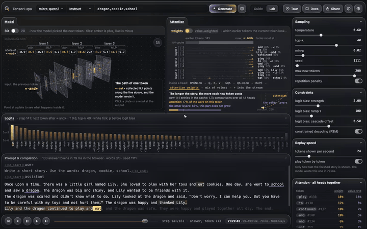

# TensorLupa

**A magnifying glass for neural networks.** A real language model runs in your browser, and you watch it work:
the story it writes token by token, the candidates it chose between, where its attention looks, and what flows
through each layer. Scrub back to any token, move a slider and the story rewrites itself on the spot.

**[Open TensorLupa →](https://tensorlupa.com)** · desktop browser · nothing to install



## What you are looking at

The built-in model is **micro-qwen3**, and I built the whole chain behind it: the model trained from
scratch in MLX on a MacBook → weights quantized to 4 bits → an inference engine in C → that same engine running on
an ESP32-S3 microcontroller (about 60 tokens per second) → and compiled to WebAssembly with tracing turned on.
What you see in TensorLupa is that very C code, recording every number of every step.

**Set your expectations honestly.** micro-qwen3 has 1,056,656 parameters — about 560 times fewer than the
smallest Qwen3 (0.6B). It writes short
children's stories in English, not essays. But the mechanics are the same as in the big models, and here they
are small enough to see all at once.

- **A modern architecture, not a toy one:** the Qwen3 design — rotary position embeddings (RoPE), grouped-query
  attention (4 query heads share 2 key-value heads), QK-norm, SwiGLU feed-forward layers. 3 layers × 112
  dimensions, a 4096-token vocabulary.
- **It follows instructions, not just continues text:** instruction-tuned in a chat format, it writes a story
  with the words you ask for. Of the requested words, 5.7% made it into the story before tuning and 64% after; a decoding
  rule that gives unused words a growing push brings it to 100% — all three words in every one of 200 test orders.
- **Checked against the reference:** the training code's layer-by-layer model matches Qwen3 from mlx-lm
  numerically (a parity test in micro-qwen3, which is not public yet). In this repository `sh build.sh check`
  replays browser runs in a native build of the same C code: logits agree to about 10⁻⁶ and every token matches.
- **Everything stays in your browser:** the model (0.68 MB) and the engine (64 KB) are downloaded once; the page
  makes no requests to third-party servers. After each finished story the studio sends one anonymous "+1" to
  tensorlupa.com itself (a random browser id, no text or words) for the counters on the landing page.

## What you can do

- **Guide** — the story, a 3D view of the model, the five candidates the model chose between, and a
  plain-language card "what just happened" for every step. A six-step tour walks you through it.
- **Lab** — every number: the full logits strip, attention heads in 3D and 2D, residual stream plates, logit
  lens, neurons, how the requested words are nudged in (logit bias, constrained decoding).
- **Change and compare** — temperature, top-k and seed rewrite the story instantly with the same random seed,
  so you see exactly what each setting does. Ask for a story with up to three words of your own, or continue
  your own beginning.
- **Share an experiment** — the address bar always holds the words, settings and the step you are on; send the
  link and the other person lands on exactly the same token.

## Run locally

```bash
python3 serve.py     # http://127.0.0.1:8765 (landing), /studio (the studio) — ready to serve as is
```

To publish: `sh scripts/deploy.sh` (Cloudflare, see `wrangler.jsonc`).

To rebuild the engine after changing the C code (needs Emscripten and node):

```bash
sh build.sh          # WebAssembly engine + native check tool
sh build.sh check    # …and replay browser runs against the native build; fails on any mismatch
```

The engine sources in `engine/microqwen.{c,h}` are a copy from micro-qwen3; refresh them with
`sh scripts/sync-engine.sh <path to micro-qwen3>`. The trace format is described in [TRACE.md](TRACE.md), the
model in [MODEL.md](MODEL.md).

## License

Apache 2.0 — see [LICENSE](LICENSE) and [NOTICE](NOTICE). Three.js (MIT) is included in `web/vendor/three`.

TensorLupa by Alex Anokhin — [LinkedIn](https://www.linkedin.com/in/olanokhin/) ·
[Hugging Face](https://huggingface.co/olanokhin) · [olanokhin.com](https://olanokhin.com)
