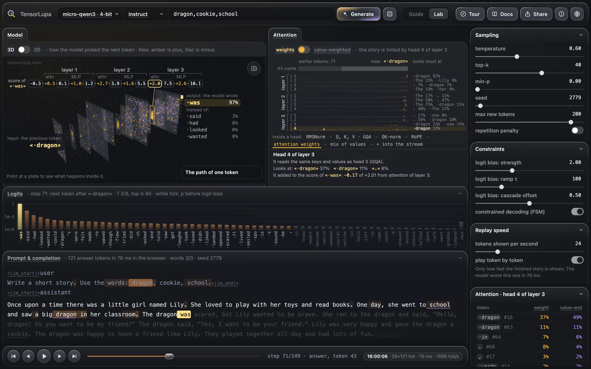

**In one sentence:** an attention head is one independent way of looking back. Each layer has four heads, and
each learns to notice different things.

## One head, one way of looking

[Attention](../attention/) explains the idea: the current [token](../token/) compares its query with the keys of
earlier tokens, turns the matches into weights that add up to 100%, and collects their values. A head is one
complete copy of that machinery with its own learned weights. In micro-qwen3 every head works with lists of 64
numbers for its queries, keys and values.

Because each head has its own weights, each one learns its own idea of what is worth looking at. A layer runs its
four heads side by side, and their results are added together into the
[residual stream](../residual-stream/). Three layers with four heads each give 12 heads in total.

## Heads specialise

Averaged over every step of the demo story, the 12 heads behave very differently. A few of them have a clear job:

| Head (as the studio numbers them) | What it does most | Average weight |
| --- | --- | --- |
| Layer 1, head 1 | looks at the current token itself | 33% on itself |
| Layer 2, head 3 | looks at the token just before | 34% on the previous token |
| Layer 2, head 4 | looks at the token just before | 32% on the previous token |
| Layer 3, head 4 | looks back at the requested words in the [prompt](../prompt/) | 19% on "dragon", "cookie" and "school" |

The last one is the most interesting. The other 11 heads give the three requested words 0% to 6% of their
attention on average; layer 3, head 4 gives them 19%, even though they sit dozens of tokens back. When the model
writes "was" after "The dragon", this head puts 37% of its weight on "dragon" in the request, 54 tokens earlier.

A previous-token head can also be very sure of itself: at the step "...play with her toys and", layer 2,
head 4 puts 85% of its weight on "toys", the token right before.

## Where it looks, and what it takes

A weight says where a head looks. It does not say how much the head actually takes from that token, because some
values are small and some are large. The studio shows both:

- **weights**: the attention weights of the head, as computed.
- **value-weighted**: each weight multiplied by the size of what that token would add to the stream through this
  head (the length of the value after the head's output projection, ‖W_o · value‖), then scaled again to 100%.

Usually the two agree. When they don't, it tells you something. Two real cases from the demo story:

| Step | Head | Token | Weight | Value-weighted |
| --- | --- | --- | --- | --- |
| writing "was" after "The dragon" | layer 3, head 4 | "dragon" in the request | 37% | 49% |
| writing "read" after "her toys and" | layer 3, head 4 | "school" in the request | 21% | 31% |
| same step | layer 3, head 4 | "and", the current token | 17% | 11% |
| later in the story | layer 3, head 4 | a full stop "." | 51% | 37% |

So the request words carry more than their weight suggests, and the full stop, a common place for a head to
"rest" its attention, carries less. Reading weights alone would understate how much the request steers this head.

## Grouped-query attention

In micro-qwen3 each layer has 4 query heads but only 2 sets of keys and values: every pair of heads shares one
key and one value. This is called grouped-query attention ([GQA](https://arxiv.org/abs/2305.13245)). The heads
still look in different directions, because each has its own query, but the model has to store only half as many
keys and values for the tokens it has already read: 256 numbers per token per layer instead of 512. In large
models with long texts this memory is a big share of the cost, which is why Qwen3 and many other models use it.

Two more details from the Qwen3 design shape every head. Positions come from RoPE
([rotary position embedding](https://arxiv.org/abs/2104.09864)): queries and keys are rotated by an angle that
depends on their position, so the match between two tokens depends on how far apart they are. And QK-norm
normalises queries and keys before they are compared, which keeps the scores in a sane range during training
([Qwen3 Technical Report](https://arxiv.org/abs/2505.09388)).

## Where it is in the studio

- In the **Attention** panel, click one map in the 3D stack (or one cell of the 2D grid in the Lab) to select a
  single head. The story is then highlighted by that head only. Click it again to go back to all heads.
- The switch at the top of the panel chooses between **weights** and **value-weighted**.
- In the Lab, the inspector shows a table for the selected head: the tokens it looks at most, with both numbers
  side by side.

## Try it

<a class="try-link" href="/studio?w=dragon,cookie,school&seed=2779&s=70&mode=lab" target="_blank" rel="noopener">Open this step in the Lab</a>

Select layer 3, head 4 and compare its two columns in the inspector. Then step to the previous token and select
layer 2, head 3 to watch a previous-token head at work.

## In micro-qwen3

- 3 layers × 4 heads = 12 heads, each working with 64 numbers.
- 4 query heads share 2 key-value heads per layer (grouped-query attention).
- RoPE for positions and QK-norm, as in Qwen3.
- At most 256 tokens of context, so a head can look back at most 255 tokens.

## A bit of history

Multi-head attention comes from the 2017 paper
[Attention Is All You Need](https://arxiv.org/abs/1706.03762): instead of one attention per layer, the transformer
runs several smaller ones side by side, so that each can learn a different relation between words. Grouped-query
attention was proposed in 2023 by Joshua Ainslie and colleagues as a middle ground between giving every head its
own keys and values and sharing one set across all heads.

## Related

- [Attention](../attention/): the idea behind every head.
- [Residual stream](../residual-stream/): where the heads write their results.
- [Logit lens](../logit-lens/): reading what the stream says after each layer.

## References

- Ashish Vaswani et al. (2017). [Attention Is All You Need](https://arxiv.org/abs/1706.03762).
- Joshua Ainslie et al. (2023). [GQA: Training Generalized Multi-Query Transformer Models from Multi-Head Checkpoints](https://arxiv.org/abs/2305.13245).
- Jianlin Su et al. (2021). [RoFormer: Enhanced Transformer with Rotary Position Embedding](https://arxiv.org/abs/2104.09864).
- An Yang et al. (2025). [Qwen3 Technical Report](https://arxiv.org/abs/2505.09388).
