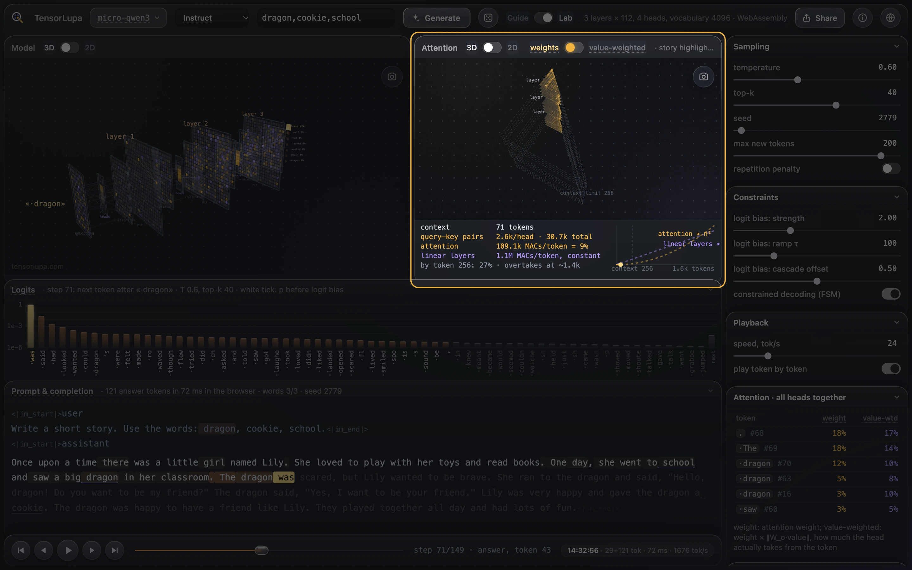

**In one sentence:** attention lets each token look back at earlier tokens and take what it needs from them to
predict the next one.

## How it works

Inside the [transformer](../transformer/), every [token](../token/) has its own list of numbers, the
[residual stream](../residual-stream/). On its own, that list knows only about its token. Attention is the step
where tokens share information.

At each layer, every token makes three things from its numbers:

- a **query**: what am I looking for?
- a **key**: what do I offer to others?
- a **value**: what will I pass on if someone looks at me?

The current token compares its query with the key of every earlier token. Good matches get a high score, and the
scores are turned into weights that add up to 100%. Then the token collects the values of the earlier tokens,
mixed in those proportions, and adds the result to its own numbers.

Two rules keep this simple:

- **Only earlier tokens.** A token can look back at the [prompt](../prompt/) and at what has been written so far,
  never ahead. That is what makes writing one token at a time possible.
- **Several heads.** Each layer runs a few attentions side by side, called [heads](../attention-head/). Each head
  learns its own idea of what is worth looking at: one follows names, another the last full stop.

## A real step

The demo story so far: *"...she went to school and saw a big dragon in her classroom. The dragon"*. The model is
about to write "was". This is where its attention went, averaged over all heads of all three layers:

| Earlier token | Weight |
| --- | --- |
| "." (end of the previous sentence) | 18% |
| "The" | 18% |
| "dragon" (the current token itself) | 12% |
| "dragon" (in "a big dragon") | 5% |
| "dragon" (in the request: "Use the words: dragon") | 3% |

On average, attention stays close: the current sentence and the word just before. But one head in the third layer
behaves very differently. It puts 37% of its attention on the word "dragon" in the request, 54 tokens back in
the prompt, and another 11% on "a big dragon". Its job looks like keeping track of what the story is about.

The same thing happens with names. When the story mentions "Lily" for the second time, a head in the first layer
spends 14% of its attention on the first "Lily", dozens of tokens earlier.

## Weights and contribution

A high weight means a token was looked at, not that much was taken from it. The studio has two views:
**weights** shows where a head looks, and **value-weighted** shows how much each token actually contributes,
because some values are tiny. See [attention head](../attention-head/) for the details.

## Why longer texts cost more

Every new token compares itself with all earlier tokens. The 10th token makes 10 comparisons per head, the
200th makes 200. So the work of attention grows with the length of the text, while the other parts of the layer
(the [MLP](../mlp/) and the projections) cost the same for every token.

The studio shows this in a small chart next to the attention view. In micro-qwen3 the layers outside attention
do about 1.1 million multiply-adds per token. Attention is a small share at the start of a story; by token 256,
the longest text the model can read, it is about 27% of the work, and it would overtake the rest at about 1,400
tokens. In large models with long contexts, attention is where most of the cost goes.

## Where it is in the studio

The **Attention** panel shows the maps of all heads as a 3D stack, or as a 2D grid. The story below is
highlighted by where attention went at the current step. Click a map to see one head instead of all of them, and
switch between **weights** and **value-weighted** at the top of the panel.

## Try it

<a class="try-link" href="/studio?w=dragon,cookie,school&seed=2779&s=70" target="_blank" rel="noopener">Open this step in the studio</a>

Click the maps one by one to find the head that looks back at "dragon" in the request. Then step forward and
watch the highlight move.

## In micro-qwen3

- 3 layers with 4 attention heads each, every head working with 64 numbers.
- [Grouped-query attention](https://arxiv.org/abs/2305.13245): the 4 heads share 2 sets of keys and values, which halves the memory needed for them.
- [RoPE](https://arxiv.org/abs/2104.09864): positions are encoded by rotating the queries and keys, so attention knows how far back a token is.
- QK-norm: queries and keys are normalized before they are compared, which keeps training stable.
- The model reads at most 256 tokens; the prompt and the story together have to fit.

All of this is the same design as in [Qwen3](https://arxiv.org/abs/2505.09388), at a much smaller size.

## A bit of history

Attention was introduced in 2014 by [Dzmitry Bahdanau, Kyunghyun Cho and Yoshua Bengio](https://arxiv.org/abs/1409.0473) for machine translation:
a model translating a sentence learned to look back at the right words of the original. In 2017 the paper
["Attention Is All You Need"](https://arxiv.org/abs/1706.03762) built a whole model from attention alone, the transformer, and almost every large
language model since then is built on it.

## Next

[MLP](../mlp/): the second half of every layer, where the neurons are.

## References

- Dzmitry Bahdanau, Kyunghyun Cho, Yoshua Bengio (2014). [Neural Machine Translation by Jointly Learning to Align and Translate](https://arxiv.org/abs/1409.0473). arXiv.
- Ashish Vaswani et al. (2017). [Attention Is All You Need](https://arxiv.org/abs/1706.03762). arXiv.
- Joshua Ainslie et al. (2023). [GQA: Training Generalized Multi-Query Transformer Models from Multi-Head Checkpoints](https://arxiv.org/abs/2305.13245). arXiv.
- Jianlin Su et al. (2021). [RoFormer: Enhanced Transformer with Rotary Position Embedding](https://arxiv.org/abs/2104.09864). arXiv.
- An Yang et al. (2025). [Qwen3 Technical Report](https://arxiv.org/abs/2505.09388). arXiv.
