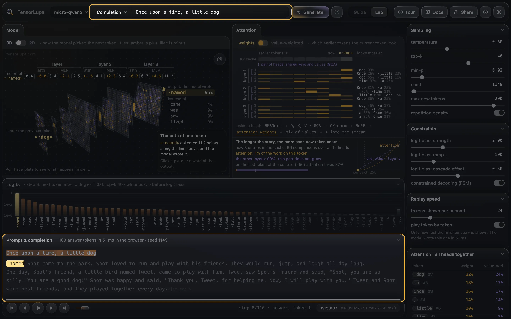

**In one sentence:** in completion mode the model simply continues the text you give it, with no request and no
chat markers.

## The mode every model starts with

A [language model](../language-model/) is first trained on a large pile of plain text with one task: predict the
next [token](../token/). The result is a **base model**. It does not know what a question or a request is. It
only knows how texts usually go on.

Give it the beginning of a story and it writes the rest:

> *Once upon a time, a little dog* named Spot came to the park. Spot loved to run and play with his friends. They
> would run, jump, and laugh all day long. One day, Spot's friend, a little bird named Tweet, came to play with
> him...

## Base models on Hugging Face

On Hugging Face most model families come in two versions, and the names tell them apart:

| Name | What it is | What it does |
| --- | --- | --- |
| [`Qwen/Qwen3-0.6B-Base`](https://huggingface.co/Qwen/Qwen3-0.6B-Base) | base model | continues text |
| [`Qwen/Qwen3-0.6B`](https://huggingface.co/Qwen/Qwen3-0.6B) | instruction-tuned model | answers requests in a chat |

The base model is the raw result of pre-training. The [instruct](../instruct/) model is the same network trained
a little more to follow requests. People download base models to fine-tune them for their own task, and instruct
models to talk to them.

## How micro-qwen3 was trained to continue text

micro-qwen3 was trained from scratch on **[TinyStories](https://huggingface.co/datasets/roneneldan/TinyStories)**, a dataset of short stories written in simple English for
young children. It was made by Ronen Eldan and Yuanzhi Li to study how small a language model can be and still
write coherent English ([the paper](https://arxiv.org/abs/2305.07759)). We used version 2 of the stories, written
by GPT-4, from [roneneldan/TinyStories](https://huggingface.co/datasets/roneneldan/TinyStories) (license
CDLA-Sharing-1.0).

That is why the model writes children's stories and nothing else: it has never seen any other kind of text.

## Where it is in the studio

Switch the mode at the top from **Instruct** to **Completion**. The words field turns into a text field: type the
beginning of a story and press Generate. The studio sends your text as it is, without chat markers.

The model in the studio is the instruction-tuned one; in completion mode it still continues text well, because
continuing stories is what it learned first.

## Try it

<a class="try-link" href="/studio?p=Once%20upon%20a%20time%2C%20a%20little%20dog&seed=1149&s=7&q=8" target="_blank" rel="noopener">Open this story in the studio</a>

Then change the beginning: start in the middle of a sentence, or with a question, and see how the model goes on.

## A bit of history

For years every language model was a base model: it continued text and nothing else. In 2020 [GPT-3](https://arxiv.org/abs/2005.14165) showed that a large enough base model can still do tasks if the prompt starts with a few solved examples, which is called few-shot prompting. Instruction tuning came later to make that unnecessary.

## Next

[Instruct](../instruct/): how a model learns to follow a request instead of just continuing text.

## References

- Ronen Eldan, Yuanzhi Li (2023). [TinyStories: How Small Can Language Models Be and Still Speak Coherent English?](https://arxiv.org/abs/2305.07759). arXiv.
- [TinyStories dataset](https://huggingface.co/datasets/roneneldan/TinyStories) (CDLA-Sharing-1.0). Hugging Face.
- [Qwen3-0.6B-Base](https://huggingface.co/Qwen/Qwen3-0.6B-Base). Hugging Face.
- [Qwen3-0.6B](https://huggingface.co/Qwen/Qwen3-0.6B). Hugging Face.
- Tom B. Brown et al. (2020). [Language Models are Few-Shot Learners](https://arxiv.org/abs/2005.14165). arXiv.
