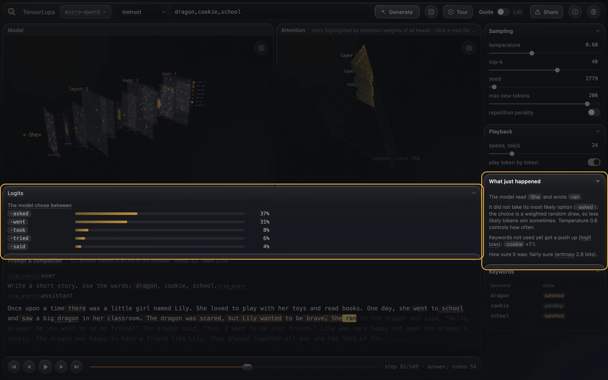

**In one sentence:** entropy says how spread out the choice is, in bits: 0 means the model is completely sure,
higher means more options compete.

## What the number means

At every step the model gives chances to its candidates for the next [token](../token/). Entropy turns that whole
list of chances into one number:

- **0 bits:** one candidate has all the chance. There is nothing to decide.
- **1 bit:** about as uncertain as a fair coin between two options.
- **2 bits:** about as uncertain as four equal options.
- **Each extra bit** doubles the number of equally likely options.

It does not say which token wins, only how much the model hesitates. A step with high entropy is where the
[random draw](../sampling/) really matters and where two runs with different [seeds](../seed/) are most likely
to go different ways.

## Which chances the studio measures

The studio computes entropy over the same chances the draw uses: the final [logits](../logits/) after
[logit bias](../logit-bias/) and [constrained decoding](../fsm/), divided by the [temperature](../temperature/)
and cut by [top-k](../top-k/) and [min-p](../min-p/). So when you move the temperature slider, the entropy moves too.
With top-k 40 the largest possible value is about 5.3 bits (40 equal candidates).

## A real story, step by step

These numbers come from the demo story (words dragon, cookie, school, seed 1111, temperature 0.6, top-k 40,
min-p 0.02), 133 tokens of answer:

| | Value |
| --- | --- |
| average over the story | 0.83 bits |
| steps under 1 bit (the studio says "very sure") | 83 of 133 |
| steps from 1 to 3 bits ("fairly sure") | 48 of 133 |
| steps of 3 bits or more ("unsure") | 2 |
| steps with almost exactly 0 bits | 48 |

The least certain step comes after *"…The dragon was scared and didn't know what to do. Lily"*:

| Candidate | Chance |
| --- | --- |
| tried | 24.6% |
| 's | 12.6% |
| thought | 10.5% |
| wanted | 10.4% |

Entropy here is 3.42 bits, and the draw picked "looked", a candidate far down the list. The most certain steps
are the fixed phrases: after *"Once upon a"* the model gives "time" 100%, 0 bits.

Most of a story is the model being very sure, with a few real choices in between. Those few steps decide which
story you get.

## Where it is in the studio

- In **Guide**, the card "What just happened" ends with "How sure it was": very sure under 1 bit, fairly sure
  from 1 to 3 bits, unsure above that, with the exact number in brackets.
- In **Lab**, the step inspector shows the entropy in bits.
- The attention card uses the same idea for [attention](../attention/): "attention spread" tells how many earlier
  tokens a head looks at. 0 bits means one single token; the maximum grows with the length of the text.

## Try it

<a class="try-link" href="/studio?w=dragon,cookie,school&seed=1111&s=93&q=8" target="_blank" rel="noopener">Open the least certain step</a>

Then step back and forth with the arrow keys and watch "How sure it was" change. Move the temperature slider on a
hesitant step to see the entropy rise and fall.

## In micro-qwen3

- The same model scores are much flatter before temperature and top-k: over all 4,096 tokens at temperature 1, the
  average entropy of this story is 2.31 bits instead of 0.83. Temperature 0.6, top-k 40 and min-p 0.02 cut away
  most of the long tail.
- The largest possible entropy over the whole vocabulary is 12 bits (4,096 equal tokens). A trained model is never
  close to that.

## A bit of history

Entropy as a measure of information comes from Claude Shannon's
[A Mathematical Theory of Communication](https://ieeexplore.ieee.org/document/6773024) (1948). In the same paper
he generated English-like text from letter and word statistics, the earliest ancestor of a
[language model](../language-model/). Measuring uncertainty in bits is his idea too.

## Related

- [Temperature](../temperature/) lowers or raises the entropy of every step.
- [Sampling](../sampling/) is where the uncertainty turns into one chosen token.
- [Logits](../logits/) are the raw scores the chances are made from.

## References

- Claude E. Shannon (1948). [A Mathematical Theory of Communication](https://ieeexplore.ieee.org/document/6773024). Bell System Technical Journal.
