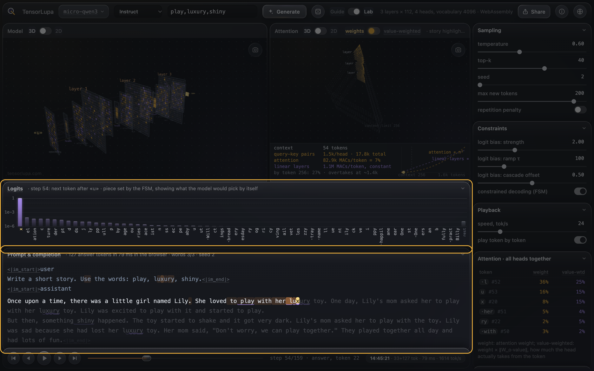

**In one sentence:** constrained decoding means that once a keyword is started, a small finite-state machine (FSM)
makes the model finish spelling it.

## The problem it solves

[Logit bias](../logit-bias/) decides *when* a requested word appears. Constrained decoding decides *how* it is
written. A rare word is made of several [tokens](../token/): "luxury" is `[ l][u][x][u][ry]`. A small model can
start such a word and wander off halfway, or finish it and then glue more letters on: "warnerer",
"examineineine". The finite-state machine is a short list of rules that follows the word piece by piece and says
which pieces may come next.

## What the rules do

For each requested word the studio prepares its normal forms: the word itself, with `s`, `es`, `ed`, `d` or
`ing`, a doubled last letter where English does that ("dragonned", "dragonning"), with or without a capital, with
or without a leading space. Then, at every step:

1. **Two or more pieces of a word are written:** the next piece is set, no draw at all. The model sees the chance
   of that piece as 100%.
2. **Only the first piece is written:** the second piece gets an extra bonus of +4, but the model can still go
   another way.
3. **A normal form has just been finished:** pieces that would continue the word with letters are blocked, except
   the ones that lead to another normal form. After "luxury" the model may still write "luxurys" or "luxuryed" in
   theory, but not "luxuryous".

Everything else, punctuation, spaces and new words, stays free. The machine only watches the requested words.

## A real step: writing "luxury"

The order "play, luxury, shiny", seed 2. The story so far: *"Once upon a time, there was a little girl named Lily.
She loved to play with her"*. The model wanted "toys" (88.8%); "luxury" starts with the piece " l", which had
2.4%.

| Piece | What happened |
| --- | --- |
| ` l` | logit bias +4.08 raised it from 2.4% to 95.6%, and the draw picked it |
| `u` | first piece written: +4 extra from the machine on top of the logit bias |
| `x` | two pieces written: set by the machine, no draw |
| `u` | set by the machine |
| `ry` | set by the machine, the word is complete |
| ` toy` | "luxury" is finished; only `s`, `es`, `ed`, `d` and `ing` could have continued it; the model wrote " toy" |

The result: *"She loved to play with her luxury toy."* The model chose the word; the machine only made sure it
came out whole.

In the demo story with dragon, cookie and school, every requested word is a single token, so nothing is ever
forced. The machine still works after each word: after "dragon" only `es`, `ed`, `ing`, `ned` and `ning` may follow
as letters.

## Where it is in the studio

- In **Logits**, a forced piece shows 100%, and the line above the strip says the piece was set by the FSM, with
  what the model would have picked on its own.
- In the Lab, the **Constraints** card has the switch **constrained decoding (FSM)**. Switch it off to compare.

## Try it

<a class="try-link" href="/studio?w=play,luxury,shiny&seed=2&s=53&mode=lab" target="_blank" rel="noopener">Open the forced "x" of "luxury"</a>

<a class="try-link" href="/studio?w=play,luxury,shiny&seed=2&fsm=0&mode=lab" target="_blank" rel="noopener">The same order without the FSM</a>

## In micro-qwen3

- A piece is forced once two pieces of the word are written; the first piece alone gets a +4 bonus for the second.
- The same rules run in the C engine on the ESP32-S3 and in the browser.
- The machine only knows the requested words and their simple English forms. It does not check grammar or meaning.

## A bit of history

Constraining what a model may write next is a common technique: tools for large models use finite-state machines
and grammars to force valid JSON or code, by blocking every token that would break the format. TensorLupa uses the
same idea at the smallest scale: a few rules per requested word.

## Related

- [Logit bias](../logit-bias/): when a requested word appears.
- [Token](../token/): why some words are made of several pieces.
- [Logits](../logits/): where blocked tokens get their scores removed.
