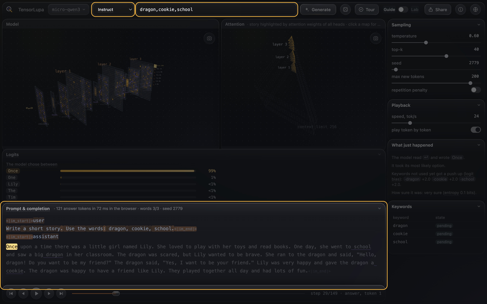

**In one sentence:** an instruct model is a base model trained a little more on requests and answers, so it does
what you ask instead of just continuing your text.

## From continuing to answering

A [base model](../completion/) continues text. Ask it "Write a short story. Use the words: dragon, cookie,
school." without any chat markers, and it treats your request as the start of some text:

> *Write a short story. Use the words: dragon, cookie, school.* The teacher said, "Sometimes, people, and a little
> sigh." The teacher smiled and said, "That's a good idea, but you can try to make your school...

Instruction tuning fixes that. The model is trained on many pairs of a request and a good answer, wrapped in chat
markers (see [prompt](../prompt/)). It learns that after `<|im_start|>assistant` comes an answer that does what
the request says. The method is usually called supervised fine-tuning (SFT).

## Small models usually skip this step

Many very small models stop at the base stage. Following a request needs
the model to look back at the request while writing, often hundreds of tokens later, and that is hard for a tiny
network. micro-qwen3 was trained to do it anyway.

## How micro-qwen3 learned to follow requests

The demo model was fine-tuned on **[TinyStoriesInstruct](https://huggingface.co/datasets/roneneldan/TinyStoriesInstruct)** by the same authors as TinyStories
([roneneldan/TinyStoriesInstruct](https://huggingface.co/datasets/roneneldan/TinyStoriesInstruct)), converted to
the Qwen chat format. Two kinds of tasks were mixed: write a story from given words, features or a plot, and
summarize a story in one sentence. The summaries turned out to matter: they teach the model to look back at the
request.

How many of the requested words made it into the story, on test orders of three words:

| Model | Requested words in the story |
| --- | --- |
| before instruction tuning | 5.7% |
| after instruction tuning | 64% |
| after tuning, with a growing push toward unused words ([logit bias](../logit-bias/)) | 100% |

The last row is a decoding rule on top of the model: the studio raises the scores of requested words that have
not appeared yet, more and more while they wait. You can switch it off in the Lab and see the model on its own.

## Where it is in the studio

**Instruct** is the default mode. Type up to three English words and press Generate. The studio builds the chat
prompt for you; you can see it at the top of **Prompt & completion**.

## Try it

<a class="try-link" href="/studio?w=dragon,cookie,school&seed=2779&s=28" target="_blank" rel="noopener">Open an instruct story in the studio</a>

<a class="try-link" href="/studio?p=Write%20a%20short%20story.%20Use%20the%20words%3A%20dragon%2C%20cookie%2C%20school.&seed=1&s=20" target="_blank" rel="noopener">Open the same request in completion mode</a>

The first link wraps the request in chat markers; the second sends it as plain text. Same model, same words, very
different stories.

## A bit of history

Instruction tuning became standard around 2021 and 2022, with Google's [FLAN](https://arxiv.org/abs/2109.01652) (Wei et al., 2021) and OpenAI's [InstructGPT](https://arxiv.org/abs/2203.02155) (Ouyang et al., 2022), the model family that led to ChatGPT. TinyStoriesInstruct, the data micro-qwen3 was tuned on, comes from the [TinyStories paper](https://arxiv.org/abs/2305.07759) by Ronen Eldan and Yuanzhi Li (2023).

## Next

[Transformer](../transformer/): what happens inside the model at every step.

## References

- Jason Wei et al. (2021). [Finetuned Language Models Are Zero-Shot Learners](https://arxiv.org/abs/2109.01652). arXiv.
- Long Ouyang et al. (2022). [Training language models to follow instructions with human feedback](https://arxiv.org/abs/2203.02155). arXiv.
- Ronen Eldan, Yuanzhi Li (2023). [TinyStories: How Small Can Language Models Be and Still Speak Coherent English?](https://arxiv.org/abs/2305.07759). arXiv.
- [TinyStoriesInstruct dataset](https://huggingface.co/datasets/roneneldan/TinyStoriesInstruct). Hugging Face.
