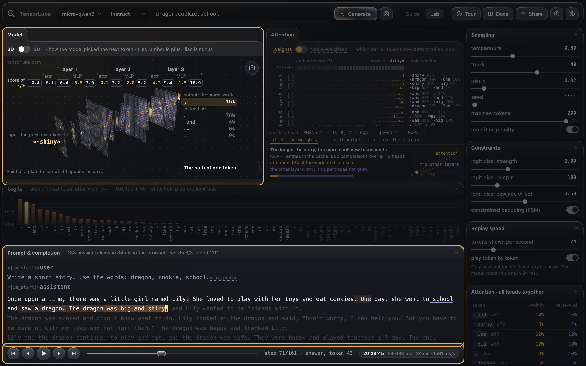

**In one sentence:** a language model predicts the next piece of text. It reads what is written so far, scores
every possible next token, picks one, adds it and repeats.

## One token at a time

A language model never writes a whole sentence at once. Every step is the same small loop:

1. Read everything written so far.
2. Give a score to each of the 4,096 [tokens](../token/) it knows.
3. Turn the scores into chances and draw one token.
4. Add that token to the text and go back to step 1.

A story of 150 tokens is 150 turns of this loop. Nothing else is happening: no plan for the whole story, no
memory between stories, just "what comes next?" asked again and again.

## A real start of a story

These are some of the first steps micro-qwen3 took when it wrote the demo story, with the favourites at each step:

| Written so far | Top candidates | Drawn |
| --- | --- | --- |
| *(start of the answer)* | Once 100% | Once |
| Once upon a time | **,** 96.6%, there 3.4% | **,** |
| Once upon a time, there was a | little 81.2%, big 9.9%, boy 6.1% | little |
| Once upon a time, there was a little | girl 69.4%, boy 30.6% | girl |

Two things are worth noticing. Most steps are nearly certain: after "Once upon a" the model gives "time" 100%.
And now and then the model does not take its favourite. Later in the story, after "The dragon was big and
shiny", a period had 78.0%, but the draw landed on a comma, which had 16.0%, and the sentence went on: ", and
Lily wanted to be friends with it." That is how the same model can write many different stories.

## Where it is in the studio

- **Prompt & completion** shows the text. The highlighted token is the current step.
- **Model** shows, at the right of the plates, the token the model wrote at this step and the candidates it chose
  between, with their chances. **Logits** shows the score of every token in the vocabulary.
- **The player** at the bottom moves one token back or forward. Every step is recorded, so you can go back to any
  moment of the story.

## Try it

<a class="try-link" href="/studio?w=dragon,cookie,school&seed=1111&s=70&q=8" target="_blank" rel="noopener">Open the step where the draw missed the favourite</a>

Then press the arrow keys or the player buttons and watch the candidates change from token to token.

## In micro-qwen3

micro-qwen3 has 1,056,656 parameters, about 560 times fewer than the smallest [Qwen3](https://arxiv.org/abs/2505.09388). In your browser it writes
well over a thousand tokens per second, so a whole story is ready in a fraction of a second; the studio then plays
it back slowly so you can follow. The same C code runs on an ESP32-S3 microcontroller at about 60 tokens per
second.

Large models like the ones behind chat assistants do exactly the same loop. They have far more parameters, read
far longer texts and were trained on far more data, but each step is still "score every token, draw one, add it".

## A bit of history

In 1948 [Claude Shannon](https://ieeexplore.ieee.org/document/6773024) showed that English can be imitated with simple statistics: pick each next letter or word by how often it follows the previous ones. In 2003 [Yoshua Bengio and colleagues](https://www.jmlr.org/papers/volume3/bengio03a/bengio03a.pdf) replaced the counting with a neural network that predicts the next word. [GPT](https://cdn.openai.com/research-covers/language-unsupervised/language_understanding_paper.pdf) in 2018 took the same next-token idea and scaled it up with a transformer.

## Next

[Token](../token/): what the pieces of text are, and why "dragon" is one token while a rare word takes several.

## References

- Claude E. Shannon (1948). [A Mathematical Theory of Communication](https://ieeexplore.ieee.org/document/6773024). Bell System Technical Journal.
- Yoshua Bengio, Réjean Ducharme, Pascal Vincent, Christian Jauvin (2003). [A Neural Probabilistic Language Model](https://www.jmlr.org/papers/volume3/bengio03a/bengio03a.pdf). JMLR.
- Alec Radford et al. (2018). [Improving Language Understanding by Generative Pre-Training](https://cdn.openai.com/research-covers/language-unsupervised/language_understanding_paper.pdf). OpenAI.
- An Yang et al. (2025). [Qwen3 Technical Report](https://arxiv.org/abs/2505.09388). arXiv.
