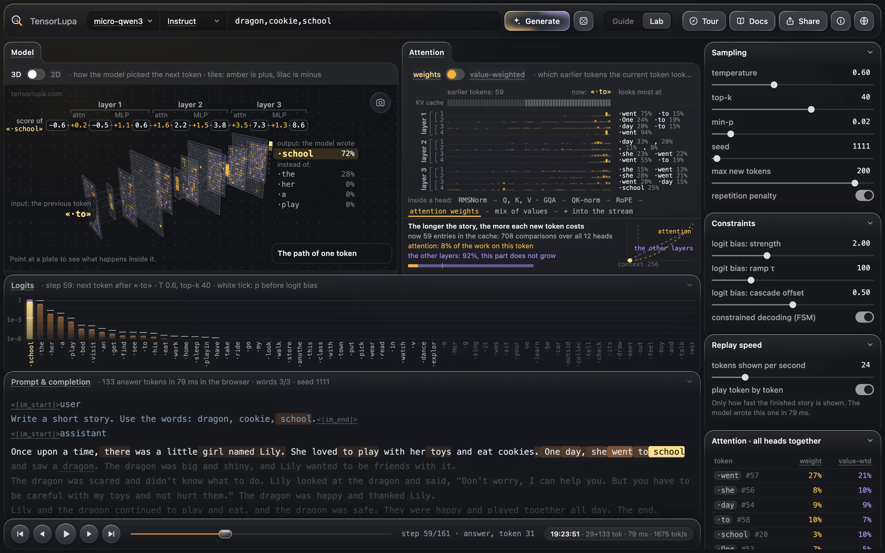

**In one sentence:** logit bias is a bonus added to a token's score before the choice; here it goes to the
keywords you asked for that are not in the story yet.

## Why a nudge is needed

An [instruction-tuned](../instruct/) micro-qwen3 understands "use the words: dragon, cookie, school", but on its
own it uses all three words in only about a third of the stories. Printing the [logits](../logits/) of the
requested words at every step showed why: the model ranks them high, it "wants" them, but rarely enough to win the
[draw](../sampling/). So TensorLupa gives them a push.

The push is simple arithmetic: before the choice, a number is added to the score of each requested word that has
not appeared yet. A higher score means a higher chance, and the draw does the rest. Words that are already in the
story get nothing, so the model is free to use them again or not.

## The rule, found step by step

Each part of the rule came from looking at the previous result. All numbers are from 200 test orders of three
words, measured in the micro-qwen3 project:

| Idea | Stories with all three words |
| --- | --- |
| no bias, just sampling (T 0.5) | 36.5% |
| a constant bonus for every missing word | 79.5% |
| each used word raises the bonus for the rest | 94% |
| the bonus also grows while a word keeps waiting | 99.5% |
| the same rule at temperature 0.6 | 100% |

The final rule:

```
bonus = strength · (u + 1) · (1 + t / τ)
  u  how many requested words are already in the text
  t  tokens since the last requested word appeared
  τ  how fast the waiting bonus grows (the ramp)
```

With the studio defaults (strength 2, τ 100) the first missing word gets +2, and the bonus doubles after the first
word is used and triples after the second. A word that keeps waiting for 100 tokens gets twice its starting bonus.

A word made of several [tokens](../token/) is pushed piece by piece: the bonus goes to its next missing piece. Once
it is started, [constrained decoding](../fsm/) takes over and makes sure it is finished properly.

## Real steps: the bonus grows as the story goes on

The demo story (seed 1111, words dragon, cookie, school). The model wrote "cookies" by itself, so one word was used
when the two steps below came. Chances are at temperature 0.6, before and after the bonus:

| Story so far | Bonus | Before | After |
| --- | --- | --- | --- |
| ...she went to | +4.28 | "the" 95.6%, "her" 2.9%, "a" 1.1%, ..., **"school" 0.2%** | **"school" 71%** |
| ...she went to school and saw a | +6.18 | "big" 98.7%, "cookie" 0.3%, ..., **"dragon" under 0.1%** | **"dragon" 78%** |

The second row shows why the bonus grows. After "school" two words were used, so the base bonus tripled
(2 · 3 = 6) instead of doubling (2 · 2 = 4) as in the first row. The model was about to write "a big" with 98.7%.
"dragon" had less than a tenth of a percent. With +6.18 it got 78%, and "dragon" won.

Without the push the story would have been fine, just without a school. Set strength to 0 and the same order
goes "...she went to the park with her mom", and "school" never comes. The bonus does not write the story; it
changes which of the model's own options wins.

## Fewer than three words

The bonus grows with every word used, so a single requested word would stay at the smallest bonus and come out in
only 93% of stories. The fix is to start part of the way up: the **cascade offset** starts `u` at
`0.5 · (3 − number of words)`. With it, one word reaches 99.5% and two words 100%, at almost no cost to how
natural the text is.

## Where it is in the studio



- **Guide:** the card "What just happened" shows the effect of the bonus at a step, for example "school 0.2% → 71%".
- **Lab:** the **Constraints** card has the three sliders: **logit bias: strength**, **ramp τ** and **cascade
  offset**. In the Logits strip a white tick shows each token's chance before the bonus, and the **Keywords** card
  shows which words are still waiting.
- Set strength to 0 to switch the bonus off and see what the model does on its own.

## Try it

<a class="try-link" href="/studio?w=dragon,cookie,school&seed=1111&s=58&q=8&mode=lab" target="_blank" rel="noopener">Open the "school" step in the Lab</a>

<a class="try-link" href="/studio?w=dragon,cookie,school&seed=1111&wb=0&q=8&mode=lab" target="_blank" rel="noopener">The same order without the bonus</a>

## In micro-qwen3

- Defaults: strength 2, ramp τ 100, cascade offset 0.5, [temperature](../temperature/) 0.6.
- The same rule runs in the C engine on the ESP32-S3 and in the browser.
- The model was trained on orders of a verb, a noun and an adjective. On hand-picked orders of that kind, every
  story used all three words; orders of three nouns, such as dragon, cookie, school, worked in 94% of stories.
- A big constant bonus is not a shortcut: at +6 the text gets less natural and single words are still missed in
  8.5% of stories. The growing rule reaches about 100% of all three words at the same naturalness.

## A bit of history

Adding a fixed number to chosen tokens' scores is an old trick, and large model APIs offer it as a "logit bias"
option, mostly to ban or encourage specific tokens. The cascade and the waiting ramp here are TensorLupa's own: a
bonus that knows which words are still missing and grows the longer they wait.

## Related

- [Constrained decoding (FSM)](../fsm/): finishing a word once it is started.
- [Logits](../logits/): the scores the bonus is added to.
- [Sampling](../sampling/): the draw that turns the higher score into a higher chance.
