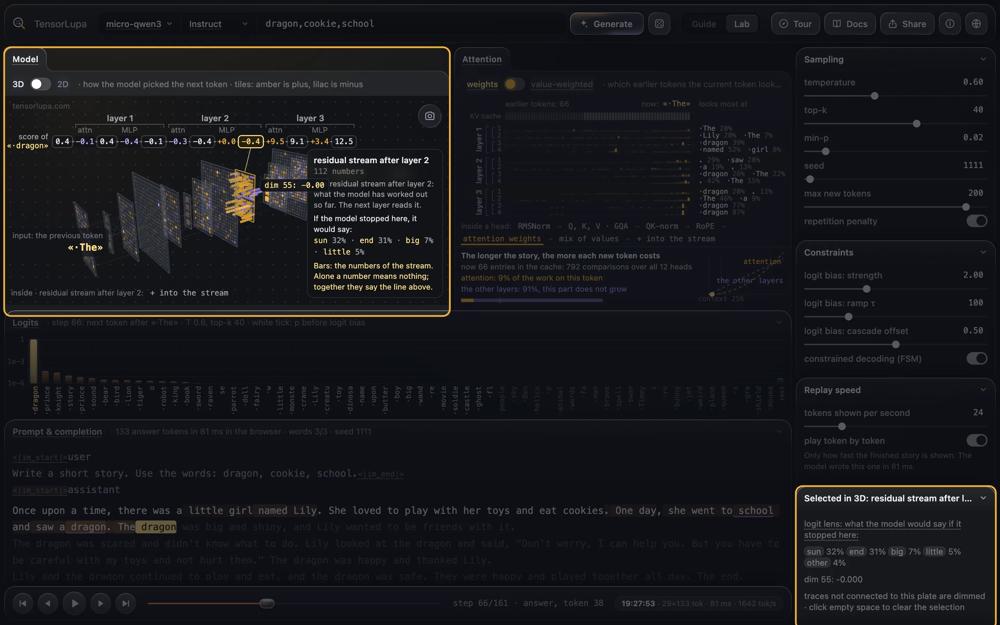

**In one sentence:** the logit lens decodes the stream in the middle of the model as if it were the end, to see
what the model would say at that point.

## How it works

Every [token](../token/) travels through the model as a list of 112 numbers, the
[residual stream](../residual-stream/). Each layer adds its contribution to it. Only after the last layer does the
model turn the stream into a score for every possible next token, the [logits](../logits/): it normalises the
stream and multiplies it by the output table.

The logit lens applies that same last step early. Take the stream after layer 1 or layer 2, normalise it, multiply
it by the output table, and read the result as if it were the final answer. Nothing is trained for this; it simply
reuses the model's own output layer. It works because every layer writes into the same stream that the output
layer reads at the end.

After the last layer the lens and the model agree exactly: the lens after layer 3 is the model's raw output.

## A real step: the answer appears in the last layer

The demo story has just written *"…she went to school and saw a dragon. The"*. Here is what
the stream would say at each point:

| Point in the stream | Top guesses |
| --- | --- |
| right after the embedding | The 99.8% |
| after layer 1 | end 26.3%, other 18.0%, The 16.1% |
| after layer 2 | sun 31.8%, end 30.9%, big 7.2% |
| after layer 3 | **dragon 97.7%**, princess 0.2%, knight 0.2% |

For two layers the stream holds the most common continuations of "The" in children's stories: "The end", "The
sun". Only the third layer brings in the context, a dragon was just mentioned, and the answer jumps to "dragon"
at 97.7%. The model wrote "dragon".

## A second step: what the lens cannot see

Three tokens earlier the story reached *"…she went to school and saw a"*. The lens after layer 3 gives big
68.1%, cookie 2.2%, little 1.3%, and "dragon" only 0.3%. Yet the model wrote "dragon": in the final candidates it
had 78% against 22% for "big".

The difference is [logit bias](../logit-bias/). "dragon" was a requested word not used yet, so the studio added
6.18 to its score after the model's own output. The lens shows the model alone, before any bias, before
[temperature](../temperature/) and [top-k](../top-k/), at temperature 1. Comparing the lens after the last layer
with the final candidates shows exactly how much of a choice came from the model and how much from the rules
around it.

## Where it is in the studio

In **Lab**, click a glass plate of the residual stream in the 3D **Model** view. The info card in the Model
panel and the inspector on the right show "logit lens: what the model would say if it stopped here" with the top
guesses at that point. Click the plates
one after another to watch the guess form layer by layer, and compare them with the **Logits** panel.

## Try it

<a class="try-link" href="/studio?w=dragon,cookie,school&seed=1111&s=65&q=8&mode=lab" target="_blank" rel="noopener">Open the "The dragon" step in the Lab</a>

<a class="try-link" href="/studio?w=dragon,cookie,school&seed=1111&s=62&q=8&mode=lab" target="_blank" rel="noopener">Open the "saw a" step</a>

In each, click the plates after layer 1, 2 and 3 and compare the lens with the final candidates.

## In micro-qwen3

- 3 layers, so the lens has four points to read: after the embedding and after each layer.
- Right after the embedding the lens mostly reads the current token back ("The" 99.8%), because the stream has
  not yet seen anything else.
- In a small model the middle layers often guess common phrases first, and the last layer fixes them with the
  context. Large models show the same pattern over dozens of layers.

## A bit of history

The name comes from a 2020 blog post by the researcher known as nostalgebraist, who decoded the middle layers of
GPT-2 this way and saw its guesses sharpen layer by layer. The idea relies on the
[residual stream](../residual-stream/) view of a transformer, described in Anthropic's
[A Mathematical Framework for Transformer Circuits](https://transformer-circuits.pub/2021/framework/index.html)
(2021), where every layer reads from and writes to one shared stream.

## Related

- [Embedding and residual stream](../residual-stream/): the stream the lens reads.
- [Transformer](../transformer/): what the layers do between the lens points.
- [Logits](../logits/): the final scores the lens imitates.

## References

- Nelson Elhage et al., Anthropic (2021). [A Mathematical Framework for Transformer Circuits](https://transformer-circuits.pub/2021/framework/index.html).
