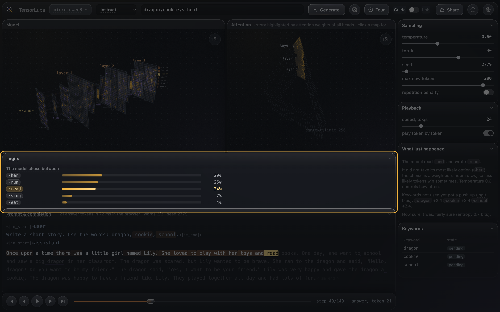

**In one sentence:** logits are the model's raw scores for all 4,096 [tokens](../token/); softmax turns them into
probabilities that add up to 100%.

## From scores to chances

At the end of every step the [transformer](../transformer/) gives one number to every token in its vocabulary:
4,096 numbers, one per possible next token. These raw scores are the logits. A higher logit means "more likely
next", but the numbers themselves are not probabilities: they can be negative, and they do not add up to anything.

Softmax turns them into chances. It raises e to the power of each logit, so every score becomes positive, and then
divides by the total, so the chances add up to 100%.

Because of that power, small gaps in logits become big gaps in chances. A token whose logit is 1 point higher is
about 2.7 times as likely; 2 points higher, about 7 times; 5 points higher, about 150 times. That is why a whole
vocabulary of 4,096 tokens can end up with most of the chance on a handful of them.

## A real step

The story so far: *"Once upon a time there was a little girl named Lily. She loved to play with her toys and"*.
These are the model's own logits for the top candidates, and what they become:

| Token | Logit | Chance at temperature 1 | Chance at the default 0.6, top-k 40 |
| --- | --- | --- | --- |
| her | 7.81 | 14.8% | 29.0% |
| run | 7.74 | 13.8% | 25.9% |
| **read** | 7.70 | 13.2% | **24.2%** |
| sing | 6.98 | 6.4% | 7.3% |
| eat | 6.58 | 4.3% | 3.7% |

"her" and "read" differ by only 0.11 in logits, so their chances are close. "sing" is 0.8 lower and already gets
about half as much. Across the whole vocabulary the logits at this step go from about -9 to 7.8; the lowest token
is millions of times less likely than the favourite.

How concentrated the chances are, out of 4,096 tokens:

| | Tokens holding 50% | 90% | 99% |
| --- | --- | --- | --- |
| raw logits, temperature 1 | 5 | 156 | 1,265 |
| as the studio uses them, temperature 0.6 | 2 | 6 | 45 |

The model drew **read**, the third option, and the story went on with "read books".

## What happens to the logits before the choice

The studio does not always use the model's logits as they are. At every step of the answer, in this order:

1. **Raw logits** come out of the model.
2. **[Logit bias](../logit-bias/)** adds a bonus to requested words that have not appeared yet. At this step
   "dragon", "cookie" and "school" each got +2.40; they were still far below "her", so the bonus did not change
   the pick.
3. **[Constrained decoding](../fsm/)** blocks pieces that would break a requested word into junk; blocked tokens
   get a logit of minus infinity, so their chance is exactly 0.
4. **[Repetition penalty](../repetition-penalty/)**, if switched on, lowers the score of tokens that would repeat
   a phrase.
5. **[Top-k](../top-k/)** keeps only the k highest logits (40 by default).
6. **[Temperature](../temperature/)** divides the logits, then softmax turns them into chances.
7. **[Sampling](../sampling/)** draws one token.

## Where it is in the studio

- In **Guide**, the **Logits** panel lists the five favourites under "The model chose between", with their
  chances; the chosen one is lit up.
- In **Lab**, the same panel shows a strip of the 64 best candidates plus one bar for all the rest, on a log scale.
  The chosen token is bright, the top-k candidates are dimmer, tokens outside top-k are barely visible. A white tick
  marks the chance a token had before logit bias. Hover over a bar to see its logit and bonus.

## Try it

<a class="try-link" href="/studio?w=dragon,cookie,school&seed=2779&s=48&mode=lab" target="_blank" rel="noopener">Open this step in the Lab</a>

Hover over the bars for "her", "run" and "read", then move the temperature slider and watch the strip sharpen and
flatten.

## In micro-qwen3

- 4,096 logits per step, one per token; the final layer computes them from the token's 112 numbers at the end of the
  [residual stream](../residual-stream/).
- The [logit lens](../logit-lens/) applies the same last step to the stream in the middle of the model, to see what
  it would say if it stopped early.
- Large models work the same way, only with a vocabulary of about 150,000 tokens, so each step produces about
  150,000 logits.

## A bit of history

The word "logit" was coined by the statistician [Joseph Berkson in 1944](https://doi.org/10.1080/01621459.1944.10500699), from the logistic function used to model
chances. Softmax has the same form as the [Boltzmann distribution](https://en.wikipedia.org/wiki/Boltzmann_distribution) from statistical physics, which is also where
[temperature](../temperature/) gets its name; the name "softmax" was given by [John Bridle in 1990](https://doi.org/10.1007/978-3-642-76153-9_28).

## Next

[Sampling](../sampling/): how one token is drawn from these chances.

## References

- Joseph Berkson (1944). [Application of the Logistic Function to Bio-Assay](https://doi.org/10.1080/01621459.1944.10500699). Journal of the American Statistical Association.
- [Boltzmann distribution](https://en.wikipedia.org/wiki/Boltzmann_distribution). Wikipedia.
- John S. Bridle (1990). [Probabilistic Interpretation of Feedforward Classification Network Outputs, with Relationships to Statistical Pattern Recognition](https://doi.org/10.1007/978-3-642-76153-9_28). Neurocomputing.
