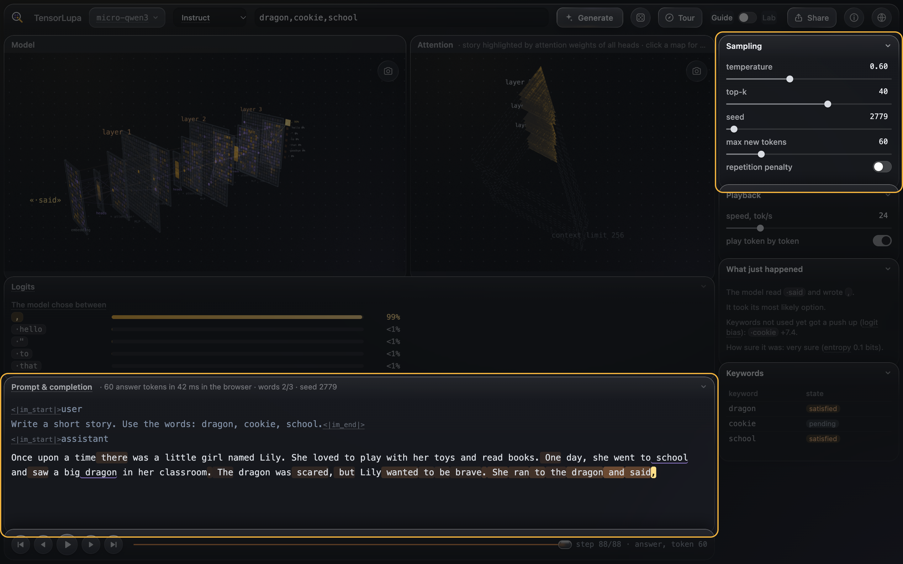

**In one sentence:** max new tokens is the longest answer the model may write, counted in [tokens](../token/).

## How it works

The model writes one token at a time and decides by itself when the story is over: it writes the
[special token](../special-tokens/) `<|im_end|>`, and the studio stops. Max new tokens is a safety limit on top of
that. If the model has not finished by then, the studio stops it anyway, in the middle of a sentence if need be.

There is a second, hard limit: the model can read at most 256 tokens in total, prompt and answer together. With
the 29-token prompt of a three-word order, that leaves room for about 226 tokens of answer, so the slider stops at
220.

## A real story, full and cut

The demo story (seed 2779, words dragon, cookie, school) ends on its own after 121 tokens, well under the default
limit of 200:

> Once upon a time there was a little girl named Lily. [...] Lily was very happy and gave the dragon a cookie. The
> dragon was happy to have a friend like Lily. They played together all day and had lots of fun.

The same story with max new tokens set to 60 stops mid-sentence:

> Once upon a time there was a little girl named Lily. She loved to play with her toys and read books. One day,
> she went to school and saw a big dragon in her classroom. The dragon was scared, but Lily wanted to be brave. She
> ran to the dragon and said,

Every token up to the cut is exactly the same: the limit does not change any choice, it only stops the loop
earlier. And because the story was cut before "cookie" came up, only two of the three words made it in.

## Where it is in the studio

The **max new tokens** slider is in the **Sampling** card: from 20 to 220 in steps of 10, default 200. Moving it
reruns the story with the same [seed](../seed/), so you can watch exactly where the cut falls.

## Try it

<a class="try-link" href="/studio?w=dragon,cookie,school&seed=2779&n=60&s=87" target="_blank" rel="noopener">Open the story cut at 60 tokens</a>

Then drag the slider up and watch the same story continue past the cut, until it ends by itself.

## In micro-qwen3

With the studio's default settings, about 87% of three-word stories end on their own before the limit (measured
on 200 orders at [temperature](../temperature/) 0.6). The rest are often stuck in a [loop](../repetition-penalty/)
and would go on and on; for those, max new tokens is what ends the story.

## Related

- [Special tokens](../special-tokens/): `<|im_end|>`, the token the model writes when it decides the story is over.
- [Repetition penalty](../repetition-penalty/): the stories that do not end on their own are often stuck in a loop.
- [Sampling](../sampling/): the limit stops the loop of choices, it does not change any single choice.
