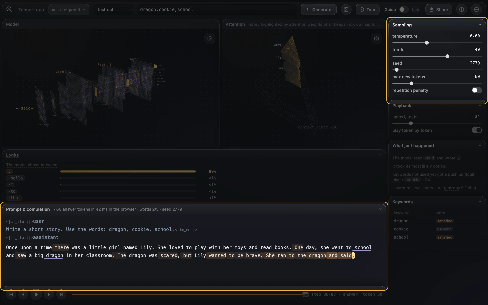

**In one sentence:** max new tokens is the longest answer the model may write, counted in [tokens](../token/).

## How it works

The model writes one token at a time and decides by itself when the story is over: it writes the
[special token](../special-tokens/) `<|im_end|>`, and the studio stops. Max new tokens is a safety limit on top of
that. If the model has not finished by then, the studio stops it anyway, in the middle of a sentence if need be.

There is a second, hard limit: the model can read at most 256 tokens in total, prompt and answer together. With
the 29-token prompt of a three-word order, that leaves room for about 226 tokens of answer, so the slider stops at
220.

## A real story, full and cut

The demo story (seed 1111, words dragon, cookie, school) ends on its own after 133 tokens, well under the default
limit of 200:

> Once upon a time, there was a little girl named Lily. [...] The dragon was happy and thanked Lily. Lily and the
> dragon continued to play and eat, and the dragon was safe. They were happy and played together all day. The end.

The same story with max new tokens set to 30 stops mid-sentence:

> Once upon a time, there was a little girl named Lily. She loved to play with her toys and eat cookies. One day,
> she went to

Every token up to the cut is exactly the same: the limit does not change any choice, it only stops the loop
earlier. And because the story was cut before "school" and "dragon" came up, only one of the three words made it
in.

## Where it is in the studio

The **max new tokens** slider is in the **Sampling** card: from 20 to 220 in steps of 10, default 200. Moving it
reruns the story with the same [seed](../seed/), so you can watch exactly where the cut falls.

## Try it

<a class="try-link" href="/studio?w=dragon,cookie,school&seed=1111&n=30&s=57&q=8" target="_blank" rel="noopener">Open the story cut at 30 tokens</a>

Then drag the slider up and watch the same story continue past the cut, until it ends by itself.

## In micro-qwen3

With the studio's default settings, about 85% of three-word stories end on their own before the limit (measured
on 300 stories from 100 different orders). The rest are still writing when the limit comes; for those, max new
tokens is what ends the story.

## Related

- [Special tokens](../special-tokens/): `<|im_end|>`, the token the model writes when it decides the story is over.
- [Repetition penalty](../repetition-penalty/): without it, the stories that do not end on their own are often stuck in a loop.
- [Sampling](../sampling/): the limit stops the loop of choices, it does not change any single choice.
