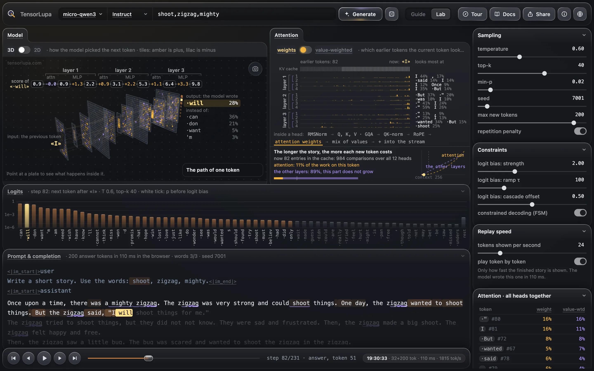

**In one sentence:** min-p rules out every token that is much less likely than the favourite: at 0.02, anything
50 or more times less likely.

## The problem it solves

[Top-k](../top-k/) keeps the 40 most likely [tokens](../token/) at every step. When the model is sure, most of
those 40 have almost no chance, but "almost no" is not zero. Over a long story the draw sometimes lands there, and
a tiny model rarely recovers from such a slip: it glues the odd piece into a word that does not exist.

## A real slip

Words shoot, zigzag, mighty, seed 7001, min-p off. At step 81 the model has written *"As he was shooting, he saw a
big zigzag on the ground."* and is sure what comes next: " He" 91.8%, " It" 4.8%, " The" 3.1%. The draw lands on
" B", a token with 0.003%, about 30,000 times less likely than " He". The model has to make a word out of it and
writes *"Byican said, …"*.

<a class="try-link" href="/studio?w=shoot,zigzag,mighty&seed=7001&mp=0&s=81&q=8" target="_blank" rel="noopener">Open the slip at step 81 (min-p off)</a>

With min-p 0.02, " B" is out of the draw at this step, together with everything below 1.8% (2% of " He"'s 91.8%).

## How it works

1. Take the chances after [temperature](../temperature/) and [top-k](../top-k/).
2. Find the favourite's chance.
3. Rule out every token whose chance is below min-p times that.
4. Share the 100% among the tokens that are left and [sample](../sampling/).

The cut follows the model's confidence. When the favourite has 90%, min-p 0.02 removes everything under 1.8%. When
the model hesitates and the favourite has only 20%, it removes only tokens under 0.4%, and the real alternatives
stay. At temperature 0.6 micro-qwen3 is usually sure: on a typical story min-p 0.02 rules out about 36 of the 40
top-k candidates per step, almost all of them with chances far below one percent.

## Min-p or top-p

[Top-p](https://arxiv.org/abs/1904.09751) (nucleus sampling) is the better-known way to cut the tail: keep the
most likely tokens until their chances add up to, say, 95%. We measured both on 300 stories (100 orders the model
had never seen, 3 seeds each), with the default 8-bit weights and the [repetition
penalty](../repetition-penalty/) on:

| Cut | Stories with an invented word | Looping stories | Ends on its own | Diversity |
| --- | --- | --- | --- | --- |
| none (top-k 40 only) | 2.7% | 1% | 83% | 0.745 |
| **min-p 0.02** | **1.0%** | 1% | 85% | 0.730 |
| min-p 0.05 | 2.3% | 1% | 79% | 0.715 |
| min-p 0.1 | 1.7% | 2% | 83% | 0.703 |
| top-p 0.95 | 1.3% | 1% | 83% | 0.725 |
| top-p 0.9 | 3.3% | 1% | 88% | 0.717 |

"Diversity" is the share of different four-word phrases across all 300 stories. On the 4-bit weights the effect is
larger: stories with an invented word drop from 6.7% to 3.0% with min-p 0.02.

At the same strength min-p 0.02 and top-p 0.95 are a tie. The studio uses min-p because its rule fits in one
sentence and its line on the logits strip sits at a fixed distance from the favourite, while the top-p line jumps
from step to step with the shape of the chances.

One more thing the measurement showed: cutting the tail without a repetition penalty makes loops more common
(looping stories 9% → 13% at min-p 0.02, 23% at min-p 0.1), because the model takes its favourite more often, and
the favourite is often the repeat. With the penalty on, loops stay at 1 to 2%.

## Where it is in the studio

The **min-p** slider is the third one in the **Sampling** card, under top-k. It goes from 0 (off) to 0.2; the
default is 0.02. In the Lab, the logits strip greys out the candidates it rules out; their chance is 0.

## In micro-qwen3

- Default min-p 0.02 for both the 8-bit and the 4-bit weights.
- The same code runs in the C engine on the ESP32-S3 and in the browser.
- Old studio links, made before min-p existed, open with min-p off, so the stories in older articles stay the same.

## A bit of history

Min-p was proposed in the open-source community in 2023 and written up by
[Nguyen and colleagues in 2024](https://arxiv.org/abs/2407.01082), who showed that it keeps text coherent at high
temperatures where top-p starts to fall apart.

## Related

- [Top-k](../top-k/): the fixed cut that comes before min-p.
- [Temperature](../temperature/): reshapes the chances that min-p compares.
- [Sampling](../sampling/): the draw that min-p limits.
- [Repetition penalty](../repetition-penalty/): the other half of the default rules.
