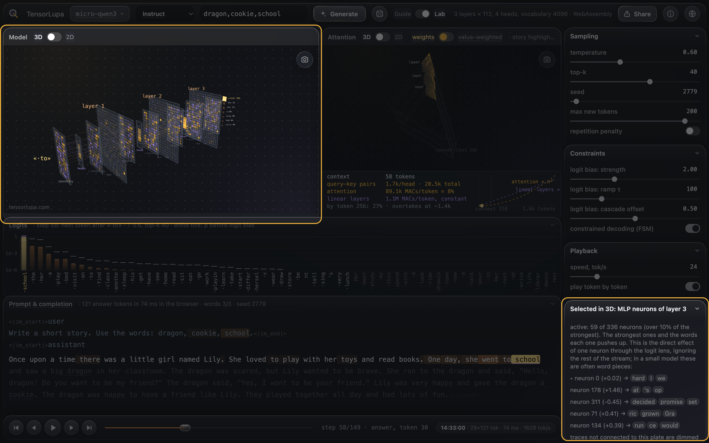

**In one sentence:** the MLP is the second half of each layer: 336 neurons per layer that react to patterns and
push certain next words up or down.

## What happens inside

Every [transformer](../transformer/) layer has two halves. First [attention](../attention/) lets the
[token](../token/) look back at earlier tokens. Then the MLP works on the token alone: it reads the token's
[residual stream](../residual-stream/), thinks about it, and adds its answer back on top.

The MLP in micro-qwen3 is built the same way as in Qwen3, a design called SwiGLU. In plain words:

1. The 112 numbers of the stream are mixed into 336 neurons, twice: once as a **signal** and once as a **gate**.
2. The gate decides how strongly each neuron fires. Most neurons stay almost silent at any given step; a few light
   up.
3. Each neuron that fires writes its own fixed direction back into the stream, scaled by how strongly it fired.
   A negative value writes the same direction backwards.

So a neuron is a small detector with an opinion: "when I see this kind of situation, push the next word toward
these tokens". You can read that opinion with the [logit lens](../logit-lens/): decode the neuron's direction as
if it were the end of the model and see which tokens it favours.

## A real step

The demo story has just written *"One day, she went to"*, and the next token will be "school". These are the
strongest neurons of two layers at that step, with the three tokens each one pushes up:

| Layer | Neuron | Firing | Pushes toward |
| --- | --- | --- | --- |
| 2 | 118 | +1.29 | see, know, the |
| 2 | 273 | +0.49 | Mommy, call |
| 3 | 178 | +1.46 | at, 's, op |
| 3 | 311 | −0.45 | *(away from)* decided, promise, set |
| 3 | 134 | +0.39 | run, ce, would |

Two things stand out. Only a small part of each layer is busy: 30 of 336 neurons in layer 2 and 59 in layer 3
fire at more than a tenth of the strongest one. And many neurons push word pieces like "at", "op" or "ce" rather
than whole words. In a model this small, one neuron rarely means one clear idea; the meaning comes from many of
them adding up together with attention.

## Where it is in the studio

Switch to **Lab** and click an MLP plate in the 3D **Model** view, the plate after the attention heads of a
layer. The inspector shows how many neurons are active and lists the strongest ones, each with its firing value
and the tokens it pushes toward.

## Try it

<a class="try-link" href="/studio?w=dragon,cookie,school&seed=2779&s=57&mode=lab" target="_blank" rel="noopener">Open this step in the studio</a>

Click the MLP plate of layer 3, then step one token forward or back and watch different neurons take over.

## In micro-qwen3

- 3 layers × 336 neurons, gated the SwiGLU way, as in Qwen3.
- The MLPs hold 338,688 of the model's 1,056,656 parameters, about 32%. Attention takes 258,048 (about 24%), and
  the token table, shared between the input embedding and the output, takes 458,752 (about 43%).
- In large models the MLP is the biggest part of every layer, and individual neurons are easier to name. That is
  where much of a model's stored knowledge is thought to live.

## A bit of history

The neuron as a learning unit goes back to the perceptron, built by Frank Rosenblatt in 1958. Stacks of such
neurons, multilayer perceptrons, became trainable with backpropagation in the 1980s, and the 2017 transformer
paper put one inside every layer as its feed-forward block. The gated SwiGLU version used here was proposed by
Noam Shazeer in 2020.

## Next

[Logits](../logits/): how the last layer turns into a score for every possible next token.
