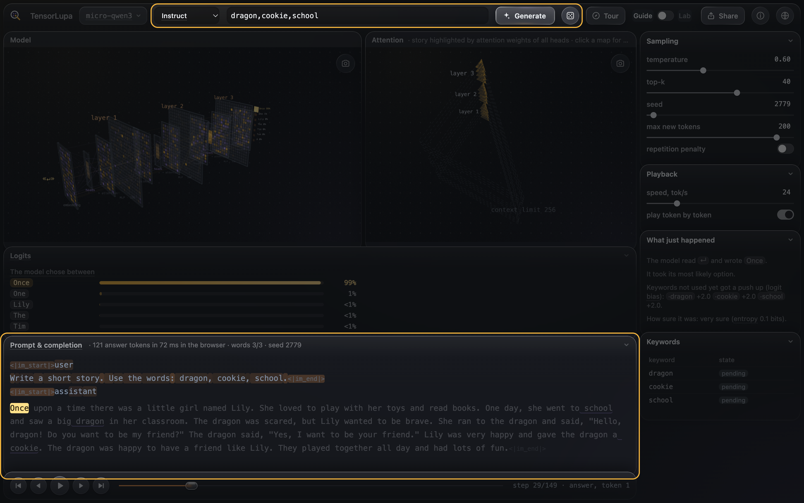

**In one sentence:** the prompt is everything the model reads before it answers; the completion is what it writes
after.

## What the model really reads

You type three words. The model reads much more. The studio wraps your words into a request in a chat format,
and the model sees all of it as one long row of [tokens](../token/):

```
<|im_start|>user
Write a short story. Use the words: dragon, cookie, school.<|im_end|>
<|im_start|>assistant
```

- `<|im_start|>user` and `<|im_end|>` mark where the request begins and ends.
- `<|im_start|>assistant` says "now it is your turn to answer". Right after it, the model writes its first token.

These markers are special tokens. The model learned what they mean during [instruction tuning](../instruct/):
after "assistant", write an answer that follows the request.

For micro-qwen3 this prompt is 29 tokens long. Notice that some ordinary words take several pieces here,
"Write" is `[W][r][ite]` and "user" is `[us][er]`, because they are rare in children's stories.

## The model reads the prompt the same way it writes

There is no separate "reading mode". The prompt goes through the same layers, one token after another, exactly as
the model's own words do later. The only difference: for prompt tokens the next token is already known, so
nothing is drawn. The studio shows these steps too; scroll the player back to the start to see the model "read".

## Where it is in the studio



The words you type go into the field at the top. In **Prompt & completion** the prompt is shown dimmed above the
answer, with the chat markers in grey.

## Try it

<a class="try-link" href="/studio?w=dragon,cookie,school&seed=2779&s=28" target="_blank" rel="noopener">Open the first step of the answer</a>

Press the left arrow a few times to step back through the prompt, then the right arrow to watch the answer start.

## A bit of history

Chat markers like `<|im_start|>` and `<|im_end|>` come from [ChatML](https://github.com/openai/openai-python/blob/release-v0.28.0/chatml.md), the chat format OpenAI introduced in 2023 to separate the roles in a conversation. Qwen uses the same style of markers, and so does micro-qwen3.

## Related

- [Completion](../completion/): no chat markers, the model simply continues your text.
- [Instruct](../instruct/): why the model follows the request at all.
- [Token](../token/): the pieces the prompt is made of.

## References

- OpenAI (2023). [ChatML, the chat markup format](https://github.com/openai/openai-python/blob/release-v0.28.0/chatml.md). GitHub.
