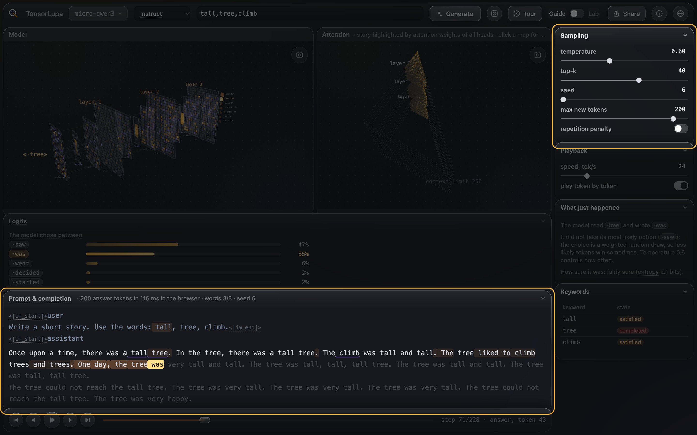

**In one sentence:** the repetition penalty lowers the score of a token that would repeat a phrase already in the
story, unless that phrase is common in children's stories, to stop the text from looping.

## Loops in a tiny model

Mentioning the hero many times is normal for a children's story ("the dragon ... the dragon"). A loop is
different: the model repeats itself because the repeat is its most likely next step, again and again. In
micro-qwen3 loops look like "tall and tall", "very tall and very tall", or "luxury luxury luxury". They are the
model's own habit. The keyword push of [logit bias](../logit-bias/) does not cause them: immediate repeats are
0.35% of words with it and 0.39% without it.

## How the studio's penalty works

The penalty looks at phrases of four [tokens](../token/). Before each draw it checks: would the next token repeat a
four-token phrase that is already written in this story? If yes, that token loses 4 points of
[logit](../logits/) for every earlier time the phrase appeared, before the [sampling](../sampling/) draw.

Some repeats are fine. Children's stories say "Once upon a time" and "One day, she" all the time. So the penalty
knows which phrases are natural: 11,224 four-token phrases that appear at least 1,000 times in TinyStories, the
stories the model was trained on. A repeat of one of them is never penalized. Everything else that repeats is.

Two more rules:
- A piece in the middle of a word is never penalized. Spelling a word to the end is the job of the
  [constrained decoding](../fsm/) automaton.
- The penalty works in both modes, Instruct and Completion.

The list comes from a table of phrase counts built from the training corpus, about 2.3 MB. The studio loads it
only when you switch the penalty on.

## A real loop, off and on

Words tall, tree, climb, seed 268. Without the penalty, the story gets stuck and never ends on its own:

> Once upon a time, there was a tall tree. The tree was very tall and tall. The tree was very tall and climbing up
> to the top of the tree. The tree was so tall that it could reach the top. The tree was very tall and tall. ...

At step 51 the model has just written "The tree was very" for the second time and gives " tall" 98.5%. The phrase
"tree was very tall" is already in the story and is rare in children's stories, so " tall" loses 4 points. The
model writes " climb" instead, and the story goes on:

> Once upon a time, there was a tall tree. The tree was very tall and tall. The tree was very climbing very high.
> One day, the tree was very high and it started to climb. As the tree was climbing, a little bird flew down from
> the tree. ...

With the penalty the story ends on its own after 114 tokens; without it, it runs into the 200-token limit.

## What it does and does not catch

Measured on 320 stories (32 three-word orders × 10 seeds), [temperature](../temperature/) 0.6, the default 8-bit
weights:

| Penalty | Repeated phrases | Looping stories | Stories with an invented word | All words used | Ends on its own |
| --- | --- | --- | --- | --- | --- |
| off | 5.7% | 17% | 10.3% | 99.6% | 75% |
| the earlier rule (below) | 2.6% | 4% | 10.3% | 99.7% | 79% |
| **the studio's penalty** | **1.0%** | **0%** | 11.6% | 99.8% | 82% |

"Repeated phrases" is the share of four-word phrases that already appeared earlier in the same story. A story
counts as looping when more than 10% of its phrases are repeats.

It does not catch a repeat that is not yet a repeated phrase. "Very tall and tall" in the story above is written
once, so it passes. It cannot fix loops of meaning either ("The wind made the wind strong").

The penalty is off by default for now: it has been measured on one set of orders, and it changes the story you
see, which is not what a first look at the model should show.

## Where it is in the studio

The **repetition penalty** switch is the last line of the **Sampling** card. Switching it reruns the story with the
same [seed](../seed/), so every difference you see comes from the penalty. At a penalized step, the step card says
which phrase would have repeated and how many points the token lost.

## Try it

<a class="try-link" href="/studio?w=tall,tree,climb&seed=268&s=51&q=8" target="_blank" rel="noopener">Open the looping story at step 51</a>

<a class="try-link" href="/studio?w=tall,tree,climb&seed=268&rp=1&s=51&q=8" target="_blank" rel="noopener">Open the same step with the penalty on</a>

## The earlier rule, and the board

Before the studio's penalty, the studio used a simpler rule, and the firmware on the ESP32-S3 still does: a word
that would repeat the word just written, or the word across "and" ("tall and tall"), lost 3 points, and a token
that would continue a phrase repeated within the last 32 tokens lost 1 to 8 points. It needs no table, which is
why the board keeps it. In the studio it sometimes made things worse: forbidding the usual next piece of a hard
word pushed the model into invented words such as "warnerer" or "luxuxuury". The corpus-aware penalty leaves word
pieces alone and lets natural phrases repeat.

## A bit of history

Penalizing repeated tokens at sampling time was proposed with the [CTRL](https://arxiv.org/abs/1909.05858) model by Keskar and colleagues at
Salesforce in 2019. The same year, Holtzman and colleagues showed why models loop at all: always taking the most
likely token makes text fall into repetition, and sampling from the distribution avoids much of it. The
studio's penalty is close to the later DRY sampler from the open-source community, with one addition: it asks the
training corpus which repeats are natural.

## Related

- [Sampling](../sampling/): the draw that the penalty changes.
- [Max new tokens](../max-new-tokens/): what stops a story that never leaves its loop.
- [Logit bias](../logit-bias/): the opposite push, toward the words you asked for.

## References

- Nitish Shirish Keskar et al. (2019). [CTRL: A Conditional Transformer Language Model for Controllable Generation](https://arxiv.org/abs/1909.05858).
- Ari Holtzman et al. (2019). [The Curious Case of Neural Text Degeneration](https://arxiv.org/abs/1904.09751).
