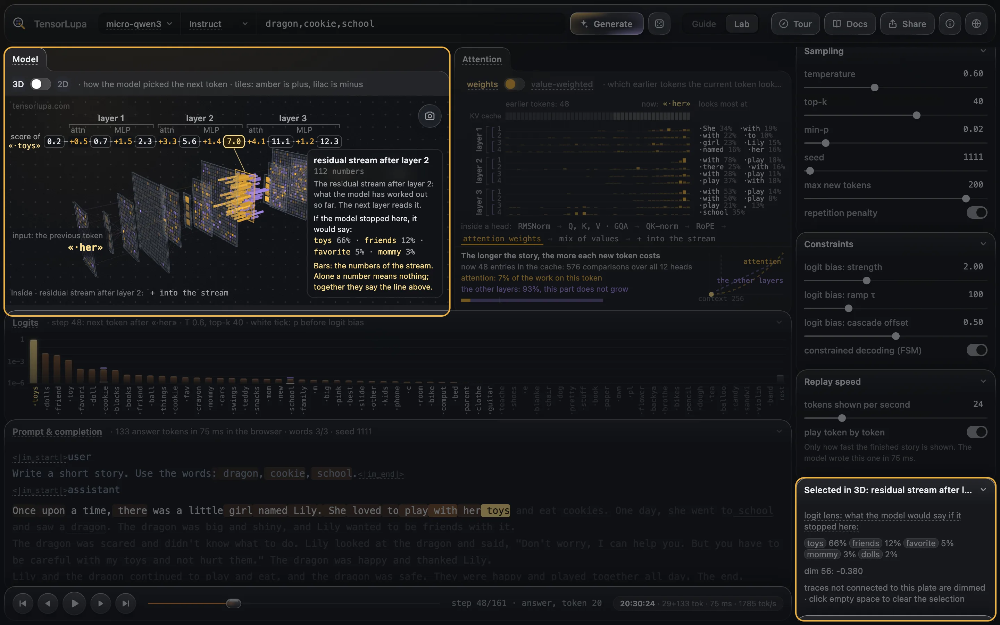

**In one sentence:** the embedding turns a [token](../token/) into a list of 112 numbers, and the residual stream
is that running list as it travels through the model, with every layer reading it and adding its own contribution
on top.

## From a token to numbers

A [transformer](../transformer/) cannot work with text directly. The first thing it does with each token is look
it up in a big table, the embedding table: one row per token in the vocabulary, 4,096 rows in micro-qwen3, each
row a list of 112 numbers. That row is the token's embedding, its starting point.

## A stream that layers add to

The list of 112 numbers then passes through the layers. Each layer does the same two things:

1. It **reads** the current list. [Attention](../attention/) looks back at earlier tokens, and the
   [MLP](../mlp/) reacts to patterns.
2. It **adds** what it found to the list, instead of replacing it.

Because every layer only adds, the list keeps everything that came before. This running sum is called the
residual stream. After the last layer the model turns the stream into a score for every possible next token,
the [logits](../logits/).

## A real step: watching the stream fill up

You can ask the stream at any point "if you stopped here, what would you say next?". This trick is called the
[logit lens](../logit-lens/): decode the stream in the middle of the model as if it were the end.

Here is one step of the demo story. The model has read *"…She loved to play with her"* and must write the next
token. The top three guesses of the lens at each point of the stream:

| Point in the stream | Top three guesses |
| --- | --- |
| right after the embedding | her 100% |
| after layer 1 | mom 68.4%, favorite 10.2%, mommy 6.3% |
| after layer 2 | **toys 66.2%**, friends 11.8%, favorite 5.3% |
| after layer 3 | **toys 83.2%**, dolls 6.6%, friends 4.4% |

Right after the embedding the stream knows only the token itself, so the lens just reads "her" back. Layer 1 adds
a rough guess: something that often follows "her" in children's stories. Layer 2 uses the context, "she loved to
play with", and lands on "toys". Layer 3 keeps it and grows surer. The model then wrote "toys".

Layers can also change their mind. Later in the story, after *"…Don't"*, layer 2 was 94% sure of "worry", and
layer 3 gave "be" 53% and left "worry" 43%. The lens shows the raw scores at temperature 1, so its
numbers differ a little from the final candidates in the studio, which use [temperature](../temperature/) 0.6 and
[top-k](../top-k/).

The stream also grows as layers add to it. Here its length (the size of the 112-number vector) goes from 1.0 after
the embedding to 2.0, 2.9 and 4.9 after the three layers.

## Where it is in the studio

In the **Model** panel the token flows from left to right. The glass plates between the layers are the residual
stream: 112 cells in a grid of 14 by 8, one cell per number, coloured by its value. The first plate is the
embedding. Inside each layer there is one more stream plate: the stream after attention, before the MLP. In Lab
mode, click a plate: the card at the bottom right of the Model panel and the inspector on the right show its logit
lens, "what the model would say if it stopped here", and the line above the model marks where in the score the
plate sits.

## Try it

<a class="try-link" href="/studio?w=dragon,cookie,school&seed=1111&s=47&q=8&mode=lab" target="_blank" rel="noopener">Open this step in the studio</a>

Click the stream plates one by one, from left to right, and watch the guesses go from "her" to "toys".

## In micro-qwen3

- 112 numbers per token, the same width at every point of the stream.
- 4,096 rows in the embedding table, one per token of the vocabulary.
- Three layers, so the stream has four points to look at: after the embedding and after each layer.
- Large models work the same way with much wider streams, thousands of numbers per token, and dozens of layers.

## A bit of history

Turning words into lists of numbers that capture their meaning became popular with [word2vec](https://arxiv.org/abs/1301.3781) in 2013. Adding a
layer's output to its input instead of replacing it comes from [residual networks](https://arxiv.org/abs/1512.03385) (ResNet, He et al., 2015), which
made very deep networks trainable. The name "residual stream" and the idea of reading the transformer as layers
writing into one shared stream come from Anthropic's 2021 paper ["A Mathematical Framework for Transformer
Circuits"](https://transformer-circuits.pub/2021/framework/index.html).

## Next

[Attention](../attention/): how a token looks back at earlier tokens and takes what it needs.

## References

- Tomas Mikolov et al. (2013). [Efficient Estimation of Word Representations in Vector Space](https://arxiv.org/abs/1301.3781). arXiv.
- Kaiming He et al. (2015). [Deep Residual Learning for Image Recognition](https://arxiv.org/abs/1512.03385). arXiv.
- Nelson Elhage et al., Anthropic (2021). [A Mathematical Framework for Transformer Circuits](https://transformer-circuits.pub/2021/framework/index.html). Transformer Circuits Thread.
