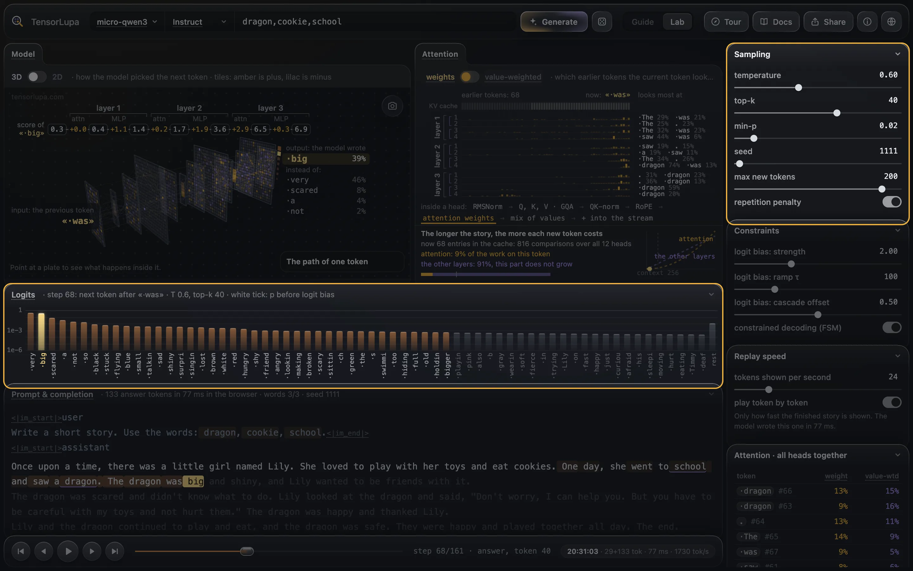

**In one sentence:** sampling is how one token is chosen from the probabilities: a weighted random draw, shaped
by temperature and top-k.

## How it works

At every step the model ends with a chance for each candidate token (see [logits](../logits/)). Sampling turns
those chances into one choice:

1. Line the candidates up from the most likely to the least likely, each taking a stretch as long as its chance.
2. Draw a random number between 0 and 1.
3. The token whose stretch the number lands in is the next token.

A token with 29% wins 29 draws out of 100, a token with 7% wins 7. Most of the time the favourite wins, but not
always, and that is what makes stories different from each other.

The random numbers come from a [seed](../seed/). The same seed and the same settings give the same draws, so the
same story; a new seed gives new draws and a new story.

**Greedy decoding** skips the draw and always takes the top token. It is fully predictable: one prompt, one
story, whatever the seed. The price is variety, and small models that always take the favourite tend to repeat
themselves. Sampling keeps some surprise in the text.

## A real draw

The demo story at the moment *"She loved to play with her toys and"* (seed 2779, temperature 0.6, top-k 40). The
candidates and the stretch each one takes:

| Token | Chance | Stretch of the line |
| --- | --- | --- |
| her | 29.0% | 0 to 29.0 |
| run | 25.9% | 29.0 to 54.9 |
| **read** | **24.2%** | **54.9 to 79.0** |
| sing | 7.3% | 79.0 to 86.3 |
| eat | 3.7% | 86.3 to 90.0 |

The random number for this step was **0.609**, so it landed at 60.9% of the line, inside the stretch of "read".
The model wrote "read" although "her" was more likely, and the story went on with "read books".

The same order with greedy decoding (top-k 1) writes one fixed story that starts almost the same way but continues
*"with her toys and run around outside"*, because at every step it takes the favourite of that moment.

## Where it is in the studio

- The **Sampling** card holds the settings that shape the draw: temperature, top-k, seed and the repetition
  penalty.
- **Logits** shows the candidates of the current step, with the chosen one highlighted.
- In the Lab, the step inspector shows **sample draw**: where the random number landed in the probability mass,
  for example "at 60.9% of mass".

## Try it

<a class="try-link" href="/studio?w=dragon,cookie,school&seed=2779&s=48" target="_blank" rel="noopener">Open this step in the studio</a>

Switch to the Lab to see the sample draw, then roll the dice for a new seed and watch the same order turn into a
different story.

## In micro-qwen3

The studio uses temperature 0.6 and top-k 40 by default. We measured both on 200 story orders: top-k barely
matters, because after instruction tuning the real choice is among 3 to 5 tokens anyway, while temperature does
matter, and 0.6 gives the best balance of fewer repeats and stories that end on their own (see
[temperature](../temperature/)).

## A bit of history

Generating text by drawing the next word at random from observed statistics goes back to [Claude Shannon's 1948
paper on information theory](https://ieeexplore.ieee.org/document/6773024), where he built sentences from letter and word frequencies. For neural language
models, top-k sampling was popularised by [Fan, Lewis and Dauphin in 2018](https://arxiv.org/abs/1805.04833), and nucleus (top-p) sampling was
introduced by [Holtzman and colleagues in 2019](https://arxiv.org/abs/1904.09751) to fix the dull, repetitive text that greedy decoding produces.

## Settings that shape the draw

- [Temperature](../temperature/): how bold the draw is.
- [Top-k](../top-k/): how many candidates take part at all.
- [Seed](../seed/): which random numbers are drawn.
- [Repetition penalty](../repetition-penalty/): lowers the chances of tokens that would repeat a phrase.
- [Logit bias](../logit-bias/): raises the chances of your requested words.

## References

- Claude E. Shannon (1948). [A Mathematical Theory of Communication](https://ieeexplore.ieee.org/document/6773024). Bell System Technical Journal.
- Angela Fan, Mike Lewis, Yann Dauphin (2018). [Hierarchical Neural Story Generation](https://arxiv.org/abs/1805.04833). arXiv.
- Ari Holtzman et al. (2019). [The Curious Case of Neural Text Degeneration](https://arxiv.org/abs/1904.09751). arXiv.
