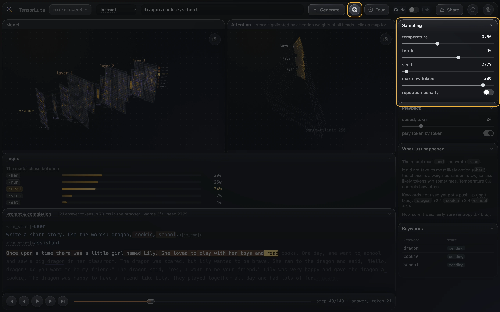

**In one sentence:** the seed is the number that fixes the random draws; the same seed and the same settings give
exactly the same story.

## How it works

At every step the model ends with chances for its candidate tokens, and one token is drawn at random (see
[sampling](../sampling/)). A computer does not have true randomness for this. It uses a pseudo-random generator: a
small formula that turns a starting number into a long row of numbers that look random. That starting number is
the seed.

- **Same seed, same settings, same words:** the same row of random numbers, so the same draws and the same story,
  token for token.
- **New seed:** a new row of random numbers, so different draws and a different story.

The seed does not make a story better or worse. It only picks one of the many stories the model could write with
those settings.

## A real example

The same order (*dragon, cookie, school*), temperature 0.6, top-k 40, min-p 0.02, only the seed changes:

| Seed | How the story starts |
| --- | --- |
| **1111** | Once upon a time, there was a little girl named Lily. She loved to play with her toys and eat cookies. One day, she went to school and saw a dragon… |
| 147 | Once upon a time, there was a little girl named Lily. She loved to read books and learn new things. One day, she went to school and saw a big dragon on the ground… |
| 42 | Once upon a time, there was a little girl named Lily. She loved to play with her toys and read books. One day, Lily's mom told her they were going to a school… |

Running seed 1111 a second time gives the first story again, character for character. The openings look alike
because the model is very sure about the first words (see [language model](../language-model/)); the stories part
ways at the first steps where the draw has real options.

## Where it is in the studio

- The **seed** slider in the **Sampling** card goes from 1 to 99,999. Moving it rewrites the story at once.
- The **dice** button next to Generate picks a new random seed: "another story" with the same words and settings.
- The seed is part of every shared link, which is why a link opens exactly the same story for someone else.

## Try it

<a class="try-link" href="/studio?w=dragon,cookie,school&seed=147&q=8" target="_blank" rel="noopener">Open seed 147 in the studio</a>

Then change the seed by one and watch a new story appear, or roll the dice a few times.

## In micro-qwen3

The demo uses seed 1111. We picked it by generating the demo order with 1,500 seeds, keeping the stories that use
all three words, end on their own and barely repeat, and then reading the best of them. The studio and the ESP32
firmware use the same small xorshift generator, so a seed gives the same draws in both.

Because the seed is fixed, every other setting can be compared fairly: move [temperature](../temperature/) or
[top-k](../top-k/) with the same seed, and every change you see comes from that setting, not from luck.

## A bit of history

Pseudo-random generators are as old as computing itself: early computers already produced "random" numbers from
formulas, because a fixed formula can be repeated exactly. That repeatability is what makes a seed useful in
machine learning: the same seed reproduces the same experiment.

## Related

- [Sampling](../sampling/): the draw that the seed feeds.
- [Temperature](../temperature/) and [top-k](../top-k/): the other settings of the draw.
