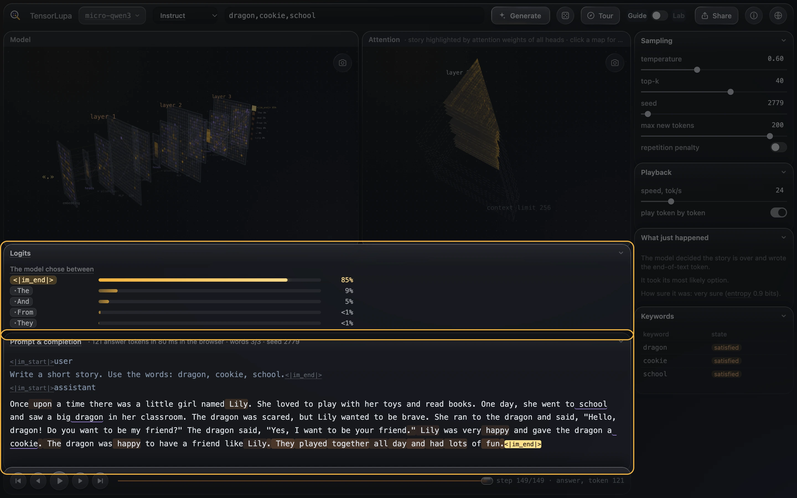

**In one sentence:** special tokens are reserved [tokens](../token/) that mark structure instead of text: where a
chat turn starts and ends, and where a text is over.

## Three tokens that are not words

micro-qwen3 has 4,096 tokens. The first three are different from all the others:

| Id | Token | What it means |
| --- | --- | --- |
| 0 | `<\|endoftext\|>` | this text is over |
| 1 | `<\|im_start\|>` | a chat turn starts; the next word names who speaks (`user` or `assistant`) |
| 2 | `<\|im_end\|>` | this turn is over |

They look like text in the studio, but each one is a single token with its own id. Ordinary byte pair encoding
never produces them: there is no way to spell `<|im_end|>` out of the usual pieces. The tokenizer recognises the
exact string and swaps in the reserved id, the same way the Hugging Face tokenizers do. That also means that if
you type `<|im_end|>` into the studio's completion mode, the model really receives the special token.

## Why they exist

A [language model](../language-model/) sees one long row of tokens and nothing else. It has no other way to know
where your request ends, whose turn it is, or that the story is finished. Special tokens put that structure into
the row itself:

```
<|im_start|>user
Write a short story. Use the words: dragon, cookie, school.<|im_end|>
<|im_start|>assistant
```

In this [prompt](../prompt/) of 29 tokens, the special tokens sit at positions 0, 22 and 24. Everything after
the last line is the answer.

## How the model learned them

- **Pre-training.** During training the stories are glued into one long stream, with `<|endoftext|>` between
  them. The model learns that after a story comes this token, and that after it a new, unrelated story starts.
- **Instruction tuning.** Every training example is wrapped in the chat markers. The model learns that after
  `<|im_start|>assistant` comes an answer that follows the request, and that an answer ends with `<|im_end|>`.
  See [Instruct](../instruct/).

## The model decides when the story ends

Nobody tells micro-qwen3 how long the story should be. It writes `<|im_end|>` itself, as one more choice among
the candidates. Near the end of the demo story, right after *"They were happy and played together all day."*,
it was one of four close options:

| Candidate | Chance |
| --- | --- |
| The | **43.9%** |
| Lily | 15.1% |
| From | 14.5% |
| `<\|im_end\|>` | 11.7% |

The draw picked "The", and the story ended with *"The end."* Right after that the chance of `<|im_end|>` was
100%, the draw picked it, and the engine stopped: as soon as any special token is drawn, the answer is over.
Before that, `<|im_end|>` never had more than 12% in this story, so the model really waited for a natural ending.

It does not always get there. At the default [temperature](../temperature/) of 0.6, about 85% of stories (300 stories from 100 different orders) end on their
own. The rest are cut by [max new tokens](../max-new-tokens/), a safety limit on the length of the answer.

## Where it is in the studio



In **Prompt & completion** the special tokens are shown as small grey markers: around your request at the top,
and at the very end of the answer. The **Model** window and the **Logits** panel show `<|im_end|>` like any other
candidate when the model considers stopping.

## Try it

<a class="try-link" href="/studio?w=dragon,cookie,school&seed=1111&s=160&q=8" target="_blank" rel="noopener">Open the last step of the story</a>

Then step back a few tokens: at the step after "all day." the chance of `<|im_end|>` is 11.7%, and after "The end." it jumps to 100%.

## In micro-qwen3

- Ids 0, 1 and 2 are the special tokens; the other 4,093 are ordinary pieces of text.
- The same markers are used by Qwen models, so the prompt format of micro-qwen3 matches Qwen3's chat format.
- The C engine stops the answer when it draws any of the three special tokens, both in the browser and on the
  ESP32-S3.

## A bit of history

Separators between documents go back to the first large pre-trained models: GPT-2 used an `<|endoftext|>` token
to mark where one text ends and the next begins. Chat models needed more structure, and in 2023 OpenAI described
[ChatML](https://github.com/openai/openai-python/blob/release-v0.28.0/chatml.md), the format with
`<|im_start|>` and `<|im_end|>` around each turn. Qwen adopted the same style of markers.

## Next

[Completion](../completion/): what a model does when there are no chat markers at all.

## References

- OpenAI (2023). [ChatML, the chat markup format](https://github.com/openai/openai-python/blob/release-v0.28.0/chatml.md).
- Alec Radford et al. (2019). [Language Models are Unsupervised Multitask Learners](https://cdn.openai.com/better-language-models/language_models_are_unsupervised_multitask_learners.pdf). OpenAI.
- An Yang et al. (2025). [Qwen3 Technical Report](https://arxiv.org/abs/2505.09388).
- Ronen Eldan, Yuanzhi Li (2023). [TinyStories: How Small Can Language Models Be and Still Speak Coherent English?](https://arxiv.org/abs/2305.07759)
