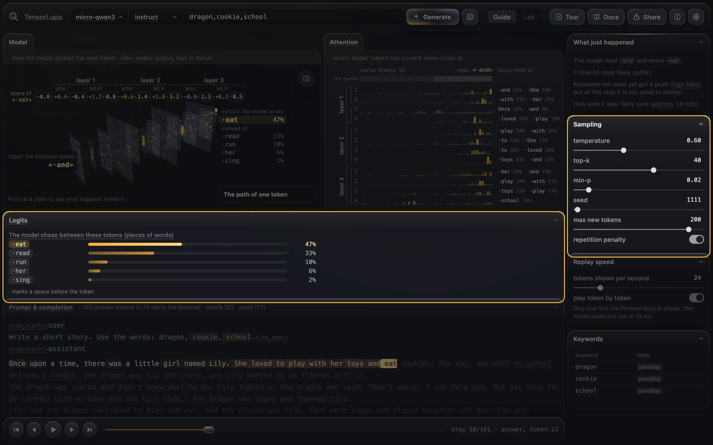

**In one sentence:** temperature sets how bold the choice is. Low temperature almost always takes the most
likely token; high temperature gives more surprising words and more mistakes.

## What happens inside

At every step the model gives each of the 4,096 tokens it knows a score, called a logit. To turn the scores into
chances, the studio divides every score by the temperature and then applies softmax.

- **Small temperature (0.2):** the gaps between scores grow, and the favourite takes even more.
- **Large temperature (1.2):** the gaps shrink, the chances even out, and rare tokens get a real chance.

Then one token is drawn at random, weighted by these chances. Temperature does not change what the model knows.
It only changes how the draw is weighted.

## A real step

The story so far: *"Once upon a time, there was a little girl named Lily. She loved to play with her toys and"*.
These are the same model scores at three temperatures, with top-k 40 and min-p 0.02 as in the studio:

| Temperature | eat | read | run | her | sing |
| --- | --- | --- | --- | --- | --- |
| 0.2 | 74% | 26% | 0% | 0% | 0% |
| **0.6** (default) | **47%** | 33% | 10% | 6% | 2% |
| 1.2 | 21% | 17% | 9% | 7% | 4% |

At 0.6 the model actually drew **eat**, the favourite, and the story continued with "eat cookies". At 0.2 only
"eat" and "read" are left: the other candidates fall so far behind that [min-p](../min-p/) rules them out. At 1.2
the chances even out, and tokens outside the top five together take 41% of them, so odd words start to slip in.

## Where it is in the studio

The temperature slider is the first one in the **Sampling** card, in both Guide and Lab. It goes from 0.05 to
1.5, and the default is 0.6. The candidates it reshapes are in the **Logits** panel, under "The model chose
between these tokens".

Moving the slider reruns the story instantly with the same seed, so every change you see comes from temperature
alone. Keep in mind that once one earlier token changes, everything after it is a different story.

## Try it

<a class="try-link" href="/studio?w=dragon,cookie,school&seed=1111&s=49&q=8" target="_blank" rel="noopener">Open this step in the studio</a>

Then drag the temperature slider and watch the bars under "The model chose between these tokens" sharpen and flatten.

## In micro-qwen3

We picked 0.6 by measuring 300 stories at each temperature (100 orders of three words the model had never seen,
3 seeds each), with the studio defaults: 8-bit weights, top-k 40, [min-p](../min-p/) 0.02 and the [repetition
penalty](../repetition-penalty/) on:

| Temperature | Requested words used | Stories with an invented word | Story ends on its own | Diversity |
| --- | --- | --- | --- | --- |
| 0.5 | 99.7% | 1.0% | 84% | 0.707 |
| **0.6** | **99.8%** | **1.0%** | **85%** | **0.730** |
| 0.7 | 99.6% | 4.0% | 86% | 0.757 |
| 0.8 | 99.8% | 3.7% | 80% | 0.787 |
| 1.0 | 99.9% | 13.7% | 77% | 0.833 |

"Diversity" is the share of different four-word phrases across all 300 stories. 0.6 is the highest temperature
at which invented words stay rare: one step up, at 0.7, four times as many stories have one, and at 1.0 it is
every seventh story. Going down to 0.5 buys nothing and makes the stories more alike.

Repetition used to be part of this choice: without the repetition penalty, 22% of stories loop at 0.5, 13% at 0.6
and none at 1.0. With the penalty on, loops stay at 0 to 1% at every temperature, so the choice now rests on
invented words and diversity.

## A bit of history

The name comes from statistical physics. Softmax with a temperature has the same form as the [Boltzmann distribution](https://en.wikipedia.org/wiki/Boltzmann_distribution), which describes how particles spread over energy states: at a high temperature all states become almost equally likely, at a low temperature the lowest-energy state wins. Language models borrowed both the formula and the word.

## Related

- **Top-k** decides how many candidates get a chance at all; temperature then shapes their chances.
- **Seed** fixes the random draw, so the same seed and settings give the same story.
- **Logits** are the raw scores that temperature divides.

## References

- [Boltzmann distribution](https://en.wikipedia.org/wiki/Boltzmann_distribution). Wikipedia.
