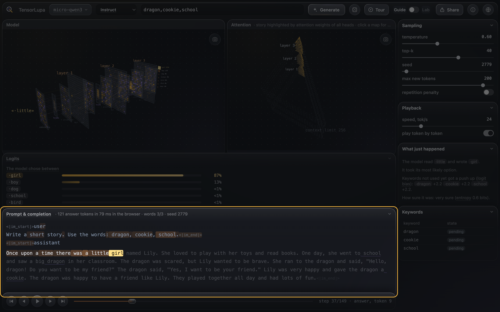

**In one sentence:** a token is a piece of text the model reads and writes: a whole word, part of a word or a
sign. micro-qwen3 knows 4,096 of them.

## Why not letters or words

A [language model](../language-model/) works with a fixed list of pieces, its vocabulary. Letters would make
every text very long; whole words would need hundreds of thousands of entries and still miss new ones. Tokens sit
in between: common words are one piece, rare words are built from smaller pieces, and any text can be written.

The vocabulary is learned from the training text before the model itself is trained. Pieces that appear often
together get merged into one token, again and again, until the list reaches its size. This method is called
byte pair encoding (BPE).

## How micro-qwen3 cuts text

These are real cuts made by the model's tokenizer. Each bracket is one token; a space belongs to the token that
follows it.

| Text | Tokens |
| --- | --- |
| Once upon a time, a little dragon loved cookies. | `[Once][ upon][ a][ time][,][ a][ little][ dragon][ loved][ cookies][.]` (11) |
| The astronaut found a luxurious spaceship. | `[The][ a][st][ron][aut][ found][ a][ l][u][x][u][ri][ous][ space][sh][ip][.]` (17) |

The first sentence is pure children's story language, so almost every word is a single token. The second uses
words that are rare in children's stories: "astronaut" takes four pieces and "luxurious" six. The vocabulary of
micro-qwen3 was learned from stories, so it is generous with story words and stingy with everything else.

This is also why the studio's [keywords](../logit-bias/) work best with simple words: a word that is one token
can be pushed in one step, while a word made of six pieces has to come out piece by piece.

## Where it is in the studio

In **Prompt & completion** every piece of text is one token, and the highlighted one is the current step. The
player moves one token at a time, and the step counter at the bottom counts tokens, not words.

## Try it

<a class="try-link" href="/studio?w=dragon,cookie,school&seed=2779&s=36" target="_blank" rel="noopener">Open this step in the studio</a>

Step through the story and watch how short words, spaces and punctuation each take a step of their own.

## In micro-qwen3

- 4,096 tokens in the vocabulary, learned with byte pair encoding, with the same rules for splitting words and
  spaces as Qwen3.
- A few tokens are special and never appear as text: `<|im_start|>` and `<|im_end|>` mark the parts of a chat,
  and `<|endoftext|>` ends a text. You can see them in the [prompt](../prompt/).
- Large models use the same idea with much bigger vocabularies; the smallest Qwen3 has about 150,000 tokens.

## A bit of history

Byte pair encoding started as a data compression algorithm, described by Philip Gage in 1994. In 2016 Rico Sennrich and colleagues adapted it to split rare words into pieces for neural translation. GPT-2 then made it work on raw bytes, so that any text can be encoded, and most language models still use a variant of it.

## Next

[Prompt](../prompt/): what the model reads before it starts to answer.
