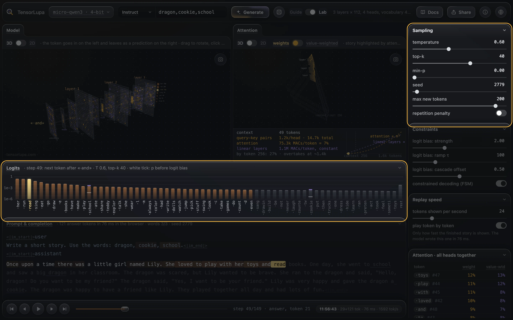

**In one sentence:** top-k lets the model draw only from the K most likely tokens; everything else is ruled out.

## How it works

At every step the model gives each of its 4,096 [tokens](../token/) a chance (see [logits](../logits/)). Most of
those chances are tiny, but together the long tail is not zero, and a weighted draw can still land there and pick
an odd word.

Top-k cuts the tail off before the draw:

1. Sort the tokens by chance.
2. Keep the K best, drop the rest.
3. Share the 100% among the K that are left, and [sample](../sampling/) from them.

Top-k 1 keeps only the favourite: that is greedy decoding, with no randomness at all. A large K changes almost
nothing. Top-k works together with [temperature](../temperature/): temperature reshapes the chances, top-k decides
who takes part.

## A real step

The demo story at *"The dragon was"* (seed 1111, temperature 0.6). These are the chances over the whole
vocabulary, before any cut:

| Top-k | Share of the chance inside | Ruled out |
| --- | --- | --- |
| 1 | 41.6% (only "very") | 58.4% |
| 5 | 89.7% | 10.3% |
| 10 | 93.7% | 6.3% |
| **40** (default) | **98.2%** | **1.8%** |
| 64 | 98.9% | 1.1% |

With top-k 40 the 40 kept tokens are scaled up from 98.2% to 100%, and [min-p](../min-p/) 0.02, which the studio
applies after top-k, drops the weakest of them too. That is why the studio shows "very" at 45.6% and not 41.6%.

The cut changes the draw and so the story. With the same seed and the other settings at their defaults:

- **top-k 1:** *"…The dragon was very big and had a long tail."* (always the favourite)
- **top-k 5:** *"…The dragon was big and shiny, and Lily wanted to be friends with it. When she got to school…"*
- **top-k 40 and top-k 64:** *"…The dragon was big and shiny, and Lily wanted to be friends with it. The dragon was
  scared and didn't know what to do."* (the same story both times)

Across the whole demo story, the tokens outside the top 40 held on average only 0.14% of the chance, and outside
the top 5 about 3.4%. Only 3 of the 133 drawn tokens came from beyond the top 5.

## Where it is in the studio

The **top-k** slider is the second one in the **Sampling** card, in both Guide and Lab. It goes from 1 to 64; the
default is 40. In the Lab, the logits strip greys out the candidates that fall outside top-k.

## Try it

<a class="try-link" href="/studio?w=dragon,cookie,school&seed=1111&s=67&q=8" target="_blank" rel="noopener">Open this step in the studio</a>

Drag top-k down to 1 and back up to 40, and watch the story switch between "very big and had a long tail" and "big and shiny".

## In micro-qwen3

We measured top-k 10, 20, 40 and 64 on 300 stories each (100 orders of three words the model had never seen,
3 seeds each), with the studio defaults: 8-bit weights, [temperature](../temperature/) 0.6, [min-p](../min-p/)
0.02 and the [repetition penalty](../repetition-penalty/) on:

| Top-k | Requested words used | Stories with an invented word | Story ends on its own | Diversity |
| --- | --- | --- | --- | --- |
| 10 | 99.7% | 3.3% | 82% | 0.731 |
| 20 | 99.9% | 1.0% | 83% | 0.730 |
| **40** | **99.8%** | **1.0%** | **85%** | **0.730** |
| 64 | 99.8% | 1.0% | 84% | 0.729 |

From 20 to 64 it barely matters: after [instruction tuning](../instruct/) the real choice at a step is among 3 to
5 tokens anyway, and min-p already removes the tail that top-k would cut. At top-k 10 more stories had an invented
word, 10 against 3 out of 300; that is too few stories to say that a tight top-k does harm, but it clearly does
not help. Temperature matters much more.

Top-k 40 alone is a weak safety net, though: a draw from the tail is rare at each step but not over a whole story,
and it is how invented words such as "Byican" begin. Without min-p, 2.7% of stories have an invented word instead
of 1.0%.

## A bit of history

Top-k sampling for neural text was popularised by
[Fan, Lewis and Dauphin in 2018](https://arxiv.org/abs/1805.04833), who used it to write stories. A year later
[Holtzman and colleagues](https://arxiv.org/abs/1904.09751) proposed nucleus (top-p) sampling, which keeps the
smallest set of tokens that together hold a chosen share of the chance, instead of a fixed number.

## Related

- [Sampling](../sampling/): the draw that top-k limits.
- [Temperature](../temperature/): reshapes the chances of the candidates that are left.
- [Seed](../seed/): fixes the random numbers of the draw.
- [Min-p](../min-p/): cuts the tail relative to the favourite, after top-k.

## References

- Angela Fan, Mike Lewis, Yann Dauphin (2018). [Hierarchical Neural Story Generation](https://arxiv.org/abs/1805.04833).
- Ari Holtzman et al. (2019). [The Curious Case of Neural Text Degeneration](https://arxiv.org/abs/1904.09751).
