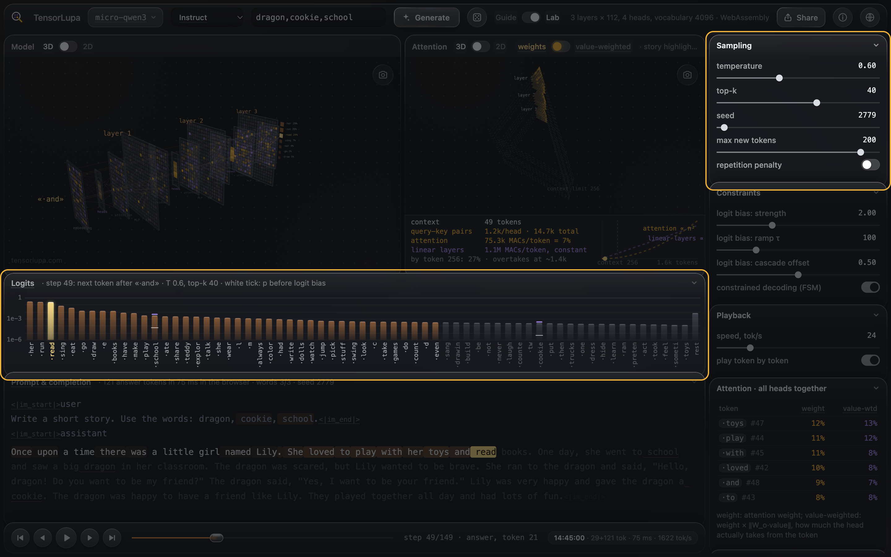

**In one sentence:** top-k lets the model draw only from the K most likely tokens; everything else is ruled out.

## How it works

At every step the model gives each of its 4,096 [tokens](../token/) a chance (see [logits](../logits/)). Most of
those chances are tiny, but together the long tail is not zero, and a weighted draw can still land there and pick
an odd word.

Top-k cuts the tail off before the draw:

1. Sort the tokens by chance.
2. Keep the K best, drop the rest.
3. Share the 100% among the K that are left, and [sample](../sampling/) from them.

Top-k 1 keeps only the favourite: that is greedy decoding, with no randomness at all. A large K changes almost
nothing. Top-k works together with [temperature](../temperature/): temperature reshapes the chances, top-k decides
who takes part.

## A real step

The demo story at *"She loved to play with her toys and"* (seed 2779, temperature 0.6). These are the chances over
the whole vocabulary, before any cut:

| Top-k | Share of the chance inside | Ruled out |
| --- | --- | --- |
| 1 | 28.6% (only "her") | 71.4% |
| 5 | 89.0% | 11.0% |
| 10 | 95.1% | 4.9% |
| **40** (default) | **98.9%** | **1.1%** |
| 64 | 99.4% | 0.6% |

With top-k 40 the 40 kept tokens are scaled up from 98.9% to 100%, which is why the studio shows "her" at 29% and
not 28.6%.

The cut changes the draw and so the story. With the same seed:

- **top-k 1:** *"…with her toys and run around outside."* (always the favourite)
- **top-k 5:** *"…with her toys and run around in the park…"*
- **top-k 40 and top-k 64:** *"…with her toys and read books."* (the same story both times)

Across the whole demo story, the tokens outside the top 40 held on average only 0.07% of the chance, and outside
the top 5 about 1.5%. Only one of the 121 drawn tokens came from beyond the top 5.

## Where it is in the studio

The **top-k** slider is the second one in the **Sampling** card, in both Guide and Lab. It goes from 1 to 64; the
default is 40. In the Lab, the logits strip greys out the candidates that fall outside top-k.

## Try it

<a class="try-link" href="/studio?w=dragon,cookie,school&seed=2779&s=48" target="_blank" rel="noopener">Open this step in the studio</a>

Drag top-k down to 1 and back up to 40, and watch the story switch between "run around outside" and "read books".

## In micro-qwen3

We measured top-k from 10 to 64 on 200 story orders, and it barely mattered: after [instruction
tuning](../instruct/) the real choice at a step is among 3 to 5 tokens anyway, so the tail is almost empty.
Temperature matters much more. Top-k 40 alone is a weak safety net, though: a draw from the tail is rare at each
step but not over a whole story, and it is how invented words such as "Byican" begin. The studio adds
[min-p](../min-p/) 0.02 after top-k, which removes the tail relative to the favourite.

## A bit of history

Top-k sampling for neural text was popularised by
[Fan, Lewis and Dauphin in 2018](https://arxiv.org/abs/1805.04833), who used it to write stories. A year later
[Holtzman and colleagues](https://arxiv.org/abs/1904.09751) proposed nucleus (top-p) sampling, which keeps the
smallest set of tokens that together hold a chosen share of the chance, instead of a fixed number.

## Related

- [Sampling](../sampling/): the draw that top-k limits.
- [Temperature](../temperature/): reshapes the chances of the candidates that are left.
- [Seed](../seed/): fixes the random numbers of the draw.
- [Min-p](../min-p/): cuts the tail relative to the favourite, after top-k.

## References

- Angela Fan, Mike Lewis, Yann Dauphin (2018). [Hierarchical Neural Story Generation](https://arxiv.org/abs/1805.04833).
- Ari Holtzman et al. (2019). [The Curious Case of Neural Text Degeneration](https://arxiv.org/abs/1904.09751).
