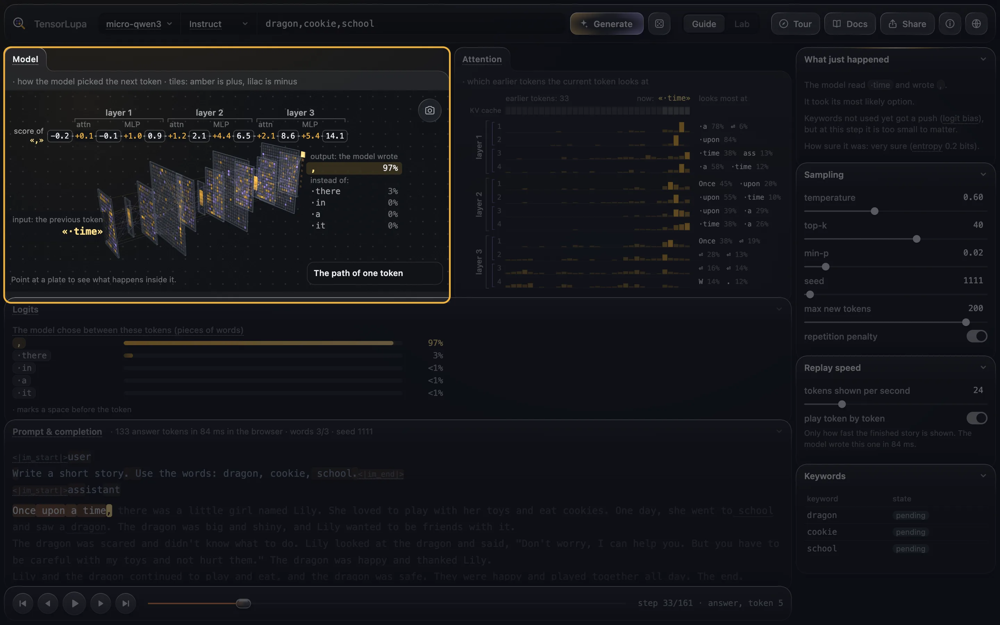

**In one sentence:** a transformer turns each [token](../token/) into a list of numbers, passes it through layers
of [attention](../attention/) and [MLP](../mlp/), and at the end gives a score to every possible next token.

## What happens at one step

Every step of a [language model](../language-model/) runs the same pipeline once, from left to right:

1. **Embedding.** The current token becomes a list of 112 numbers. This list is the token's
   [residual stream](../residual-stream/), and everything below works on it.
2. **Layers.** The stream passes through three layers. Each layer has two parts:
   - **[Attention](../attention/)** looks back at the earlier tokens and brings in what matters from them.
   - **[MLP](../mlp/)** reacts to patterns in the stream and pushes some next words up and others down.

   Neither part replaces the stream. Each one adds its contribution on top, so the stream keeps everything that
   came before.
3. **Output.** The final stream is compared with every token in the vocabulary. The result is one score per
   token, the [logits](../logits/), and from them one token is drawn ([sampling](../sampling/)).

The same layers with the same weights run for every token. The only thing that changes from step to step is the
text they look at.

## Watching the guess form, layer by layer

You can decode the stream in the middle of the model as if it were the end. This trick is called the
[logit lens](../logit-lens/), and it shows how the prediction takes shape. Here is the step right after
*"Once upon a time"* in the demo story, with the top candidates after each part (scores at temperature 1, before
[top-k](../top-k/) and keyword [logit bias](../logit-bias/)):

| Read the stream after | Top candidates |
| --- | --- |
| embedding | time 100% |
| layer 1 | time 29%, owed 2.9%, ered 1.8% |
| layer 2 | **,** 54.2%, **there** 39.2% |
| layer 3 (the output) | **,** 71.9%, **there** 27.8% |

Right after the embedding the stream only "knows" the word it is: time. After the first layer it is still mostly
about that word. The second layer brings in the context, and the two real candidates appear: a comma or "there".
The third layer sharpens the choice. In the story the draw landed on "there".

Layers do not always build the guess gradually. After *"Once upon"* the stream after layer 2 points to "night"
14% and "bed" 11%, and only the third layer settles on "a" with 100%.

## Where it is in the studio

The **Model** panel draws the whole pipeline in 3D. The token enters on the left as the embedding plate, passes
the plates of three layers, and the prediction leaves on the right. In the Lab
you can click any plate to see its values and what the model would say at that point.

## Try it

<a class="try-link" href="/studio?w=dragon,cookie,school&seed=2779&s=32" target="_blank" rel="noopener">Open this step in the studio</a>

Rotate the model with the mouse, then switch to the Lab and click the plates after each layer to follow the guess
from "time" to "there".

## In micro-qwen3

micro-qwen3 is a small copy of the [Qwen3](https://arxiv.org/abs/2505.09388) design:

- 3 layers, a stream of 112 numbers per token, a vocabulary of 4,096 tokens, 1,056,656 parameters in total.
- Attention with 4 query heads that share 2 key-value heads ([grouped-query attention](https://arxiv.org/abs/2305.13245)), each head working with 64
  numbers.
- MLP with 336 neurons per layer, using the [SwiGLU](https://arxiv.org/abs/2002.05202) activation.
- [RMSNorm](https://arxiv.org/abs/1910.07467) before each part, QK-norm inside attention, and [rotary position embeddings (RoPE)](https://arxiv.org/abs/2104.09864) so the model knows
  the order of the tokens. It reads at most 256 tokens at once.

Large models use the same parts in the same order. They just have many more layers and much longer streams.

## A bit of history

The transformer was introduced in 2017 by Vaswani and colleagues at Google in the paper ["Attention Is All You
Need"](https://arxiv.org/abs/1706.03762), for translating text. It dropped the step-by-step recurrent networks used before and relied on attention
alone. Almost every large language model since then, including Qwen3, is a transformer.

## Next

[Embedding and residual stream](../residual-stream/): the list of numbers a token turns into, and how each layer
adds to it.

## References

- Ashish Vaswani et al. (2017). [Attention Is All You Need](https://arxiv.org/abs/1706.03762). arXiv.
- An Yang et al. (2025). [Qwen3 Technical Report](https://arxiv.org/abs/2505.09388). arXiv.
- Joshua Ainslie et al. (2023). [GQA: Training Generalized Multi-Query Transformer Models from Multi-Head Checkpoints](https://arxiv.org/abs/2305.13245). arXiv.
- Noam Shazeer (2020). [GLU Variants Improve Transformer](https://arxiv.org/abs/2002.05202). arXiv.
- Biao Zhang, Rico Sennrich (2019). [Root Mean Square Layer Normalization](https://arxiv.org/abs/1910.07467). arXiv.
- Jianlin Su et al. (2021). [RoFormer: Enhanced Transformer with Rotary Position Embedding](https://arxiv.org/abs/2104.09864). arXiv.
