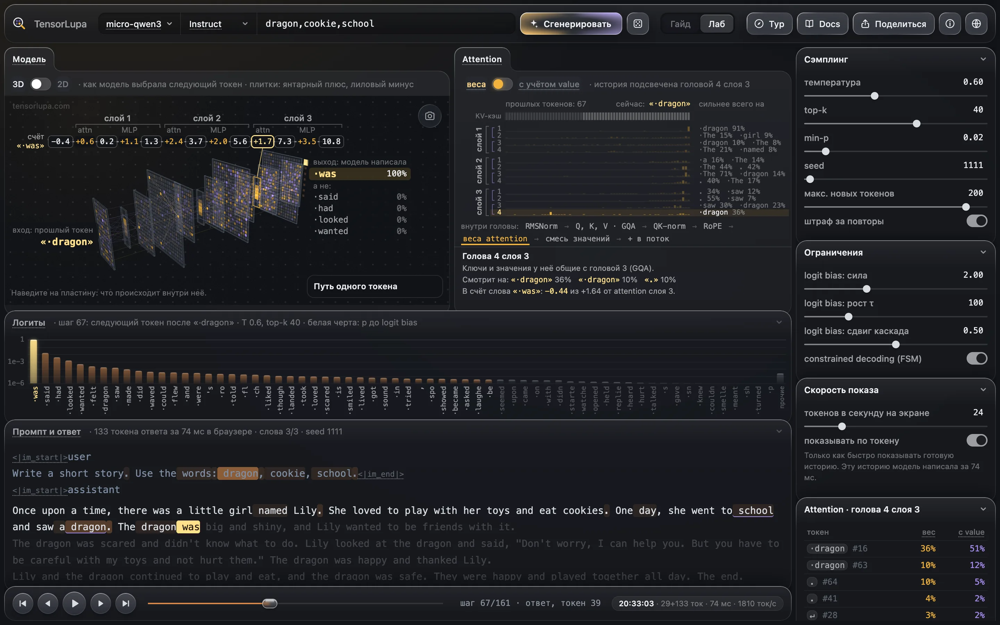

**Одной фразой:** голова attention (attention head) это один независимый способ оглядываться назад. В каждом слое
четыре головы, и каждая учится замечать своё.

## Одна голова, один способ смотреть

[Attention](../attention/) объясняет саму идею: текущий [токен](../token/) сравнивает свой запрос с ключами прежних
токенов, превращает совпадения в веса, которые в сумме дают 100%, и собирает их значения. Голова это одна полная
копия этого механизма со своими выученными весами. В micro-qwen3 каждая голова работает со списками из 64 чисел для
запросов, ключей и значений.

Поскольку у каждой головы свои веса, каждая учится по-своему решать, на что стоит смотреть. Слой запускает свои
четыре головы рядом, а их результаты складываются в [остаточный поток](../residual-stream/). Три слоя по четыре
головы дают 12 голов всего.

## Головы специализируются

В среднем по всем шагам демо-истории 12 голов ведут себя очень по-разному. У некоторых из них есть ясная работа:

| Голова (как их нумерует студия) | Что делает чаще всего | Средний вес |
| --- | --- | --- |
| Слой 1, голова 1 | смотрит на сам текущий токен | 35% на себя |
| Слой 2, голова 3 | смотрит на токен прямо перед текущим | 30% на предыдущий токен |
| Слой 2, голова 4 | смотрит на токен прямо перед текущим | 35% на предыдущий токен |
| Слой 3, голова 4 | оглядывается на заказанные слова в [промпте](../prompt/) | 16% на «dragon», «cookie» и «school» |

Последняя самая интересная. Остальные 11 голов в среднем отдают трём заказанным словам меньше 5% своего attention;
слой 3, голова 4 отдаёт им 16%, хотя они стоят за десятки токенов назад. Когда модель пишет «was» после «The
dragon», эта голова ставит 36% своего веса на «dragon» в просьбе, на 50 токенов раньше.

Голова, которая смотрит на предыдущий токен, тоже может быть очень уверена в себе: на шаге «...play with her toys
and» слой 2, голова 4 ставит 81% своего веса на «toys», токен прямо перед текущим.

## Куда она смотрит и что берёт

Вес говорит, куда смотрит голова. Он не говорит, сколько голова реально берёт из этого токена, потому что одни
значения малы, а другие велики. Студия показывает оба варианта:

- **веса**: веса attention головы, как они посчитаны.
- **с учётом value**: каждый вес, умноженный на размер того, что этот токен добавил бы в поток через эту голову
  (длина значения после выходной проекции головы, ‖W_o · value‖), и потом снова приведённый к 100%.

Обычно они совпадают. Когда не совпадают, это о чём-то говорит. Два настоящих случая из демо-истории:

| Шаг | Голова | Токен | Вес | С учётом value |
| --- | --- | --- | --- | --- |
| пишем «was» после «The dragon» | слой 3, голова 4 | «dragon» в просьбе | 36% | 51% |
| пишем «eat» после «her toys and» | слой 3, голова 4 | «school» в просьбе | 24% | 33% |
| тот же шаг | слой 3, голова 4 | «and», текущий токен | 8% | 4% |
| пишем «you» после «But» | слой 3, голова 4 | точка «.» | 31% | 23% |

Выходит, что слова из просьбы вносят больше, чем говорит их вес, а точка, куда голова часто «отдыхает» своим
attention, вносит меньше. Если читать одни веса, мы бы занижали, насколько просьба управляет этой головой.

## Grouped-query attention

В micro-qwen3 в каждом слое 4 головы запросов, но всего 2 набора ключей и значений: каждая пара голов делит один
ключ и одно значение. Это называется grouped-query attention ([GQA](https://arxiv.org/abs/2305.13245)). Головы всё
равно смотрят в разные стороны, потому что у каждой свой запрос, но модели нужно хранить вдвое меньше ключей и
значений для уже прочитанных токенов: 256 чисел на токен на слой вместо 512. В больших моделях с длинными текстами
эта память составляет большую долю затрат, поэтому GQA используют Qwen3 и многие другие модели.

Ещё две детали из устройства Qwen3 определяют каждую голову. Позиции приходят из RoPE
([поворотное кодирование позиции](https://arxiv.org/abs/2104.09864)): запросы и ключи поворачиваются на угол,
зависящий от позиции, поэтому совпадение двух токенов зависит от расстояния между ними. А QK-norm нормирует запросы
и ключи перед сравнением, и от этого оценки во время обучения остаются в разумном диапазоне
([Qwen3 Technical Report](https://arxiv.org/abs/2505.09388)).

## Где это в студии

- В панели **Attention** щёлкните одну полосу, чтобы выбрать одну голову. История подсветится только этой головой.
  Щёлкните ещё раз, чтобы вернуться ко всем головам.
- Переключатель в верхней части панели выбирает между **веса** и **с учётом value**.
- Под полосами карточка описывает выбранную голову: на что она смотрит и сколько добавила к оценке написанного
  слова.
- В Лабе инспектор показывает таблицу для выбранной головы: токены, на которые она смотрит сильнее всего, с обоими
  числами рядом.

## Попробуйте

<a class="try-link" href="/ru/studio?w=dragon,cookie,school&seed=1111&s=66&q=8&mode=lab" target="_blank" rel="noopener">Открыть этот шаг в Лабе</a>

Выберите слой 3, голову 4 и сравните два её столбца в инспекторе. Потом откройте шаг после «her toys and» и выберите
слой 2, голову 4, чтобы увидеть, как работает голова, смотрящая на предыдущий токен.

<a class="try-link" href="/ru/studio?w=dragon,cookie,school&seed=1111&s=49&q=8&mode=lab" target="_blank" rel="noopener">Открыть шаг «her toys and» в Лабе</a>

## В micro-qwen3

- 3 слоя × 4 головы = 12 голов, каждая работает с 64 числами.
- 4 головы запросов делят 2 головы ключей и значений в каждом слое (grouped-query attention).
- RoPE для позиций и QK-norm, как в Qwen3.
- Не больше 256 токенов контекста, поэтому голова может оглянуться не дальше чем на 255 токенов.

## Немного истории

Многоголовый attention пришёл из статьи 2017 года
[Attention Is All You Need](https://arxiv.org/abs/1706.03762): вместо одного attention на слой трансформер запускает
рядом несколько меньших, чтобы каждый мог выучить свою связь между словами. Grouped-query attention в 2023 году
предложил Джошуа Эйнсли с коллегами как золотую середину между тем, чтобы дать каждой голове свои ключи и значения,
и тем, чтобы делить один набор на все головы.

## Связанные термины

- [Attention](../attention/): идея, на которой построена каждая голова.
- [Остаточный поток](../residual-stream/): куда головы пишут свои результаты.
- [Logit lens](../logit-lens/): как прочитать, что говорит поток после каждого слоя.

## Источники

- Ashish Vaswani et al. (2017). [Attention Is All You Need](https://arxiv.org/abs/1706.03762).
- Joshua Ainslie et al. (2023). [GQA: Training Generalized Multi-Query Transformer Models from Multi-Head Checkpoints](https://arxiv.org/abs/2305.13245).
- Jianlin Su et al. (2021). [RoFormer: Enhanced Transformer with Rotary Position Embedding](https://arxiv.org/abs/2104.09864).
- An Yang et al. (2025). [Qwen3 Technical Report](https://arxiv.org/abs/2505.09388).
