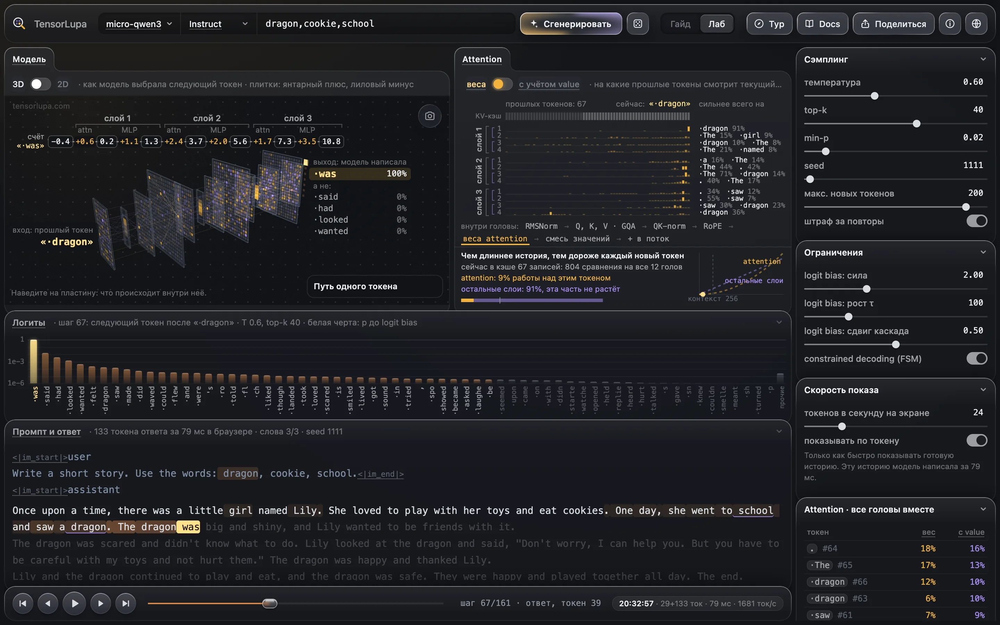

**Одной фразой:** attention (внимание) позволяет каждому токену оглянуться на прежние токены и взять из них то,
что нужно для предсказания следующего.

## Как это работает

Внутри [трансформера](../transformer/) у каждого [токена](../token/) есть свой список чисел,
[остаточный поток](../residual-stream/). Сам по себе этот список знает только о своём токене. Attention это шаг,
на котором токены обмениваются информацией.

В каждом слое каждый токен делает из своих чисел три вещи:

- **запрос** (query): что я ищу?
- **ключ** (key): что я предлагаю другим?
- **значение** (value): что я передам, если на меня посмотрят?

Текущий токен сравнивает свой запрос с ключом каждого прежнего токена. Хорошие совпадения получают высокую оценку,
а оценки превращаются в веса, которые в сумме дают 100%. Потом токен собирает значения прежних токенов, смешанные в
этих долях, и прибавляет результат к своим числам.

Два правила делают всё это простым:

- **Только прежние токены.** Токен может оглянуться на [промпт](../prompt/) и на уже написанное, но не вперёд.
  Именно поэтому текст можно писать по одному токену.
- **Несколько голов.** В каждом слое несколько attention работают рядом, их называют [головами](../attention-head/).
  Каждая голова учится по-своему решать, на что стоит смотреть: одна следит за именами, другая за последней точкой.

## Настоящий шаг

Демо-история к этому моменту: *«...she went to school and saw a dragon. The dragon»*. Модель сейчас напишет
«was». Вот куда ушёл её attention, в среднем по всем головам всех трёх слоёв:

| Прежний токен | Вес |
| --- | --- |
| «.» (конец предыдущего предложения) | 18% |
| «The» | 17% |
| «dragon» (сам текущий токен) | 12% |
| «saw» | 7% |
| «dragon» (в «saw a dragon») | 6% |
| «dragon» (в просьбе: «Use the words: dragon») | 3% |

В среднем attention держится рядом: текущее предложение и слово прямо перед текущим. Но одна голова третьего слоя
ведёт себя совсем иначе. 36% своего attention она отдаёт слову «dragon» в просьбе, на 50 токенов назад в промпте,
и ещё 10% приходится на «saw a dragon». Похоже, её работа в том, чтобы помнить, о чём история.

С именами эта голова делает то же самое. Когда история собирается снова написать «Lily», после «shiny, and», она
отдаёт 71% своего attention первому «Lily», на 32 токена раньше.

## Веса и вклад

Высокий вес значит, что на токен посмотрели, а не что из него много взяли. В студии два вида:
**веса** показывают, куда смотрит голова, а **с учётом value** показывает, сколько каждый токен реально вносит,
потому что некоторые значения совсем малы. Подробности в статье [голова attention](../attention-head/).

## Почему длинные тексты стоят дороже

Каждый новый токен сравнивает себя со всеми прежними. 10-й токен делает 10 сравнений на голову, 200-й
делает 200. Поэтому работа attention растёт с длиной текста, а остальные части слоя ([MLP](../mlp/) и проекции)
стоят одинаково для каждого токена.

Студия показывает это на маленьком графике рядом с attention. В micro-qwen3 слои за пределами attention делают
около 1,1 млн умножений со сложением на токен. В начале истории attention занимает малую долю. К 256-му токену,
самому длинному тексту, который модель может прочитать, это около 27% работы, а обогнал бы он остальное примерно
на 1400 токенах. В больших моделях с длинным контекстом основная стоимость приходится именно на attention.

## Где это в студии

Панель **Attention** показывает текущий шаг: двенадцать полос, по одной на голову, сгруппированных по слоям. В
полосе прежние токены идут слева направо, а высота столбика показывает, насколько текущий токен смотрит на этот
прежний. Справа написаны слова, на которые голова смотрит сильнее всего. История внизу подсвечена так же. Щёлкните
полосу, чтобы видеть одну голову вместо всех, и переключайтесь между **веса** и **с учётом value** в верхней части
панели.

Ряд над полосами это KV-кэш, по ячейке на прежний токен: щёлкните ячейку, чтобы увидеть, какие головы смотрят на
этот токен сейчас. В строке под полосами перечислены шаги внутри головы.

## Попробуйте

<a class="try-link" href="/ru/studio?w=dragon,cookie,school&seed=1111&s=66&q=8&mode=lab" target="_blank" rel="noopener">Открыть этот шаг в студии</a>

Щёлкайте полосы по очереди и найдите голову, которая оглядывается на «dragon» в просьбе. Потом шагните вперёд и
посмотрите, как сдвигается подсветка.

## В micro-qwen3

- 3 слоя, в каждом 4 головы attention, каждая голова работает с 64 числами.
- [Grouped-query attention](https://arxiv.org/abs/2305.13245): 4 головы делят 2 набора ключей и значений, и памяти под них нужно вдвое меньше.
- [RoPE](https://arxiv.org/abs/2104.09864): позиции кодируются поворотом запросов и ключей, поэтому attention знает, как далеко позади стоит токен.
- QK-norm: запросы и ключи нормируются перед сравнением, от этого обучение идёт устойчиво.
- Модель читает не больше 256 токенов: промпт и история должны поместиться вместе.

Всё это устроено так же, как в [Qwen3](https://arxiv.org/abs/2505.09388), только гораздо меньше по размеру.

## Немного истории

Attention предложили в 2014 году [Дмитрий Богданов, Кёнхён Чо и Йошуа Бенжио](https://arxiv.org/abs/1409.0473) для машинного перевода:
модель, переводя предложение, училась оглядываться на нужные слова оригинала. В 2017 году статья
[«Attention Is All You Need»](https://arxiv.org/abs/1706.03762) построила целую модель на одном attention, трансформер, и с тех пор на нём
построена почти каждая большая языковая модель.

## Дальше

[MLP](../mlp/): вторая половина каждого слоя, где находятся нейроны.

## Источники

- Dzmitry Bahdanau, Kyunghyun Cho, Yoshua Bengio (2014). [Neural Machine Translation by Jointly Learning to Align and Translate](https://arxiv.org/abs/1409.0473). arXiv.
- Ashish Vaswani et al. (2017). [Attention Is All You Need](https://arxiv.org/abs/1706.03762). arXiv.
- Joshua Ainslie et al. (2023). [GQA: Training Generalized Multi-Query Transformer Models from Multi-Head Checkpoints](https://arxiv.org/abs/2305.13245). arXiv.
- Jianlin Su et al. (2021). [RoFormer: Enhanced Transformer with Rotary Position Embedding](https://arxiv.org/abs/2104.09864). arXiv.
- An Yang et al. (2025). [Qwen3 Technical Report](https://arxiv.org/abs/2505.09388). arXiv.
