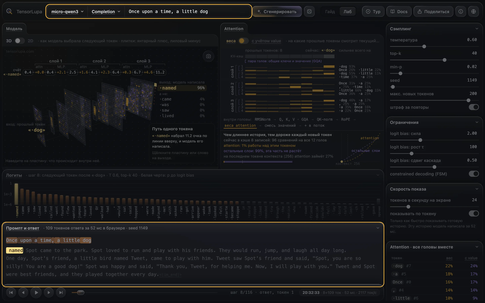

**Одной фразой:** в режиме completion (продолжение текста) модель просто продолжает текст, который вы ей дали, без
просьбы и без меток чата.

## Режим, с которого начинает любая модель

Сначала [языковую модель](../language-model/) обучают на большой куче обычного текста с одной задачей: предсказать
следующий [токен](../token/). Получается **базовая модель**. Она не знает, что такое вопрос или просьба. Она знает
только, как обычно продолжаются тексты.

Дайте ей начало истории, и она допишет остальное:

> *Once upon a time, a little dog* named Spot came to the park. Spot loved to run and play with his friends. They
> would run, jump, and laugh all day long. One day, Spot's friend, a little bird named Tweet, came to play with
> him...

## Базовые модели на Hugging Face

На Hugging Face большинство семейств моделей выходят в двух версиях, и различить их помогают названия:

| Название | Что это | Что делает |
| --- | --- | --- |
| [`Qwen/Qwen3-0.6B-Base`](https://huggingface.co/Qwen/Qwen3-0.6B-Base) | базовая модель | продолжает текст |
| [`Qwen/Qwen3-0.6B`](https://huggingface.co/Qwen/Qwen3-0.6B) | модель, дообученная на инструкциях | отвечает на просьбы в чате |

Базовая модель это сырой результат предобучения. Модель [instruct](../instruct/) это та же сеть, обученная ещё
немного, чтобы выполнять просьбы. Базовые модели скачивают, чтобы дообучить под свою задачу, а instruct-модели,
чтобы с ними разговаривать.

## Как micro-qwen3 учили продолжать текст

micro-qwen3 обучена с нуля на **[TinyStories](https://huggingface.co/datasets/roneneldan/TinyStories)**, наборе коротких историй, написанных простым английским для
маленьких детей. Его сделали Ронен Эльдан и Юаньчжи Ли, чтобы выяснить, насколько маленькой может быть языковая
модель, которая всё ещё пишет связный английский ([статья](https://arxiv.org/abs/2305.07759)). Мы взяли версию 2 историй, написанных
GPT-4, из [roneneldan/TinyStories](https://huggingface.co/datasets/roneneldan/TinyStories) (лицензия
CDLA-Sharing-1.0).

Поэтому модель пишет детские истории и больше ничего: других текстов она никогда не видела.

## Где это в студии

Переключите режим наверху с **Instruct** на **Completion**. Поле со словами превратится в текстовое поле: наберите
начало истории и нажмите «Сгенерировать». Студия отправит ваш текст как есть, без меток чата.

Модель в студии это та, что дообучена на инструкциях; в режиме Completion она всё равно хорошо продолжает текст,
потому что продолжать истории она выучила в первую очередь.

## Попробуйте

<a class="try-link" href="/ru/studio?p=Once%20upon%20a%20time%2C%20a%20little%20dog&seed=1149&s=7&q=8" target="_blank" rel="noopener">Открыть эту историю в студии</a>

Потом измените начало: начните с середины предложения или с вопроса и посмотрите, как модель продолжит.

## Немного истории

Много лет любая языковая модель была базовой: она продолжала текст и ничего больше. В 2020 году [GPT-3](https://arxiv.org/abs/2005.14165) показала, что достаточно большая базовая модель всё равно справляется с задачами, если промпт начинается с нескольких решённых примеров. Это называется few-shot prompting. Дообучение на инструкциях появилось позже, чтобы в этом отпала нужда.

## Дальше

[Instruct](../instruct/): как модель учится выполнять просьбу, а не просто продолжать текст.

## Источники

- Ronen Eldan, Yuanzhi Li (2023). [TinyStories: How Small Can Language Models Be and Still Speak Coherent English?](https://arxiv.org/abs/2305.07759). arXiv.
- [TinyStories dataset](https://huggingface.co/datasets/roneneldan/TinyStories) (CDLA-Sharing-1.0). Hugging Face.
- [Qwen3-0.6B-Base](https://huggingface.co/Qwen/Qwen3-0.6B-Base). Hugging Face.
- [Qwen3-0.6B](https://huggingface.co/Qwen/Qwen3-0.6B). Hugging Face.
- Tom B. Brown et al. (2020). [Language Models are Few-Shot Learners](https://arxiv.org/abs/2005.14165). arXiv.
