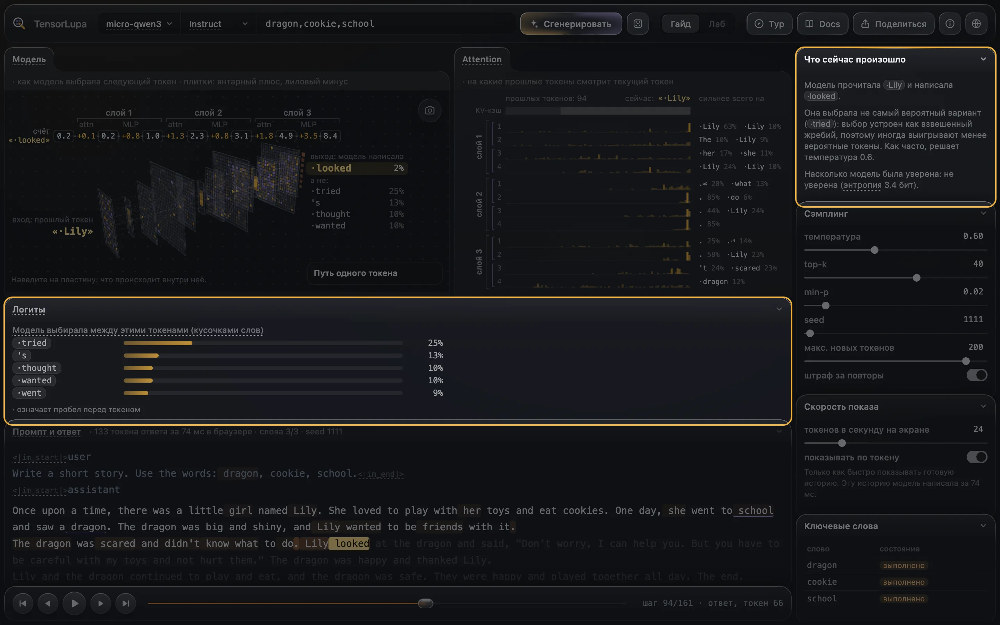

**Одной фразой:** энтропия (entropy) показывает, насколько размазан выбор, в битах: 0 значит, что модель полностью
уверена, больше значит, что спорят больше вариантов.

## Что означает это число

На каждом шаге модель даёт шансы своим кандидатам на следующий [токен](../token/). Энтропия превращает весь этот
список шансов в одно число:

- **0 бит:** у одного кандидата весь шанс. Решать нечего.
- **1 бит:** примерно столько же неопределённости, сколько в честной монете между двумя вариантами.
- **2 бита:** примерно столько же неопределённости, сколько между четырьмя равными вариантами.
- **Каждый лишний бит** удваивает число одинаково вероятных вариантов.

Она не говорит, какой токен победит, а только насколько модель колеблется. Шаг с высокой энтропией это место, где
[случайный жребий](../sampling/) действительно важен и где два прогона с разными [seed](../seed/) скорее всего
пойдут в разные стороны.

## Какие шансы измеряет студия

Студия считает энтропию по тем же шансам, по которым идёт жребий: итоговые [логиты](../logits/) после
[logit bias](../logit-bias/) и [декодирования с ограничениями](../fsm/), поделённые на [температуру](../temperature/)
и обрезанные [top-k](../top-k/) и [min-p](../min-p/). Поэтому, когда вы двигаете ползунок температуры, энтропия
тоже двигается. При top-k 40 наибольшее возможное значение около 5,3 бита (40 равных кандидатов).

## Настоящая история, шаг за шагом

Эти числа взяты из демо-истории (слова dragon, cookie, school, seed 1111, температура 0,6, top-k 40, min-p 0,02),
133 токена ответа:

| | Значение |
| --- | --- |
| среднее по истории | 0,83 бита |
| шагов меньше 1 бита (студия пишет «очень уверена») | 83 из 133 |
| шагов от 1 до 3 бит («довольно уверена») | 48 из 133 |
| шагов от 3 бит и выше («не уверена») | 2 |
| шагов почти ровно с 0 бит | 48 |

Самый неуверенный шаг идёт после *«…The dragon was scared and didn't know what to do. Lily»*:

| Кандидат | Шанс |
| --- | --- |
| tried | 24,6% |
| 's | 12,6% |
| thought | 10,5% |
| wanted | 10,4% |

Энтропия здесь 3,42 бита, а жребий выбрал «looked», кандидата далеко внизу списка. Самые уверенные шаги это
устойчивые фразы: после *«Once upon a»* модель даёт «time» 100%, 0 бит.

Большую часть истории модель очень уверена, а между этим есть несколько настоящих выборов. Эти немногие шаги и
решают, какая история у вас получится.

## Где это в студии

- В **Гайде** карточка «Что сейчас произошло» заканчивается строкой «Насколько модель была уверена»: очень уверена
  меньше 1 бита, довольно уверена от 1 до 3 бит, не уверена выше этого, с точным числом в скобках.
- В **Лабе** инспектор шага показывает энтропию в битах.
- Карточка attention использует ту же идею для [attention](../attention/): «рассеянность attention» говорит, на
  сколько прежних токенов смотрит голова. 0 бит значит один-единственный токен; максимум растёт с длиной текста.

## Попробуйте

<a class="try-link" href="/ru/studio?w=dragon,cookie,school&seed=1111&s=93&q=8" target="_blank" rel="noopener">Открыть самый неуверенный шаг</a>

Потом шагайте вперёд и назад стрелками и смотрите, как меняется «Насколько модель была уверена». Подвигайте
ползунок температуры на шаге, где модель колеблется, и увидите, как энтропия растёт и падает.

## В micro-qwen3

- Те же оценки модели намного ровнее до температуры и top-k: по всем 4096 токенам при температуре 1 средняя
  энтропия этой истории 2,31 бита вместо 0,83. Температура 0,6, top-k 40 и min-p 0,02 отрезают большую часть
  длинного хвоста.
- Наибольшая возможная энтропия по всему словарю 12 бит (4096 равных токенов). Обученная модель никогда не
  подходит к ней близко.

## Немного истории

Энтропия как мера информации пришла из статьи Клода Шеннона
[A Mathematical Theory of Communication](https://ieeexplore.ieee.org/document/6773024) (1948). В той же статье он
создавал похожий на английский текст по статистике букв и слов, самый ранний предок [языковой модели](../language-model/).
Измерять неопределённость в битах тоже его идея.

## Связанные термины

- [Температура](../temperature/) понижает или повышает энтропию каждого шага.
- [Сэмплинг](../sampling/) это место, где неопределённость превращается в один выбранный токен.
- [Логиты](../logits/) это сырые оценки, из которых получаются шансы.

## Источники

- Claude E. Shannon (1948). [A Mathematical Theory of Communication](https://ieeexplore.ieee.org/document/6773024). Bell System Technical Journal.
