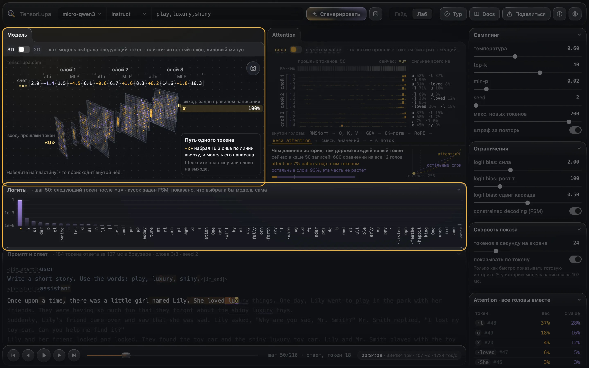

**Одной фразой:** constrained decoding (декодирование с ограничениями) значит, что когда ключевое слово начато, маленький конечный автомат (FSM)
заставляет модель дописать его по буквам.

## Какую задачу он решает

[Logit bias](../logit-bias/) решает, *когда* появится заказанное слово. Constrained decoding решает, *как* оно
написано. Редкое слово состоит из нескольких [токенов](../token/): «luxury» это `[ l][u][x][u][ry]`. Маленькая
модель может начать такое слово и свернуть на полпути или закончить его и приклеить ещё букв: «warnerer»,
«examineineine». Конечный автомат это короткий список правил, который идёт за словом по кусочкам и говорит, какие
кусочки могут быть дальше.

## Что делают правила

Для каждого заказанного слова студия готовит его обычные формы по правилам английского написания, каждую с большой
буквой и без, с пробелом впереди и без:

- само слово;
- множественное число или третье лицо: «dragons», «boxes», «tries»;
- прошедшее время: «dared», «stopped», «tried»; у частых неправильных глаголов его нет, потому что «ran» или «swam» не
  продолжает слово;
- форма на -ing: «daring» (немая e уходит), «running» (у короткого слова удваивается последняя буква), «lying».

Слова, похожие на существительные («invitation», «happiness»), получают только множественное число, а слова,
похожие на прилагательные («graceful», «careless»), не получают форм совсем.

Дальше на каждом шаге:

1. **Написаны два или больше кусочков слова:** следующий кусочек задан, жребия нет вообще. Модель видит шанс этого
   кусочка как 100%.
2. **Написан только первый кусочек:** второй кусочек получает дополнительную доплату +4, но модель всё ещё может пойти
   другим путём.
3. **Только что закончена обычная форма:** кусочки, которые продолжили бы слово буквами, блокируются, кроме тех, что
   ведут к другой обычной форме. После «luxury» модель в теории ещё может написать «luxuries» или «luxuried», но не
   «luxuryous».

Всё остальное, знаки препинания, пробелы и новые слова, остаётся свободным. Автомат следит только за заказанными
словами.

## Настоящий шаг: пишем «luxury»

Заказ «play, luxury, shiny», seed 2. История к этому моменту: *«Once upon a time, there was a little girl named Lily.
She loved»*. Модель хотела « to» (55%); «luxury» начинается с кусочка « l», у которого было 1,7%.

| Кусочек | Что произошло |
| --- | --- |
| ` l` | logit bias +2,30 поднял его с 1,7% до 44%, и жребий его выбрал |
| `u` | первый кусочек написан: +4 дополнительно от автомата поверх logit bias |
| `x` | два кусочка написаны: задан автоматом, без жребия |
| `u` | задан автоматом |
| `ry` | задан автоматом, слово закончено |
| ` things` | «luxury» закончено; продолжить его буквами мог только `ing`; модель написала « things» |

Результат: *«She loved luxury things.»* Слово выбрала модель; автомат только проследил, чтобы оно вышло целым. Здесь
модель и так была уверена в каждом кусочке (от 99,8% до 100%), так что автомат не изменил ни одной буквы. Его эффект
это гарантия и небольшой побочный эффект: заданный кусочек не тратит случайный бросок. При выключенном автомате тот же
seed даёт *«She loved luxury and play with her toys.»*

В демо-истории с dragon, cookie и school каждое заказанное слово это один токен, поэтому ничего не задаётся. Автомат
всё равно работает после каждого слова: после «dragon» буквами могут идти только `ed` и `ing`, после «school» только
`s`, `ed` и `ing`.

## Где это в студии

- В панели **«Логиты»** заданный кусочек показан со 100%, а строка над полосой говорит, что кусочек задан FSM, и что
  модель выбрала бы сама.
- В Лабе в карточке **«Ограничения»** есть переключатель **constrained decoding (FSM)**. Выключите его, чтобы
  сравнить.

## Попробуйте

<a class="try-link" href="/ru/studio?w=play,luxury,shiny&seed=2&s=49&q=8&mode=lab" target="_blank" rel="noopener">Открыть заданное «x» из «luxury»</a>

<a class="try-link" href="/ru/studio?w=play,luxury,shiny&seed=2&fsm=0&q=8&mode=lab" target="_blank" rel="noopener">Тот же заказ без FSM</a>

## В micro-qwen3

- Кусочек задаётся, когда написаны два кусочка слова; один первый кусочек получает +4 для второго.
- Те же правила работают в движке на C на ESP32-S3 и в браузере.
- Автомат знает только заказанные слова и их простые английские формы. Грамматику и смысл он не проверяет.
- Раньше формы строились приклеиванием каждого окончания к каждому слову. Так проходили «dareing», «examineing» и
  «invitationing», и эти правила стояли за большой долей выдуманных слов в студии. Следование английскому написанию
  снизило долю историй с выдуманным словом с 6,0% до 3,3% (300 историй, веса 8 бит, без штрафа за повторы).
  Со штрафом и [min-p](../min-p/), как в студии сейчас, это 1,0%.

## Немного истории

Ограничивать, что модель может написать дальше, это распространённая техника: инструменты для больших моделей
используют конечные автоматы и грамматики, чтобы получать корректный JSON или код, блокируя каждый токен, который
сломал бы формат. TensorLupa использует ту же идею в самом малом масштабе: несколько правил на каждое заказанное
слово.

## Связанные термины

- [Logit bias](../logit-bias/): когда появляется заказанное слово.
- [Токен](../token/): почему некоторые слова состоят из нескольких кусочков.
- [Логиты](../logits/): где у заблокированных токенов снимаются их оценки.
