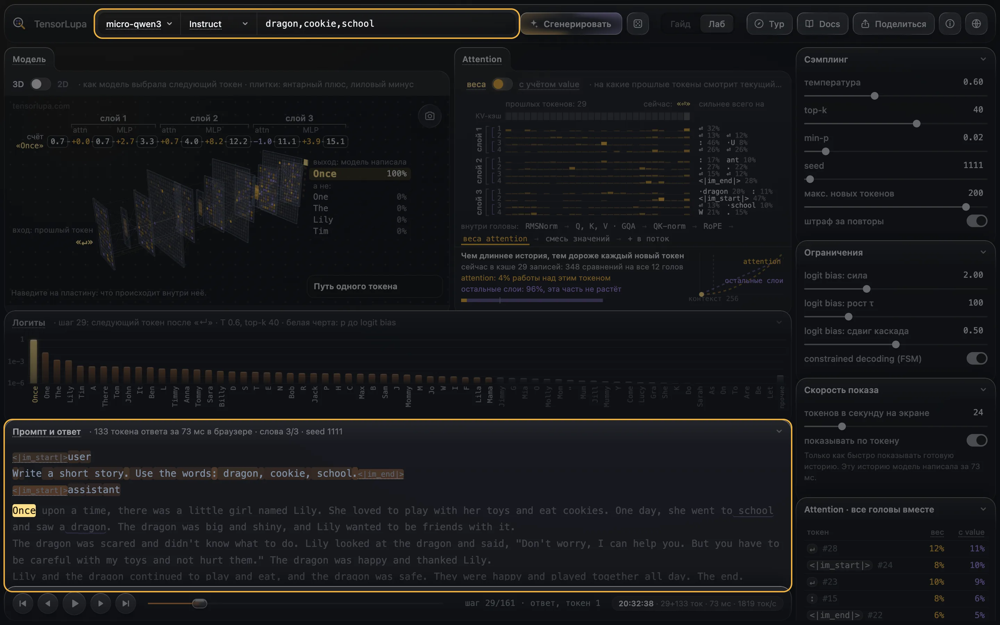

**Одной фразой:** instruct-модель (по инструкции) это базовая модель, которую ещё немного обучили на просьбах и
ответах, поэтому она делает то, что вы просите, а не просто продолжает ваш текст.

## От продолжения к ответу

[Базовая модель](../completion/) продолжает текст. Попросите её «Write a short story. Use the words: dragon, cookie,
school.» без всяких меток чата, и она воспримет вашу просьбу как начало какого-то текста:

> *Write a short story. Use the words: dragon, cookie, school.* It is a big bear who is very friendly. Do you want
> to play with me?" The man smiled and said, "Yes, let's play together." They played together every day and had
> lots of fun...

Ни дракона, ни печенья, ни школы: просьба оказалась просто первой строкой текста, который нужно продолжить.

Дообучение на инструкциях это исправляет. Модель обучают на множестве пар «просьба и хороший ответ», обёрнутых в
метки чата (см. [промпт](../prompt/)). Она учится: после `<|im_start|>assistant` идёт ответ, который делает то,
что сказано в просьбе. Метод обычно называют supervised fine-tuning (SFT).

## Маленькие модели обычно пропускают этот шаг

Многие совсем маленькие модели останавливаются на базовой стадии. Чтобы выполнить просьбу, модели нужно во время
письма оглядываться на просьбу, часто через сотни токенов, а крошечной сети это трудно. micro-qwen3 всё же
научили это делать.

## Как micro-qwen3 научилась выполнять просьбы

Демо-модель дообучили на **[TinyStoriesInstruct](https://huggingface.co/datasets/roneneldan/TinyStoriesInstruct)** тех же авторов, что и TinyStories
([roneneldan/TinyStoriesInstruct](https://huggingface.co/datasets/roneneldan/TinyStoriesInstruct)), переведённом в
формат чата Qwen. Смешали два вида задач: написать историю по заданным словам, особенностям или сюжету и пересказать
историю одним предложением. Пересказы оказались важны: они учат модель оглядываться на просьбу.

Сколько из заказанных слов попало в историю, на тестовых заказах из трёх слов:

| Модель | Заказанные слова в истории |
| --- | --- |
| до дообучения на инструкциях | 5,7% |
| после дообучения на инструкциях | 64% |
| после дообучения, с растущим толчком к неиспользованным словам ([logit bias](../logit-bias/)) | 100% |

Последняя строка это правило декодирования поверх модели: студия повышает оценки заказанных слов, которые ещё не
появились, всё сильнее, пока они ждут. Его можно выключить в Лабе и посмотреть на модель саму по себе.

## Где это в студии

**Instruct** это режим по умолчанию. Впишите до трёх английских слов и нажмите «Сгенерировать». Промпт в формате
чата студия соберёт сама; его видно наверху панели **«Промпт и ответ»**.

## Попробуйте

<a class="try-link" href="/ru/studio?w=dragon,cookie,school&seed=1111&s=28&q=8" target="_blank" rel="noopener">Открыть instruct-историю в студии</a>

<a class="try-link" href="/ru/studio?p=Write%20a%20short%20story.%20Use%20the%20words%3A%20dragon%2C%20cookie%2C%20school.&seed=1231&s=17&q=8" target="_blank" rel="noopener">Открыть ту же просьбу в режиме Completion</a>

Первая ссылка оборачивает просьбу в метки чата, вторая отправляет её простым текстом. Та же модель, те же слова,
совсем разные истории.

## Немного истории

Дообучение на инструкциях стало стандартом примерно в 2021 и 2022 годах, с [FLAN](https://arxiv.org/abs/2109.01652) от Google (Wei et al., 2021) и [InstructGPT](https://arxiv.org/abs/2203.02155) от OpenAI (Ouyang et al., 2022), семейством моделей, из которого вышел ChatGPT. TinyStoriesInstruct, данные, на которых дообучали micro-qwen3, взят из [статьи о TinyStories](https://arxiv.org/abs/2305.07759) Ронена Эльдана и Юаньчжи Ли (2023).

## Дальше

[Трансформер](../transformer/): что происходит внутри модели на каждом шаге.

## Источники

- Jason Wei et al. (2021). [Finetuned Language Models Are Zero-Shot Learners](https://arxiv.org/abs/2109.01652). arXiv.
- Long Ouyang et al. (2022). [Training language models to follow instructions with human feedback](https://arxiv.org/abs/2203.02155). arXiv.
- Ronen Eldan, Yuanzhi Li (2023). [TinyStories: How Small Can Language Models Be and Still Speak Coherent English?](https://arxiv.org/abs/2305.07759). arXiv.
- [TinyStoriesInstruct dataset](https://huggingface.co/datasets/roneneldan/TinyStoriesInstruct). Hugging Face.
