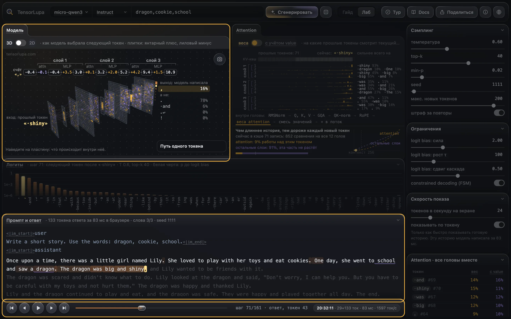

**Одной фразой:** языковая модель (language model) предсказывает следующий кусочек текста. Она читает написанное,
оценивает каждый возможный следующий токен, выбирает один, дописывает его и повторяет.

## По одному токену

Языковая модель никогда не пишет целое предложение сразу. Каждый шаг это один и тот же небольшой цикл:

1. Прочитать всё, что написано до сих пор.
2. Поставить оценку каждому из 4096 известных ей [токенов](../token/).
3. Превратить оценки в шансы и вытянуть один токен.
4. Дописать этот токен к тексту и вернуться к шагу 1.

История из 150 токенов это 150 оборотов этого цикла. Больше ничего не происходит: нет плана на всю историю, нет
памяти между историями, только вопрос «что дальше?», который задают снова и снова.

## Настоящее начало истории

Это несколько первых шагов, которые micro-qwen3 сделала, когда писала демо-историю, с фаворитами на каждом шаге:

| Написано до сих пор | Главные кандидаты | Выпало |
| --- | --- | --- |
| *(начало ответа)* | Once 100% | Once |
| Once upon a time | **,** 96,6%, there 3,4% | **,** |
| Once upon a time, there was a | little 81,2%, big 9,9%, boy 6,1% | little |
| Once upon a time, there was a little | girl 69,4%, boy 30,6% | girl |

Стоит заметить две вещи. Большинство шагов почти определённые: после «Once upon a» модель даёт «time» 100%. А
время от времени модель берёт не фаворита. Позже в истории, после «The dragon was big and shiny», у точки было
78,0%, но жребий выпал на запятую, у которой было 16,0%, и предложение продолжилось: «, and Lily wanted to be
friends with it.» Так одна и та же модель может писать много разных историй.

## Где это в студии

- **«Промпт и ответ»** показывает текст. Подсвеченный токен это текущий шаг.
- **«Модель»** показывает справа от пластин токен, который модель написала на этом шаге, и кандидатов, между
  которыми она выбирала, с их шансами. **«Логиты»** показывают оценку каждого токена словаря.
- **Плеер** внизу двигается на один токен назад или вперёд. Каждый шаг записан, поэтому можно вернуться к любому
  моменту истории.

## Попробуйте

<a class="try-link" href="/ru/studio?w=dragon,cookie,school&seed=1111&s=70&q=8" target="_blank" rel="noopener">Открыть шаг, где жребий выпал не на фаворита</a>

Потом нажимайте стрелки или кнопки плеера и смотрите, как кандидаты меняются от токена к токену.

## В micro-qwen3

В micro-qwen3 1 056 656 параметров, примерно в 560 раз меньше, чем в самой маленькой [Qwen3](https://arxiv.org/abs/2505.09388). В браузере она пишет
заметно больше тысячи токенов в секунду, так что вся история готова за долю секунды, а студия потом проигрывает
её медленно, чтобы вы успевали следить. Тот же код на C работает на микроконтроллере ESP32-S3 со скоростью около
60 токенов в секунду.

Большие модели, на которых работают чат-ассистенты, делают ровно тот же цикл. У них гораздо больше параметров, они
читают гораздо более длинные тексты и обучены на гораздо большем объёме данных, но каждый шаг по-прежнему такой:
«оценить каждый токен, вытянуть один, дописать».

## Немного истории

В 1913 году Андрей Марков вручную подсчитал, как в «Евгении Онегине» гласные и согласные следуют друг за другом: это была первая цепь Маркова и первая модель того, «что идёт следом» в тексте ([как она соотносится с micro-qwen3](../../model/next-token/)). В 1948 году [Клод Шеннон](https://ieeexplore.ieee.org/document/6773024) показал, что английский можно имитировать простой статистикой: выбирать каждую следующую букву или слово по тому, как часто они следуют за предыдущими. В 2003 году [Йошуа Бенжио с коллегами](https://www.jmlr.org/papers/volume3/bengio03a/bengio03a.pdf) заменили подсчёт нейронной сетью, которая предсказывает следующее слово. [GPT](https://cdn.openai.com/research-covers/language-unsupervised/language_understanding_paper.pdf) в 2018 году взяла ту же идею следующего токена и масштабировала её с помощью трансформера.

## Дальше

[Токен](../token/): что за кусочки текста и почему «dragon» это один токен, а редкое слово занимает несколько.

## Источники

- Claude E. Shannon (1948). [A Mathematical Theory of Communication](https://ieeexplore.ieee.org/document/6773024). Bell System Technical Journal.
- Yoshua Bengio, Réjean Ducharme, Pascal Vincent, Christian Jauvin (2003). [A Neural Probabilistic Language Model](https://www.jmlr.org/papers/volume3/bengio03a/bengio03a.pdf). JMLR.
- Alec Radford et al. (2018). [Improving Language Understanding by Generative Pre-Training](https://cdn.openai.com/research-covers/language-unsupervised/language_understanding_paper.pdf). OpenAI.
- An Yang et al. (2025). [Qwen3 Technical Report](https://arxiv.org/abs/2505.09388). arXiv.
