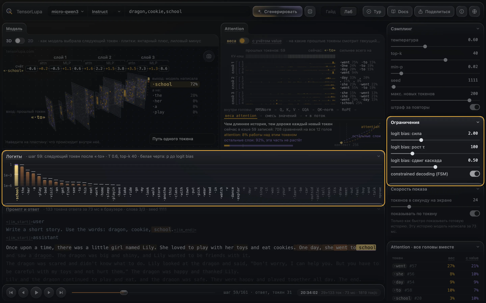

**Одной фразой:** logit bias (доплата к оценке) это число, которое добавляется к оценке токена перед выбором; здесь оно достаётся
заказанным ключевым словам, которых ещё нет в истории.

## Зачем нужен толчок

[Обученная по инструкциям](../instruct/) micro-qwen3 понимает «use the words: dragon, cookie, school», но сама
использует все три слова только примерно в трети историй. Вывод [логитов](../logits/) заказанных слов на каждом шаге
показал причину: модель ставит их высоко, она их «хочет», но слишком редко, чтобы выиграть [жребий](../sampling/).
Поэтому TensorLupa даёт им толчок.

Толчок это простая арифметика: перед выбором к оценке каждого заказанного слова, которое ещё не появилось,
прибавляется число. Выше оценка, выше шанс, остальное делает жребий. Слова, которые уже есть в истории, ничего не
получают, и модель вольна использовать их снова или нет.

## Правило, найденное шаг за шагом

Каждая часть правила появилась из взгляда на предыдущий результат. Все числа из 200 тестовых заказов из трёх слов,
измеренных в проекте micro-qwen3:

| Идея | Истории со всеми тремя словами |
| --- | --- |
| без доплаты, просто сэмплинг (T 0,5) | 36,5% |
| постоянная доплата за каждое недостающее слово | 79,5% |
| каждое использованное слово повышает доплату остальным | 94% |
| доплата ещё и растёт, пока слово продолжает ждать | 99,5% |
| то же правило при температуре 0,6 | 100% |

Итоговое правило:

```
bonus = strength · (u + 1) · (1 + t / τ)
  u  how many requested words are already in the text
  t  tokens since the last requested word appeared
  τ  how fast the waiting bonus grows (the ramp)
```

При настройках студии по умолчанию (сила 2, τ 100) первое недостающее слово получает +2, после первого
использованного слова доплата удваивается, после второго утраивается. Слово, которое ждёт 100 токенов, получает вдвое
больше начальной доплаты.

Слово из нескольких [токенов](../token/) подталкивается по кусочкам: доплата идёт его следующему недостающему
кусочку. Когда слово начато, дальше берёт [constrained decoding](../fsm/) и следит, чтобы оно было дописано как надо.

## Настоящие шаги: доплата растёт по ходу истории

Демо-история (seed 1111, слова dragon, cookie, school). Слово «cookies» модель написала сама, так что одно слово уже
было использовано, когда пришли два шага ниже. Шансы при температуре 0,6, до доплаты и после:

| История до этого места | Доплата | До | После |
| --- | --- | --- | --- |
| ...she went to | +4,28 | «the» 95,6%, «her» 2,9%, «a» 1,1%, ..., **«school» 0,2%** | **«school» 71%** |
| ...she went to school and saw a | +6,18 | «big» 98,7%, «cookie» 0,3%, ..., **«dragon» меньше 0,1%** | **«dragon» 78%** |

Вторая строка показывает, почему доплата растёт. После «school» использованы два слова, поэтому базовая доплата
утроилась (2 · 3 = 6), а не удвоилась (2 · 2 = 4), как в первой строке. Модель собиралась писать «a big» с 98,7%.
У «dragon» было меньше десятой доли процента. С +6,18 он получил 78%, и «dragon» выиграл.

Без толчка история получилась бы нормальной, только без школы. Поставьте силу 0, и тот же заказ идёт так: «...she
went to the park with her mom», а «school» так и не приходит. Доплата не пишет историю, она меняет только то, какой из
собственных вариантов модели выигрывает.

## Меньше трёх слов

Доплата растёт с каждым использованным словом, поэтому единственное заказанное слово осталось бы на самой малой
доплате и попадало бы только в 93% историй. Лечение: начать не с самого низа. **Сдвиг каскада** начинает `u` с
`0.5 · (3 − number of words)`. С ним одно слово доходит до 99,5%, а два слова до 100%, почти без потери естественности
текста.

## Где это в студии



- **Гайд:** карточка «Что сейчас произошло» показывает действие доплаты на шаге, например «school 0,2% → 71%».
- **Лаб:** в карточке **«Ограничения»** три ползунка: **logit bias: сила**, **logit bias: рост τ** и **logit bias:
  сдвиг каскада**. В панели «Логиты» белая черта показывает шанс каждого токена до доплаты, а карточка **«Ключевые
  слова»** показывает, какие слова ещё ждут.
- Поставьте силу 0, чтобы выключить доплату и увидеть, что модель делает сама.

## Попробуйте

<a class="try-link" href="/ru/studio?w=dragon,cookie,school&seed=1111&s=58&q=8&mode=lab" target="_blank" rel="noopener">Открыть шаг со «school» в Лабе</a>

<a class="try-link" href="/ru/studio?w=dragon,cookie,school&seed=1111&wb=0&q=8&mode=lab" target="_blank" rel="noopener">Тот же заказ без доплаты</a>

## В micro-qwen3

- По умолчанию: сила 2, рост τ 100, сдвиг каскада 0,5, [температура](../temperature/) 0,6.
- Одно и то же правило работает в движке на C на ESP32-S3 и в браузере.
- Модель обучали на заказах из глагола, существительного и прилагательного. На заказах такого вида, подобранных
  вручную, каждая история использовала все три слова; заказы из трёх существительных, как dragon, cookie, school,
  сработали в 94% историй.
- Большая постоянная доплата не выход: при +6 текст становится менее естественным, а отдельные слова всё равно
  пропускаются в 8,5% историй. Растущее правило даёт около 100% всех трёх слов при той же естественности.

## Немного истории

Прибавлять фиксированное число к оценкам выбранных токенов это старый приём, и API больших моделей предлагают его как
параметр «logit bias», чаще всего чтобы запретить или поощрить определённые токены. Каскад и рост со временем
ожидания здесь собственные для TensorLupa: доплата, которая знает, каких слов ещё нет, и растёт, чем дольше они ждут.

## Связанные термины

- [Constrained decoding (FSM)](../fsm/): дописывание слова, когда оно начато.
- [Логиты](../logits/): оценки, к которым прибавляется доплата.
- [Сэмплинг](../sampling/): жребий, который превращает более высокую оценку в более высокий шанс.
