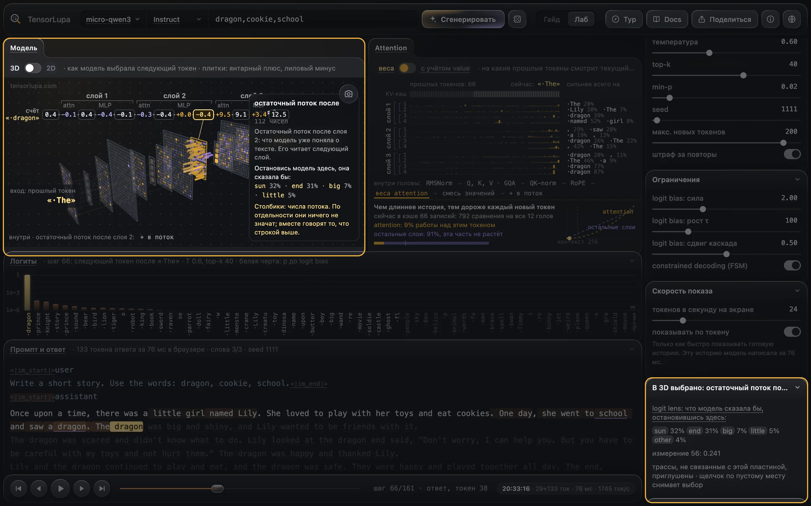

**Одной фразой:** logit lens (линза логитов) расшифровывает поток в середине модели так, будто это её конец, и
показывает, что модель сказала бы на этом месте.

## Как это работает

Каждый [токен](../token/) проходит через модель как список из 112 чисел, [остаточный поток](../residual-stream/).
Каждый слой добавляет к нему свой вклад. Только после последнего слоя модель превращает поток в оценку для каждого
возможного следующего токена, [логиты](../logits/): нормирует поток и умножает его на выходную таблицу.

Logit lens применяет этот последний шаг раньше времени. Возьмите поток после слоя 1 или слоя 2, нормируйте его,
умножьте на выходную таблицу и прочитайте результат так, будто это окончательный ответ. Для этого ничего не
обучается: просто используется выходной слой самой модели. Это работает потому, что каждый слой пишет в тот же
поток, который выходной слой читает в конце.

После последнего слоя линза и модель совпадают полностью: линза после слоя 3 это сырой выход модели.

## Настоящий шаг: ответ появляется в последнем слое

Демо-история только что написала *«…she went to school and saw a dragon. The»*. Вот что сказал бы поток в каждой
точке:

| Точка в потоке | Главные догадки |
| --- | --- |
| сразу после эмбеддинга | The 99,8% |
| после слоя 1 | end 26,3%, other 18,0%, The 16,1% |
| после слоя 2 | sun 31,8%, end 30,9%, big 7,2% |
| после слоя 3 | **dragon 97,7%**, princess 0,2%, knight 0,2% |

Два слоя поток хранит самые частые продолжения «The» в детских историях: «The end», «The sun». Только третий слой
приносит контекст, только что упомянули дракона, и ответ перескакивает на «dragon» с 97,7%. Модель написала
«dragon».

## Второй шаг: чего линза не видит

На три токена раньше история дошла до *«…she went to school and saw a»*. Линза после слоя 3 даёт big 68,1%, cookie
2,2%, little 1,3%, а «dragon» только 0,3%. И всё же модель написала «dragon»: в итоговых кандидатах у него было 78%
против 22% у «big».

Разница в [logit bias](../logit-bias/). «dragon» было заказанным словом, которое ещё не использовали, поэтому
студия добавила к его оценке 6,18 уже после собственного выхода модели. Линза показывает одну модель, до всякого
bias, до [температуры](../temperature/) и [top-k](../top-k/), при температуре 1. Если сравнить линзу после
последнего слоя с итоговыми кандидатами, видно, сколько в выборе пришло от модели, а сколько от правил вокруг неё.

## Где это в студии

В **Лабе** щёлкните стеклянную пластину остаточного потока в 3D-виде панели **«Модель»**. Информационная карточка в
панели «Модель» и инспектор справа показывают «logit lens: что модель сказала бы, остановившись здесь» с главными
догадками в этой точке. Щёлкайте пластины одну за другой, чтобы увидеть, как догадка складывается слой за слоем, и
сравнивайте их с панелью **«Логиты»**.

## Попробуйте

<a class="try-link" href="/ru/studio?w=dragon,cookie,school&seed=1111&s=65&q=8&mode=lab" target="_blank" rel="noopener">Открыть шаг «The dragon» в Лабе</a>

<a class="try-link" href="/ru/studio?w=dragon,cookie,school&seed=1111&s=62&q=8&mode=lab" target="_blank" rel="noopener">Открыть шаг «saw a»</a>

В каждом щёлкните пластины после слоя 1, 2 и 3 и сравните линзу с итоговыми кандидатами.

## В micro-qwen3

- 3 слоя, поэтому у линзы четыре точки для чтения: после эмбеддинга и после каждого слоя.
- Сразу после эмбеддинга линза в основном читает обратно текущий токен («The» 99,8%), потому что поток ещё ничего
  другого не видел.
- В маленькой модели средние слои часто сначала угадывают частые фразы, а последний слой поправляет их с учётом
  контекста. Большие модели показывают ту же картину на десятках слоёв.

## Немного истории

Название пришло из блог-поста 2020 года исследователя, известного как nostalgebraist: он так расшифровал средние
слои GPT-2 и увидел, как её догадки становятся резче от слоя к слою. Идея опирается на взгляд на трансформер как на
[остаточный поток](../residual-stream/), описанный в статье Anthropic
[A Mathematical Framework for Transformer Circuits](https://transformer-circuits.pub/2021/framework/index.html)
(2021), где каждый слой читает из одного общего потока и пишет в него.

## Связанные термины

- [Эмбеддинг и остаточный поток](../residual-stream/): поток, который читает линза.
- [Трансформер](../transformer/): что делают слои между точками линзы.
- [Логиты](../logits/): итоговые оценки, которые имитирует линза.

## Источники

- Nelson Elhage et al., Anthropic (2021). [A Mathematical Framework for Transformer Circuits](https://transformer-circuits.pub/2021/framework/index.html).
