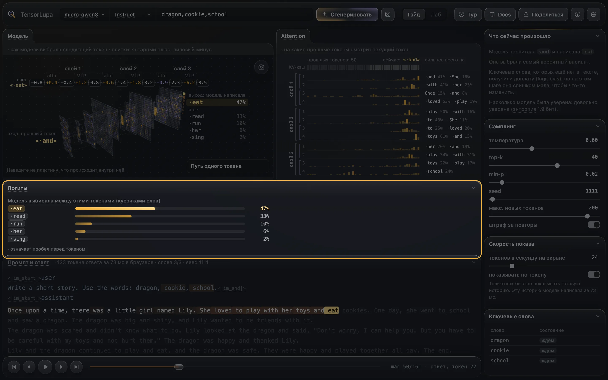

**Одной фразой:** логиты (logits) это сырые оценки модели для всех 4096 [токенов](../token/); softmax превращает их в
вероятности, которые в сумме дают 100%.

## От оценок к шансам

В конце каждого шага [трансформер](../transformer/) ставит одно число каждому токену своего словаря: 4096 чисел, по
одному на каждый возможный следующий токен. Эти сырые оценки и есть логиты. Чем выше логит, тем вероятнее токен
следующий, но сами числа не вероятности: они могут быть отрицательными, и в сумме не дают ничего определённого.

Softmax превращает их в шансы. Он возводит e в степень каждого логита, поэтому каждая оценка становится
положительной, а потом делит на общую сумму, поэтому шансы в сумме дают 100%.

Из-за этой степени маленькие разрывы в логитах становятся большими разрывами в шансах. Токен, у которого логит выше
на 1 пункт, примерно в 2,7 раза вероятнее; выше на 2 пункта, примерно в 7 раз; выше на 5 пунктов, примерно в 150
раз. Поэтому в словаре из 4096 токенов почти весь шанс может достаться нескольким.

## Настоящий шаг

История к этому моменту: *«Once upon a time, there was a little girl named Lily. She loved to play with her toys and»*.
Вот собственные логиты модели для главных кандидатов и то, во что они превращаются:

| Токен | Логит | Шанс при температуре 1 | Шанс при настройках студии по умолчанию (температура 0,6, top-k 40, min-p 0,02) |
| --- | --- | --- | --- |
| **eat** | 8,51 | 21,5% | **47,1%** |
| read | 8,30 | 17,5% | 33,2% |
| run | 7,56 | 8,4% | 9,8% |
| her | 7,28 | 6,4% | 6,1% |
| sing | 6,48 | 2,8% | 1,6% |

У «eat» и «read» логиты различаются всего на 0,21, поэтому шансы близки. «sing» ниже «eat» на 2,0 и получает
примерно в восемь раз меньше. По всему словарю логиты на этом шаге идут примерно от −9,1 до 8,5; самый нижний токен
в десятки миллионов раз менее вероятен, чем фаворит.

Насколько сконцентрированы шансы, из 4096 токенов:

| | Токенов держат 50% | 90% | 99% |
| --- | --- | --- | --- |
| сырые логиты, температура 1 | 4 | 110 | 1078 |
| как их использует студия, температура 0,6 | 2 | 3 | 6 |

Модель вытянула **eat**, фаворита, и история продолжилась словами «eat cookies».

## Что происходит с логитами перед выбором

Студия не всегда берёт логиты модели как есть. На каждом шаге ответа, в таком порядке:

1. **Сырые логиты** выходят из модели.
2. **[Logit bias](../logit-bias/)** добавляет доплату к заказанным словам, которых ещё не было. На этом шаге
   «dragon», «cookie» и «school» получили по +2,42; они всё ещё сильно уступали «eat», так что доплата не изменила
   выбор.
3. **[Декодирование с ограничениями](../fsm/)** блокирует куски, которые превратили бы заказанное слово в мусор;
   у заблокированных токенов логит минус бесконечность, поэтому их шанс ровно 0.
4. **[Штраф за повторы](../repetition-penalty/)** понижает оценку токенов, которые повторили бы фразу, уже
   стоящую в истории. На этом шаге ему нечего было понижать.
5. **[Top-k](../top-k/)** оставляет только k самых высоких логитов (по умолчанию 40).
6. **[Температура](../temperature/)** делит логиты, а потом softmax превращает их в шансы.
7. **[Min-p](../min-p/)** исключает токены, которые намного менее вероятны, чем фаворит (по умолчанию 0,02). На этом
   шаге он оставил 7 из 40 кандидатов.
8. **[Сэмплинг](../sampling/)** вытягивает один токен.

## Где это в студии

- В **Гайде** панель **«Логиты»** перечисляет пять фаворитов под строкой «Модель выбирала между этими токенами
  (кусочками слов)» с их шансами; выбранный подсвечен.
- В **Лабе** та же панель показывает полосу из 64 лучших кандидатов и один столбик для всех остальных, в
  логарифмической шкале. Выбранный токен яркий, кандидаты из top-k тусклее, токены вне top-k почти не видны. Белая
  черта отмечает шанс токена до logit bias. Наведите на столбик, чтобы увидеть его логит и доплату.

## Попробуйте

<a class="try-link" href="/ru/studio?w=dragon,cookie,school&seed=1111&s=49&q=8&mode=lab" target="_blank" rel="noopener">Открыть этот шаг в Лабе</a>

Наведите на столбики «eat», «read» и «run», потом двигайте ползунок температуры и смотрите, как полоса заостряется
и выравнивается.

## В micro-qwen3

- 4096 логитов на шаг, по одному на токен; последний слой считает их из 112 чисел токена в конце
  [остаточного потока](../residual-stream/).
- [Logit lens](../logit-lens/) применяет тот же последний шаг к потоку в середине модели, чтобы увидеть, что она
  сказала бы, остановившись раньше.
- Большие модели работают так же, только со словарём около 150 000 токенов, поэтому каждый шаг даёт около 150 000
  логитов.

## Немного истории

Слово «логит» придумал статистик [Джозеф Берксон в 1944 году](https://doi.org/10.1080/01621459.1944.10500699) от
логистической функции, которой моделировали шансы. У softmax та же форма, что у
[распределения Больцмана](https://en.wikipedia.org/wiki/Boltzmann_distribution) из статистической физики, и оттуда
же [температура](../temperature/) получила своё название; название «softmax» дал
[Джон Бридл в 1990 году](https://doi.org/10.1007/978-3-642-76153-9_28).

## Дальше

[Сэмплинг](../sampling/): как из этих шансов вытягивается один токен.

## Источники

- Joseph Berkson (1944). [Application of the Logistic Function to Bio-Assay](https://doi.org/10.1080/01621459.1944.10500699). Journal of the American Statistical Association.
- [Boltzmann distribution](https://en.wikipedia.org/wiki/Boltzmann_distribution). Wikipedia.
- John S. Bridle (1990). [Probabilistic Interpretation of Feedforward Classification Network Outputs, with Relationships to Statistical Pattern Recognition](https://doi.org/10.1007/978-3-642-76153-9_28). Neurocomputing.
