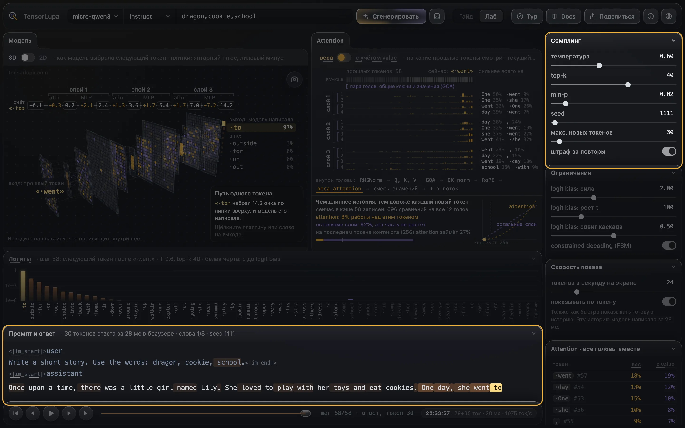

**Одной фразой:** макс. новых токенов (max new tokens) это самый длинный ответ, который модель может написать, в [токенах](../token/).

## Как это работает

Модель пишет по одному токену и сама решает, когда история закончена: она пишет [служебный токен](../special-tokens/)
`<|im_end|>`, и студия останавливается. Макс. новых токенов это страховочный предел сверху. Если к этому моменту
модель не закончила, студия всё равно её останавливает, при необходимости посреди предложения.

Есть и второй, жёсткий предел: модель может прочитать не больше 256 токенов всего, промпт и ответ вместе. При
промпте из 29 токенов для заказа из трёх слов остаётся место примерно на 226 токенов ответа, поэтому ползунок
останавливается на 220.

## Настоящая история, целая и оборванная

Демо-история (seed 1111, слова dragon, cookie, school) заканчивается сама через 133 токена, намного раньше предела
по умолчанию, 200:

> Once upon a time, there was a little girl named Lily. [...] The dragon was happy and thanked Lily. Lily and the
> dragon continued to play and eat, and the dragon was safe. They were happy and played together all day. The end.

Та же история с макс. новых токенов 30 обрывается посреди предложения:

> Once upon a time, there was a little girl named Lily. She loved to play with her toys and eat cookies. One day,
> she went to

Все токены до обрыва ровно те же: предел не меняет ни одного выбора, он только раньше останавливает цикл. А
поскольку историю оборвало до появления «school» и «dragon», из трёх слов в неё попало только одно.

## Где это в студии

Ползунок **«макс. новых токенов»** в карточке **«Сэмплинг»**: от 20 до 220 с шагом 10, по умолчанию 200. Когда вы
его двигаете, история пересчитывается с тем же [seed](../seed/), поэтому видно, где именно падает обрыв.

## Попробуйте

<a class="try-link" href="/ru/studio?w=dragon,cookie,school&seed=1111&n=30&s=57&q=8" target="_blank" rel="noopener">Открыть историю, оборванную на 30 токенах</a>

Потом тяните ползунок вверх и смотрите, как та же история продолжается за обрывом, пока не закончится сама.

## В micro-qwen3

С настройками студии по умолчанию около 85% историй из трёх слов заканчиваются сами до предела (измерено на 300
историях из 100 разных заказов). Остальные ещё пишут, когда приходит предел; для них историю заканчивает именно
макс. новых токенов.

## Связанные термины

- [Служебные токены](../special-tokens/): `<|im_end|>`, токен, который модель пишет, когда решает, что история закончена.
- [Штраф за повторы](../repetition-penalty/): без него истории, которые не заканчиваются сами, часто застревают в цикле.
- [Сэмплинг](../sampling/): предел останавливает цикл выборов, но не меняет ни один отдельный выбор.
