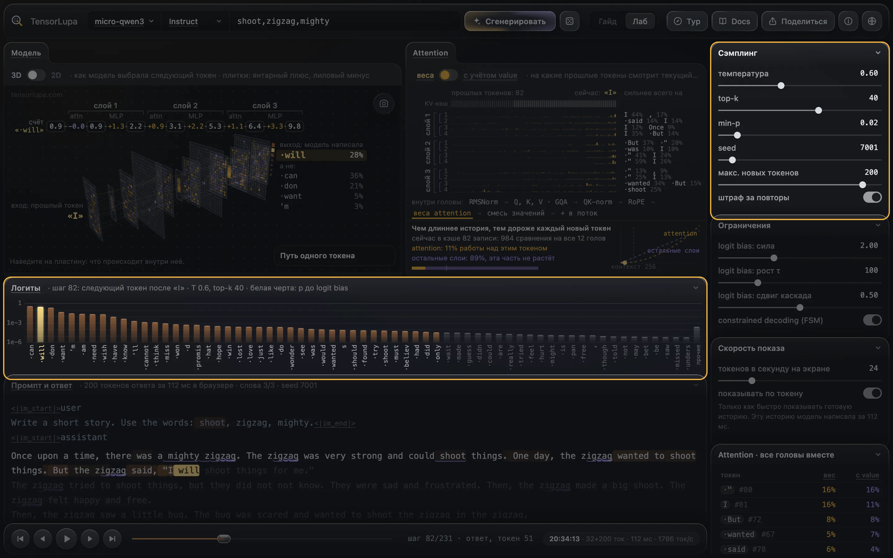

**Одной фразой:** min-p (порог от фаворита) исключает каждый токен, который намного менее вероятен, чем фаворит: при 0,02 любой, который в 50 и более раз менее вероятен.

## Какую задачу он решает

[Top-k](../top-k/) на каждом шаге оставляет 40 самых вероятных [токенов](../token/). Когда модель уверена, у
большинства из этих 40 почти нет шансов, но «почти нет» не значит ноль. На длинной истории жребий иногда попадает
туда, и крошечная модель редко оправляется от такого срыва: она склеивает странный кусочек в несуществующее слово.

## Настоящий срыв

Слова shoot, zigzag, mighty, seed 7001, min-p выключен. На шаге 81 модель написала *«As he was shooting, he saw a
big zigzag on the ground.»* и уверена, что будет дальше: « He» 91,8%, « It» 4,8%, « The» 3,1%. Жребий падает на
« B», токен с 0,003%, примерно в 35000 раз менее вероятный, чем « He». Модели приходится делать из него слово, и она
пишет *«Byican said, …»*.

<a class="try-link" href="/ru/studio?w=shoot,zigzag,mighty&seed=7001&mp=0&s=81&q=8" target="_blank" rel="noopener">Открыть срыв на шаге 81 (min-p выключен)</a>

С min-p 0,02 токен « B» на этом шаге выпадает из жребия вместе со всем, что ниже 1,8% (2% от 91,8% у « He»).

## Как это работает

1. Берём шансы после [температуры](../temperature/) и [top-k](../top-k/).
2. Находим шанс фаворита.
3. Исключаем каждый токен, чей шанс ниже min-p от него.
4. Делим 100% между оставшимися токенами и [сэмплим](../sampling/).

Отсечение следует за уверенностью модели. Когда у фаворита 90%, min-p 0,02 убирает всё ниже 1,8%. Когда модель
колеблется и у фаворита только 20%, он убирает только токены ниже 0,4%, а настоящие альтернативы остаются. При
температуре 0,6 micro-qwen3 обычно уверена: на типичной истории min-p 0,02 исключает около 36 из 40 кандидатов top-k
на шаге, почти все с шансами намного ниже одного процента.

## Min-p или top-p

[Top-p](https://arxiv.org/abs/1904.09751) (nucleus сэмплинг) это более известный способ отрезать хвост: оставлять самые
вероятные токены, пока их шансы не сложатся, скажем, в 95%. Мы измерили оба на 300 историях (100 заказов, которых
модель никогда не видела, по 3 seed на каждый), с весами 8 бит по умолчанию и включённым [штрафом за
повторы](../repetition-penalty/):

| Отсечение | Истории с выдуманным словом | Истории с зацикливанием | Заканчиваются сами | Разнообразие |
| --- | --- | --- | --- | --- |
| нет (только top-k 40) | 2,7% | 1% | 83% | 0,745 |
| **min-p 0,02** | **1,0%** | 1% | 85% | 0,730 |
| min-p 0,05 | 2,3% | 1% | 79% | 0,715 |
| min-p 0,1 | 1,7% | 2% | 83% | 0,703 |
| top-p 0,95 | 1,3% | 1% | 83% | 0,725 |
| top-p 0,9 | 3,3% | 1% | 88% | 0,717 |

«Разнообразие» это доля разных фраз из четырёх слов среди всех 300 историй. На весах 4 бита эффект больше: истории с
выдуманным словом падают с 6,7% до 3,0% с min-p 0,02.

При одинаковой силе min-p 0,02 и top-p 0,95 дают ничью. Студия использует min-p, потому что его правило умещается в
одну фразу, а его линия на панели «Логиты» стоит на постоянном расстоянии от фаворита, тогда как линия top-p скачет
от шага к шагу вместе с формой шансов.

Измерение показало ещё одно: если отрезать хвост без штрафа за повторы, циклы становятся чаще (истории с
зацикливанием 9% → 13% при min-p 0,02, 23% при min-p 0,1), потому что модель чаще берёт фаворита, а фаворит нередко
и есть повтор. При включённом штрафе циклы остаются на уровне от 1 до 2%.

## Где это в студии

Ползунок **min-p** третий в карточке **«Сэмплинг»**, под top-k. Он идёт от 0 (выключен) до 0,2, по умолчанию 0,02.
В Лабе панель «Логиты» закрашивает серым исключённых кандидатов, их шанс равен 0.

## В micro-qwen3

- По умолчанию min-p 0,02, и для весов 8 бит, и для весов 4 бита.
- Один и тот же код работает в движке на C на ESP32-S3 и в браузере.
- Старые ссылки на студию, сделанные до появления min-p, открываются с выключенным min-p, поэтому истории в старых
  статьях остаются прежними.

## Немного истории

Min-p предложили в сообществе открытого кода в 2023 году, а описали
[Нгуен с коллегами в 2024 году](https://arxiv.org/abs/2407.01082): они показали, что он сохраняет связность текста при
высоких температурах, где top-p начинает рассыпаться.

## Связанные термины

- [Top-k](../top-k/): фиксированное отсечение, которое идёт перед min-p.
- [Температура](../temperature/): меняет форму шансов, которые сравнивает min-p.
- [Сэмплинг](../sampling/): жребий, который ограничивает min-p.
- [Штраф за повторы](../repetition-penalty/): вторая половина правил по умолчанию.
