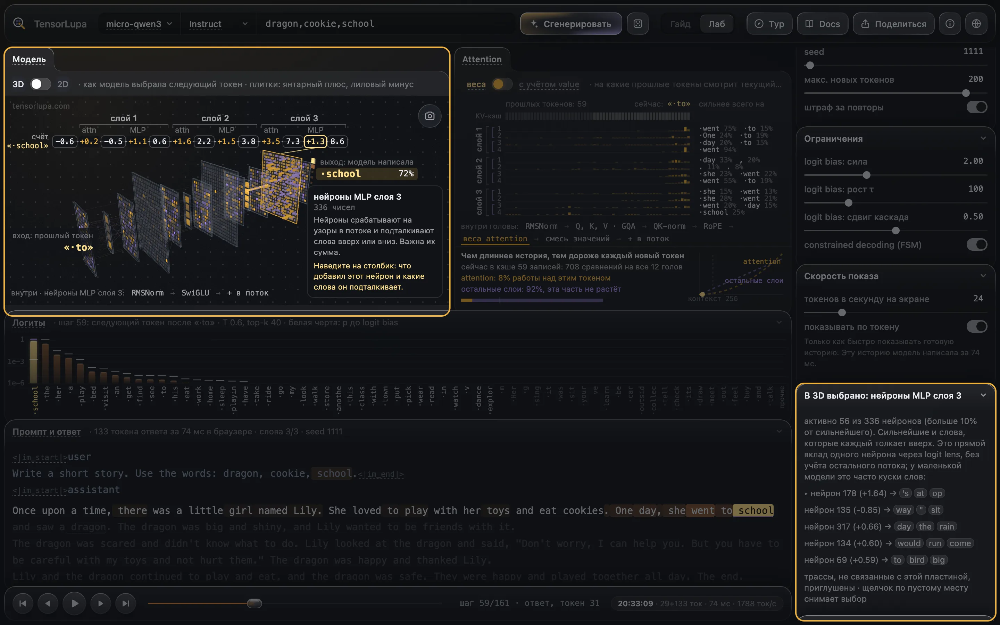

**Одной фразой:** MLP (многослойный перцептрон) это вторая половина каждого слоя: 336 нейронов на слой реагируют на
шаблоны и подталкивают одни следующие слова вверх, другие вниз.

## Что происходит внутри

В каждом слое [трансформера](../transformer/) две половины. Сначала [attention](../attention/) позволяет
[токену](../token/) оглянуться на прежние токены. Потом MLP работает уже с одним токеном: читает его
[остаточный поток](../residual-stream/), обдумывает и прибавляет свой ответ сверху.

MLP в micro-qwen3 устроен так же, как в Qwen3, по схеме [SwiGLU](https://arxiv.org/abs/2002.05202). Простыми
словами:

1. 112 чисел потока смешиваются в 336 нейронов, дважды: один раз как **сигнал** и один раз как **затвор**.
2. Затвор решает, насколько сильно срабатывает каждый нейрон. На каждом шаге большинство нейронов почти молчит, а
   несколько вспыхивают.
3. Каждый сработавший нейрон записывает обратно в поток своё собственное неизменное направление, умноженное на
   силу срабатывания. Отрицательное значение записывает то же направление в обратную сторону.

Получается, что нейрон это маленький детектор со своим мнением: «когда я вижу такую ситуацию, подтолкни следующее
слово к этим токенам». Это мнение можно прочитать через [logit lens](../logit-lens/): расшифровать направление
нейрона так, будто это конец модели, и посмотреть, какие токены он предпочитает.

## Настоящий шаг

Демо-история только что написала *«One day, she went to»*, и следующим токеном будет «school». Вот некоторые из самых
сильных нейронов двух слоёв на этом шаге и по три токена, которые каждый из них подталкивает вверх:

| Слой | Нейрон | Срабатывание | Подталкивает к |
| --- | --- | --- | --- |
| 2 | 118 | +1,48 | see, the, day |
| 2 | 213 | +0,41 | way, ve, find |
| 3 | 178 | +1,64 | 's, at, op |
| 3 | 135 | −0,85 | *(от)* way, ", sit |
| 3 | 317 | +0,66 | day, the, rain |

Заметны две вещи. Занята только небольшая часть каждого слоя: 25 из 336 нейронов в слое 2 и 56 в слое 3
срабатывают сильнее одной десятой от самого сильного. И многие нейроны подталкивают куски слов вроде «'s», «op» или
«ve», а не целые слова. В такой маленькой модели один нейрон редко означает одну ясную мысль; смысл складывается из
многих нейронов вместе с attention.

## Где это в студии

Переключитесь на **Лаб** и щёлкните пластину MLP в 3D-виде панели **«Модель»**: это пластина после голов attention
в слое. Строка под моделью перечисляет шаги внутри пластины (RMSNorm, SwiGLU, обратно в поток), а строка со счётом
над ней показывает, сколько MLP добавил к написанному слову. Инспектор показывает, сколько нейронов активно, и
перечисляет сильнейшие из них, у каждого со значением срабатывания и токенами, к которым он подталкивает.

## Попробуйте

<a class="try-link" href="/ru/studio?w=dragon,cookie,school&seed=1111&s=58&q=8&mode=lab" target="_blank" rel="noopener">Открыть этот шаг в студии</a>

Щёлкните пластину MLP слоя 3, потом шагайте на один токен вперёд или назад и смотрите, как верх берут другие нейроны.

## В micro-qwen3

- 3 слоя × 336 нейронов с затвором по схеме SwiGLU, как в Qwen3.
- На MLP приходится 338 688 из 1 056 656 параметров модели, около 32%. Attention занимает 258 048 (около 24%), а
  таблица токенов, общая для входного эмбеддинга и выхода, 458 752 (около 43%).
- В больших моделях MLP это самая большая часть каждого слоя, а отдельные нейроны легче назвать. Считается, что
  именно там хранится значительная часть знаний модели.

## Немного истории

Нейрон как обучаемая единица восходит к [перцептрону](https://doi.org/10.1037/h0042519), который построил Фрэнк
Розенблатт в 1958 году. Стопки таких нейронов, многослойные перцептроны, стало возможно обучать с помощью обратного
распространения ошибки в 1980-х, а [статья про трансформер](https://arxiv.org/abs/1706.03762) 2017 года поставила
по одному такому в каждый слой как его блок прямого распространения. Версию с затвором, SwiGLU, которую мы здесь
используем, предложил [Ноам Шазир в 2020 году](https://arxiv.org/abs/2002.05202).

## Дальше

[Логиты](../logits/): как последний слой превращается в оценку для каждого возможного следующего токена.

## Источники

- Frank Rosenblatt (1958). [The perceptron: A probabilistic model for information storage and organization in the brain](https://doi.org/10.1037/h0042519). Psychological Review.
- Ashish Vaswani et al. (2017). [Attention Is All You Need](https://arxiv.org/abs/1706.03762). arXiv.
- Noam Shazeer (2020). [GLU Variants Improve Transformer](https://arxiv.org/abs/2002.05202). arXiv.
