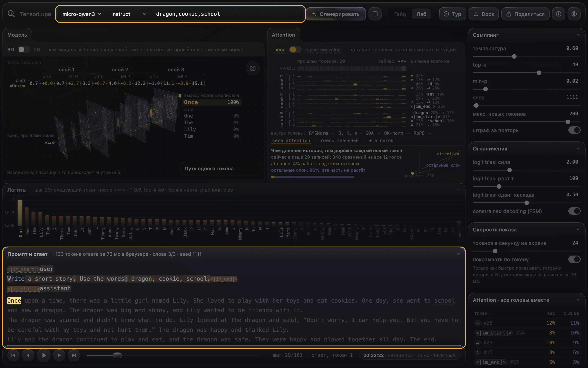

**Одной фразой:** промпт (prompt) это всё, что модель читает до ответа; то, что она пишет после, называется
ответом (completion).

## Что модель читает на самом деле

Вы набираете три слова. Модель читает гораздо больше. Студия оборачивает ваши слова в просьбу в формате чата, и
модель видит всё это как один длинный ряд [токенов](../token/):

```
<|im_start|>user
Write a short story. Use the words: dragon, cookie, school.<|im_end|>
<|im_start|>assistant
```

- `<|im_start|>user` и `<|im_end|>` отмечают, где просьба начинается и где заканчивается.
- `<|im_start|>assistant` говорит: «теперь твоя очередь отвечать». Сразу после него модель пишет свой первый токен.

Эти метки это служебные токены. Что они значат, модель узнала при [дообучении на инструкциях](../instruct/): после
«assistant» нужно написать ответ, который выполняет просьбу.

Для micro-qwen3 этот промпт занимает 29 токенов. Заметьте, что некоторые обычные слова здесь занимают несколько
кусочков: «Write» это `[W][r][ite]`, а «user» это `[us][er]`, потому что в детских историях они редки.

## Модель читает промпт так же, как пишет

Отдельного «режима чтения» нет. Промпт проходит через те же слои, токен за токеном, точно так же, как потом
проходят слова самой модели. Единственная разница: для токенов промпта следующий токен уже известен, поэтому ничего
не вытягивается. Студия показывает и эти шаги: промотайте плеер в начало, и увидите, как модель «читает».

## Где это в студии



Слова, которые вы набираете, попадают в поле наверху. В панели **«Промпт и ответ»** промпт показан приглушённым
над ответом, а метки чата серым.

## Попробуйте

<a class="try-link" href="/ru/studio?w=dragon,cookie,school&seed=1111&s=28&q=8" target="_blank" rel="noopener">Открыть первый шаг ответа</a>

Несколько раз нажмите стрелку влево, чтобы пройти по промпту назад, потом стрелку вправо, и посмотрите, как
начинается ответ.

## Немного истории

Метки чата вроде `<|im_start|>` и `<|im_end|>` пришли из [ChatML](https://github.com/openai/openai-python/blob/release-v0.28.0/chatml.md), формата чата, который OpenAI представила в 2023 году, чтобы разделять роли в разговоре. Qwen использует метки того же вида, и micro-qwen3 тоже.

## Связанные термины

- [Completion](../completion/): без меток чата, модель просто продолжает ваш текст.
- [Instruct](../instruct/): почему модель вообще выполняет просьбу.
- [Токен](../token/): кусочки, из которых состоит промпт.

## Источники

- OpenAI (2023). [ChatML, the chat markup format](https://github.com/openai/openai-python/blob/release-v0.28.0/chatml.md). GitHub.
