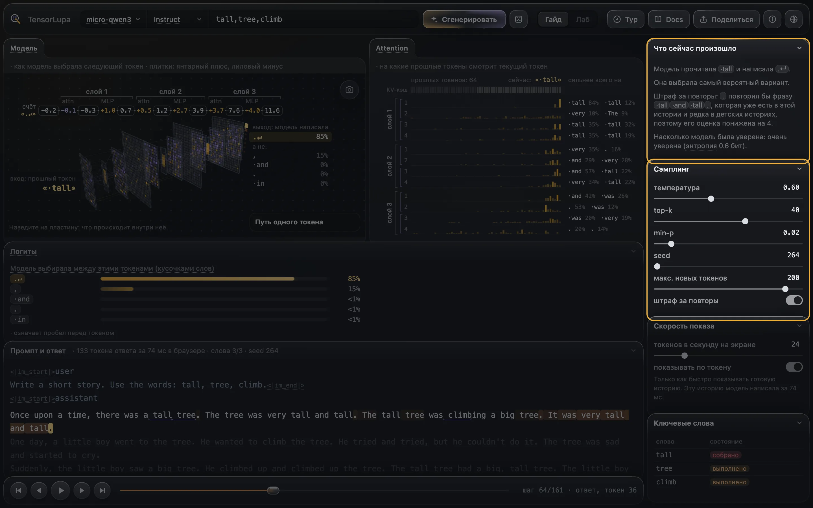

**Одной фразой:** штраф за повторы (repetition penalty) понижает оценку токена, который повторил бы фразу, уже
написанную в истории, если только эта фраза не частая в детских историях. Так текст не уходит в цикл. По умолчанию он включён.

## Циклы в крошечной модели

Упоминать героя много раз для детской истории нормально («the dragon ... the dragon»). Цикл это другое: модель
повторяется, потому что повтор снова и снова оказывается её самым вероятным следующим шагом. В micro-qwen3 циклы
выглядят как «tall and tall», «very tall and very tall» или «luxury luxury luxury». Это собственная привычка модели.
Подталкивание ключевых слов через [logit bias](../logit-bias/) их не вызывает: немедленные повторы составляют 0,35%
слов с ним и 0,39% без него.

## Как работает штраф в студии

Штраф смотрит на фразы из четырёх [токенов](../token/). Перед каждым жребием он проверяет: не повторит ли следующий
токен фразу из четырёх токенов, которая уже написана в этой истории? Если да, этот токен теряет 4 единицы
[логита](../logits/) за каждый прежний случай появления фразы, до жребия [сэмплинга](../sampling/).

Некоторые повторы нормальны. Детские истории то и дело говорят «Once upon a time» и «One day, she». Поэтому штраф
знает, какие фразы естественны: это 11224 фразы из четырёх токенов, которые встречаются в TinyStories не меньше 1000
раз. Это истории, на которых обучена модель. Повтор любой из них никогда не штрафуется. Всё остальное, что повторяется,
штрафуется.

Ещё правила, каждое найдено разбором выдуманных слов, которые раньше вызывал штраф:
- Кусочек в середине слова никогда не штрафуется. Дописывать слово до конца работа автомата
  [constrained decoding](../fsm/).
- Слова, которые вы заказали, никогда не штрафуются: дракон из истории должен возвращаться. Когда штраф бил по началу
  заказанного слова, модель приклеивала его хвост к другому началу, как в «playrobe».
- Если штрафуется кусочек с пробелом впереди (« B»), тот же кусочек без пробела («B») получает тот же штраф. Иначе
  модель приклеивала слово к предыдущему: «HappyBree».
- Штраф работает в обоих режимах, Instruct и Completion.

Список берётся из таблицы счётчиков фраз, построенной по обучающему корпусу, около 2,3 МБ. Студия загружает её,
только когда вы включаете штраф.

## Настоящий цикл, без штрафа и со штрафом

Слова tall, tree, climb, seed 264. Без штрафа история застревает на первой же идее:

> Once upon a time, there was a tall tree. The tree was very tall and tall. The tall tree was climbing a big tree.
> It was very tall and tall. The tall tree was very tall. The tall tree was tall and tall. One day, the tall tree
> saw a tall tree. ...

На шаге 63 модель только что написала *«It was very tall and tall»* и хочет закончить предложение: «.» 76%. Но
« tall and tall.» уже есть в истории и редко для детских историй, поэтому «.» теряет 4 единицы. Модель вместо этого
начинает новый абзац, и история идёт дальше:

> ... It was very tall and tall.
> One day, a little boy went to the tree. He wanted to climb the tree. He tried and tried, but he couldn't do it.
> ...

Без штрафа история продолжает кружить вокруг «The tall tree was very tall» 178 токенов; со штрафом она заканчивается
после 133.

## Что он ловит и чего не ловит

Измерено на 300 историях (100 заказов, которых модель никогда не видела, по 3 seed на каждый), [температура](../temperature/) 0,6,
[min-p](../min-p/) 0,02, веса 8 бит по умолчанию:

| Штраф | Повторные фразы | Истории с зацикливанием | Истории с выдуманным словом | Все слова использованы | Заканчиваются сами |
| --- | --- | --- | --- | --- | --- |
| выкл. | 4,6% | 13% | 1,3% | 99,8% | 84% |
| **вкл.** | **1,4%** | **1%** | 1,0% | 99,8% | 85% |

«Повторные фразы» это доля фраз из четырёх слов, которые уже встречались раньше в той же истории. История считается
зацикленной, если больше 10% её фраз повторы.

Он не ловит повтор, который ещё не стал повторной фразой: «very tall and tall» написано один раз, поэтому проходит.
Повторы заказанных слов разрешены намеренно. Не исправит он и циклы смысла («The wind made the wind strong»).

По умолчанию штраф включён, и для весов 8 бит, и для весов 4 бита.

## Где это в студии

Переключатель **«штраф за повторы»** последняя строка карточки **«Сэмплинг»**. Когда вы его переключаете, история
пересчитывается с тем же [seed](../seed/), поэтому любая разница, которую вы видите, идёт от штрафа. На шаге со
штрафом карточка шага говорит, какая фраза повторилась бы и сколько единиц потерял токен.

## Попробуйте

<a class="try-link" href="/ru/studio?w=tall,tree,climb&seed=264&rp=0&s=63&q=8" target="_blank" rel="noopener">Открыть зацикленную историю на шаге 63</a>

<a class="try-link" href="/ru/studio?w=tall,tree,climb&seed=264&s=63&q=8" target="_blank" rel="noopener">Открыть тот же шаг со штрафом</a>

## Прежнее правило и плата

До штрафа студии в студии работало более простое правило, и прошивка на ESP32-S3 использует его до сих пор: слово,
которое повторило бы только что написанное слово, или слово через «and» («tall and tall»), теряло 3 единицы, а токен,
который продолжил бы фразу, повторённую в последних 32 токенах, терял от 1 до 8 единиц. Таблица ему не нужна, поэтому
плата его и оставила. В студии оно иногда делало хуже: запрет обычного следующего кусочка трудного слова толкал
модель к выдуманным словам вроде «warnerer» или «luxuxuury». Штраф, знающий корпус, не трогает кусочки слов и
позволяет естественным фразам повторяться.

## Немного истории

Штрафовать повторные токены при сэмплинге предложили вместе с моделью [CTRL](https://arxiv.org/abs/1909.05858) Кескар
с коллегами из Salesforce в 2019 году. В тот же год Хольцман с коллегами показали, почему модели вообще зацикливаются:
если всегда брать самый вероятный токен, текст впадает в повторы, а сэмплинг из распределения во многом этого
избегает. Штраф студии близок к более позднему сэмплеру DRY из сообщества открытого кода, с одним добавлением: он
спрашивает обучающий корпус, какие повторы естественны.

## Связанные термины

- [Сэмплинг](../sampling/): жребий, который меняет штраф.
- [Макс. новых токенов](../max-new-tokens/): что останавливает историю, которая никак не выходит из цикла.
- [Logit bias](../logit-bias/): обратный толчок, в сторону слов, которые вы заказали.

## Источники

- Nitish Shirish Keskar et al. (2019). [CTRL: A Conditional Transformer Language Model for Controllable Generation](https://arxiv.org/abs/1909.05858).
- Ari Holtzman et al. (2019). [The Curious Case of Neural Text Degeneration](https://arxiv.org/abs/1904.09751).
