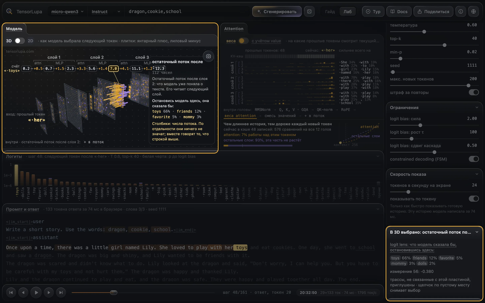

**Одной фразой:** эмбеддинг (embedding) превращает [токен](../token/) в список из 112 чисел, а остаточный поток
(residual stream) это тот же список по мере его пути через модель: каждый слой читает его и добавляет сверху свой
вклад.

## От токена к числам

[Трансформер](../transformer/) не может работать с текстом напрямую. Первое, что он делает с каждым токеном, это
находит его в большой таблице, таблице эмбеддингов: одна строка на каждый токен словаря, в micro-qwen3 это 4096
строк, и каждая строка это список из 112 чисел. Эта строка и есть эмбеддинг токена, его отправная точка.

## Поток, к которому слои добавляют

Список из 112 чисел дальше проходит через слои. Каждый слой делает две одинаковые вещи:

1. Он **читает** текущий список. [Attention](../attention/) оглядывается на прежние токены, а
   [MLP](../mlp/) реагирует на шаблоны.
2. Он **добавляет** найденное к списку, а не заменяет его.

Раз каждый слой только добавляет, список хранит всё, что было до этого. Эта нарастающая сумма и называется
остаточным потоком. После последнего слоя модель превращает поток в оценку каждого возможного следующего токена,
то есть в [логиты](../logits/).

## Настоящий шаг: смотрим, как наполняется поток

В любой точке можно спросить поток: «если бы ты остановился здесь, что бы ты сказал дальше?». Этот приём называется
[logit lens](../logit-lens/): прочитать поток в середине модели так, будто это её конец.

Вот один шаг демо-истории. Модель прочитала *«…She loved to play with her»* и должна написать следующий
токен. Три главные догадки линзы в каждой точке потока:

| Точка потока | Три главные догадки |
| --- | --- |
| сразу после эмбеддинга | her 100% |
| после слоя 1 | mom 68,4%, favorite 10,2%, mommy 6,3% |
| после слоя 2 | **toys 66,2%**, friends 11,8%, favorite 5,3% |
| после слоя 3 | **toys 83,2%**, dolls 6,6%, friends 4,4% |

Сразу после эмбеддинга поток знает только сам токен, поэтому линза просто читает обратно «her». Слой 1 добавляет
грубую догадку: то, что в детских историях часто идёт после «her». Слой 2 использует контекст, «she loved to
play with», и приходит к «toys». Слой 3 сохраняет это и становится увереннее. Модель написала «toys».

Слои могут и передумать. Позже в истории, после *«…Don't»*, слой 2 был на 94% уверен в «worry», а
слой 3 дал «be» 53% и оставил «worry» 43%. Линза показывает сырые оценки при температуре 1, поэтому её
числа немного отличаются от итоговых кандидатов в студии, где действуют [температура](../temperature/) 0,6 и
[top-k](../top-k/).

Поток при этом ещё и растёт, пока слои к нему добавляют. Его длина (размер вектора из 112 чисел) идёт от 1,0 после
эмбеддинга к 2,0, 2,9 и 4,9 после трёх слоёв.

## Где это в студии

В панели **«Модель»** токен течёт слева направо. Стеклянные пластины между слоями это остаточный поток: 112 клеток
в сетке 14 на 8, по клетке на каждое число, цвет зависит от значения. Первая пластина это эмбеддинг. Внутри
каждого слоя есть ещё одна пластина потока: поток после attention, перед MLP. В режиме «Лаб» щёлкните пластину:
карточка внизу справа в панели «Модель» и инспектор справа покажут её logit lens, «что модель сказала бы,
остановившись здесь», а строка над моделью отметит, где в счёте стоит эта пластина.

## Попробуйте

<a class="try-link" href="/ru/studio?w=dragon,cookie,school&seed=1111&s=47&q=8&mode=lab" target="_blank" rel="noopener">Открыть этот шаг в студии</a>

Щёлкайте пластины потока по очереди, слева направо, и смотрите, как догадки идут от «her» к «toys».

## В micro-qwen3

- 112 чисел на токен, одной и той же ширины в любой точке потока.
- 4096 строк в таблице эмбеддингов, по одной на токен словаря.
- Три слоя, поэтому у потока четыре точки, на которые можно посмотреть: после эмбеддинга и после каждого слоя.
- Большие модели работают так же, только потоки у них гораздо шире, тысячи чисел на токен, а слоёв десятки.

## Немного истории

Превращать слова в списки чисел, которые передают их смысл, стало популярно с [word2vec](https://arxiv.org/abs/1301.3781) в 2013 году. Прибавление выхода слоя к его входу вместо замены идёт от [остаточных сетей](https://arxiv.org/abs/1512.03385) (ResNet, He et al., 2015), которые
сделали возможным обучение очень глубоких сетей. Название «residual stream» и идея читать трансформер как слои,
пишущие в один общий поток, пришли из статьи Anthropic 2021 года ["A Mathematical Framework for Transformer
Circuits"](https://transformer-circuits.pub/2021/framework/index.html).

## Дальше

[Attention](../attention/): как токен оглядывается на прежние токены и берёт то, что ему нужно.

## Источники

- Tomas Mikolov et al. (2013). [Efficient Estimation of Word Representations in Vector Space](https://arxiv.org/abs/1301.3781). arXiv.
- Kaiming He et al. (2015). [Deep Residual Learning for Image Recognition](https://arxiv.org/abs/1512.03385). arXiv.
- Nelson Elhage et al., Anthropic (2021). [A Mathematical Framework for Transformer Circuits](https://transformer-circuits.pub/2021/framework/index.html). Transformer Circuits Thread.
