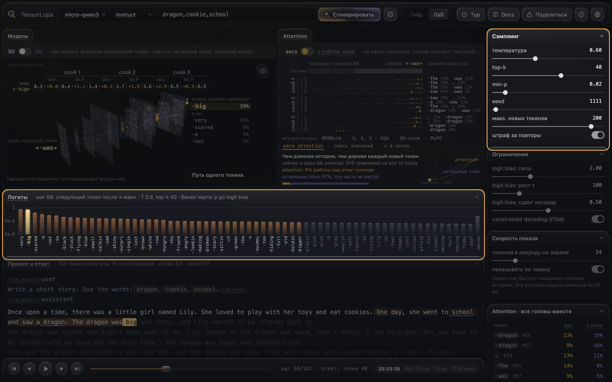

**Одной фразой:** сэмплинг (sampling) это то, как из вероятностей выбирается один токен: взвешенный случайный жребий,
которому форму задают температура и top-k.

## Как это работает

На каждом шаге у модели в конце есть шанс для каждого токена-кандидата (см. [логиты](../logits/)). Сэмплинг
превращает эти шансы в один выбор:

1. Выстройте кандидатов в ряд от самого вероятного к наименее вероятному, и каждый занимает отрезок такой длины,
   каков его шанс.
2. Вытяните случайное число от 0 до 1.
3. Токен, на чей отрезок попало число, становится следующим токеном.

Токен с 46% выигрывает 46 жребиев из 100, токен с 8% выигрывает 8. Чаще всего побеждает фаворит, но не всегда, и
именно поэтому истории отличаются друг от друга.

Случайные числа берутся из [seed](../seed/). Тот же seed и те же настройки дают те же броски, а значит ту же
историю; новый seed даёт новые броски и новую историю.

**Жадное декодирование** (greedy decoding) обходится без жребия и всегда берёт самый вероятный токен. Оно полностью
предсказуемо: один промпт, одна история, какой бы ни был seed. Цена за это однообразие, а маленькие модели, которые
всегда берут фаворита, склонны повторяться. Сэмплинг сохраняет в тексте долю неожиданности.

## Настоящий жребий

Демо-история в момент *«The dragon was»* (seed 1111, температура 0,6, top-k 40, min-p 0,02). Кандидаты и отрезок,
который занимает каждый:

| Токен | Шанс | Отрезок линии |
| --- | --- | --- |
| very | 45,6% | от 0 до 45,6 |
| **big** | **39,0%** | **от 45,6 до 84,6** |
| scared | 7,9% | от 84,6 до 92,5 |
| a | 3,6% | от 92,5 до 96,1 |
| not | 2,1% | от 96,1 до 98,2 |

Случайное число на этом шаге было **0,523**, то есть попало на 52,3% линии, внутрь отрезка «big». Модель написала
«big», хотя «very» был вероятнее, и история продолжилась словами «big and shiny».

То же задание с жадным декодированием (top-k 1) пишет одну неизменную историю, которая начинается точно так же, а
потом на этом шаге берёт «very»: *«The dragon was very big and had a long tail»*. На каждом шаге она берёт
фаворита этого момента.

## Где это в студии

- Карточка **«Сэмплинг»** содержит настройки, которые задают форму жребия: температуру, top-k, min-p, seed и штраф
  за повторы.
- Панель **«Логиты»** показывает кандидатов текущего шага, выбранный подсвечен.
- В Лабе инспектор шага показывает **сэмпл**: куда попало случайное число в массе вероятности, например «на 52,3%
  массы».

## Попробуйте

<a class="try-link" href="/ru/studio?w=dragon,cookie,school&seed=1111&s=67&q=8" target="_blank" rel="noopener">Открыть этот шаг в студии</a>

Переключитесь в Лаб, чтобы увидеть сэмпл, потом бросьте кубик ради нового seed и посмотрите, как то же задание
превращается в другую историю.

## В micro-qwen3

Студия по умолчанию использует температуру 0,6, top-k 40 и [min-p](../min-p/) 0,02. Мы измерили температуру и top-k
на 200 заказах историй: top-k почти ничего не меняет, потому что после обучения по инструкциям настоящий выбор и так
идёт между 3 и 5 токенами, а температура важна, и 0,6 даёт лучший баланс между меньшим числом повторов и историями,
которые заканчиваются сами (см. [температуру](../temperature/)).

## Немного истории

Создание текста случайным выбором следующего слова по наблюдаемой статистике восходит к
[статье Клода Шеннона 1948 года по теории информации](https://ieeexplore.ieee.org/document/6773024), где он строил
предложения по частотам букв и слов. Для нейросетевых языковых моделей top-k сэмплинг популяризовали
[Фан, Льюис и Дофин в 2018 году](https://arxiv.org/abs/1805.04833), а nucleus (top-p) сэмплинг ввели
[Хольцман с коллегами в 2019 году](https://arxiv.org/abs/1904.09751), чтобы исправить скучный повторяющийся текст,
который получается при жадном декодировании.

## Настройки, которые задают форму жребия

- [Температура](../temperature/): насколько смел жребий.
- [Top-k](../top-k/): сколько кандидатов вообще участвует.
- [Min-p](../min-p/): исключает кандидатов, которые намного менее вероятны, чем фаворит.
- [Seed](../seed/): какие случайные числа выпадают.
- [Штраф за повторы](../repetition-penalty/): понижает шансы токенов, которые повторили бы фразу.
- [Logit bias](../logit-bias/): повышает шансы заказанных вами слов.

## Источники

- Claude E. Shannon (1948). [A Mathematical Theory of Communication](https://ieeexplore.ieee.org/document/6773024). Bell System Technical Journal.
- Angela Fan, Mike Lewis, Yann Dauphin (2018). [Hierarchical Neural Story Generation](https://arxiv.org/abs/1805.04833). arXiv.
- Ari Holtzman et al. (2019). [The Curious Case of Neural Text Degeneration](https://arxiv.org/abs/1904.09751). arXiv.
