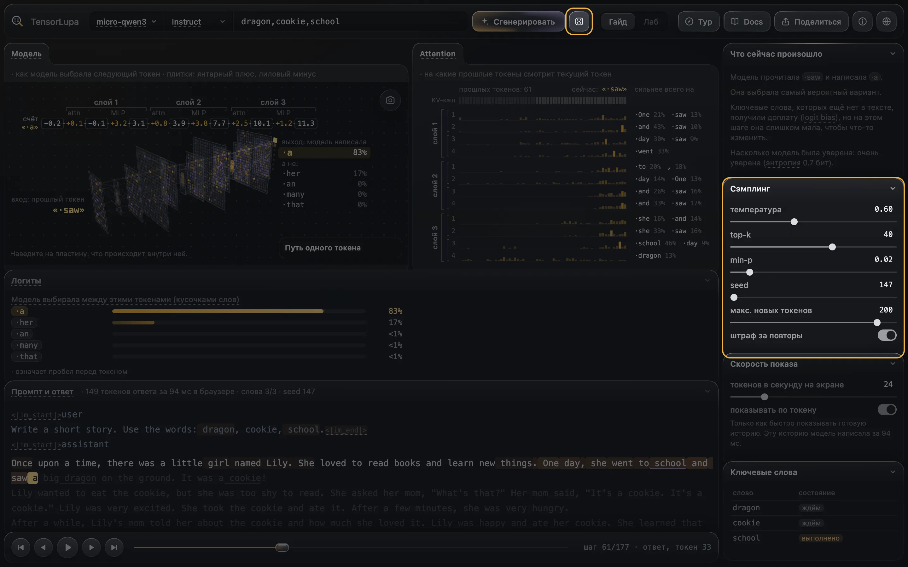

**Одной фразой:** seed (зерно случайности) это число, которое задаёт случайные броски: тот же seed и те же настройки дают ровно ту же историю.

## Как это работает

На каждом шаге у модели есть шансы для токенов-кандидатов, и один токен вытягивается случайно (см.
[сэмплинг](../sampling/)). Настоящей случайности у компьютера для этого нет. Он берёт генератор псевдослучайных
чисел: маленькую формулу, которая превращает начальное число в длинный ряд чисел, похожих на случайные. Это
начальное число и есть seed.

- **Тот же seed, те же настройки, те же слова:** тот же ряд случайных чисел, значит те же броски и та же история,
  токен в токен.
- **Новый seed:** новый ряд случайных чисел, значит другие броски и другая история.

Seed не делает историю лучше или хуже. Он только выбирает одну из многих историй, которые модель могла бы написать
с такими настройками.

## Настоящий пример

Тот же заказ (*dragon, cookie, school*), температура 0,6, top-k 40, min-p 0,02, меняется только seed:

| Seed | Как начинается история |
| --- | --- |
| **1111** | Once upon a time, there was a little girl named Lily. She loved to play with her toys and eat cookies. One day, she went to school and saw a dragon… |
| 147 | Once upon a time, there was a little girl named Lily. She loved to read books and learn new things. One day, she went to school and saw a big dragon on the ground… |
| 42 | Once upon a time, there was a little girl named Lily. She loved to play with her toys and read books. One day, Lily's mom told her they were going to a school… |

Если запустить seed 1111 второй раз, получится та же первая история, буква в букву. Начала похожи, потому что
модель очень уверена в первых словах (см. [языковая модель](../language-model/)); истории расходятся на первых
шагах, где у жребия есть настоящий выбор.

## Где это в студии

- Ползунок **seed** в карточке **«Сэмплинг»** идёт от 1 до 99999. Когда вы его двигаете, история сразу
  переписывается.
- **Кубик** рядом с кнопкой «Сгенерировать» выбирает новый случайный seed: «другая история» с теми же словами и
  настройками.
- Seed входит в каждую ссылку, которой вы делитесь, поэтому ссылка открывает у другого человека ровно ту же историю.

## Попробуйте

<a class="try-link" href="/ru/studio?w=dragon,cookie,school&seed=147&q=8" target="_blank" rel="noopener">Открыть seed 147 в студии</a>

Потом измените seed на единицу и смотрите, как появляется новая история, или бросьте кубик несколько раз.

## В micro-qwen3

В демо используется seed 1111. Мы выбрали его так: сгенерировали демо-заказ с 1500 seed, оставили истории, где есть
все три слова, которые заканчиваются сами и почти не повторяются, и прочитали лучшие из них. Студия и прошивка для
ESP32 используют один и тот же маленький генератор xorshift, поэтому seed даёт одинаковые броски в обеих.

Раз seed зафиксирован, все остальные настройки можно сравнивать честно: двигайте [температуру](../temperature/) или
[top-k](../top-k/) с тем же seed, и всё, что вы видите, меняется из-за этой настройки, а не из-за удачи.

## Немного истории

Генераторы псевдослучайных чисел стары как сами вычисления: уже ранние компьютеры получали «случайные» числа из
формул, потому что фиксированную формулу можно повторить точно. Именно эта повторяемость делает seed полезным в
машинном обучении: тот же seed воспроизводит тот же эксперимент.

## Связанные термины

- [Сэмплинг](../sampling/): жребий, который питает seed.
- [Температура](../temperature/) и [top-k](../top-k/): остальные настройки жребия.
