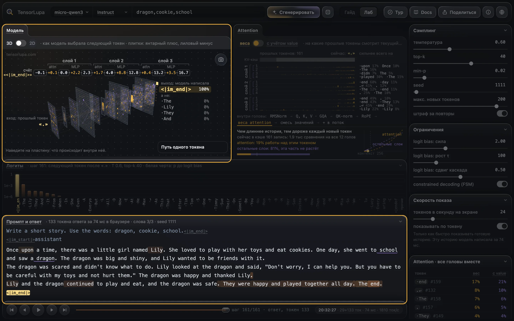

**Одной фразой:** служебные токены (special tokens) это зарезервированные [токены](../token/), которые отмечают
структуру, а не текст: где реплика в чате начинается и заканчивается и где текст кончился.

## Три токена, которые не слова

В micro-qwen3 4096 токенов. Первые три отличаются от всех остальных:

| Id | Токен | Что он значит |
| --- | --- | --- |
| 0 | `<\|endoftext\|>` | этот текст закончился |
| 1 | `<\|im_start\|>` | начинается реплика в чате; следующее слово называет, кто говорит (`user` или `assistant`) |
| 2 | `<\|im_end\|>` | эта реплика закончилась |

В студии они выглядят как текст, но каждый из них это один токен со своим id. Обычный byte pair encoding никогда их
не выдаёт: из обычных кусочков `<|im_end|>` по буквам не собрать. Токенизатор узнаёт точную строку и подставляет
зарезервированный id, так же как токенизаторы Hugging Face. Это значит и то, что, если вы наберёте `<|im_end|>` в
режиме Completion в студии, модель действительно получит служебный токен.

## Зачем они нужны

[Языковая модель](../language-model/) видит один длинный ряд токенов и больше ничего. Другого способа узнать, где
кончается ваша просьба, чья сейчас очередь и что история завершена, у неё нет. Служебные токены кладут эту
структуру в сам ряд:

```
<|im_start|>user
Write a short story. Use the words: dragon, cookie, school.<|im_end|>
<|im_start|>assistant
```

В этом [промпте](../prompt/) из 29 токенов служебные токены стоят на позициях 0, 22 и 24. Всё после последней
строки это ответ.

## Как модель их выучила

- **Предобучение.** Во время обучения истории склеиваются в один длинный поток, а между ними стоит `<|endoftext|>`.
  Модель учится: после истории идёт этот токен, а после него начинается новая, никак не связанная история.
- **Дообучение на инструкциях.** Каждый обучающий пример оборачивается в метки чата. Модель учится: после
  `<|im_start|>assistant` идёт ответ, который выполняет просьбу, и заканчивается ответ токеном `<|im_end|>`.
  См. [Instruct](../instruct/).

## Когда закончить историю, решает модель

Никто не говорит micro-qwen3, какой длины должна быть история. Она сама пишет `<|im_end|>`, как ещё один выбор
среди кандидатов. Ближе к концу демо-истории, сразу после *«They were happy and played together all day.»*, это
был один из четырёх близких вариантов:

| Кандидат | Шанс |
| --- | --- |
| The | **43,9%** |
| Lily | 15,1% |
| From | 14,5% |
| `<\|im_end\|>` | 11,7% |

Жребий выбрал «The», и история закончилась словами *«The end.»* Сразу после этого шанс `<|im_end|>` был 100%,
жребий выбрал его, и движок остановился: как только вытянут любой служебный токен, ответ окончен. До этого у
`<|im_end|>` в этой истории никогда не было больше 12%, так что модель действительно дождалась естественного конца.

Доходит она до него не всегда. При [температуре](../temperature/) по умолчанию 0,6 около 85% историй заканчиваются
сами (замер на 300 историях из 100 разных заказов). Остальные обрываются по [макс. новых токенов](../max-new-tokens/), защитному пределу длины ответа.

## Где это в студии



В панели **«Промпт и ответ»** служебные токены показаны маленькими серыми метками: вокруг вашей просьбы наверху и
в самом конце ответа. Окно **«Модель»** и панель **«Логиты»** показывают `<|im_end|>` как любого другого
кандидата, когда модель раздумывает, не остановиться ли.

## Попробуйте

<a class="try-link" href="/ru/studio?w=dragon,cookie,school&seed=1111&s=160&q=8" target="_blank" rel="noopener">Открыть последний шаг истории</a>

Потом вернитесь на несколько токенов назад: на шаге после «all day.» шанс `<|im_end|>` равен 11,7%, а после «The end.» он подскакивает до 100%.

## В micro-qwen3

- Служебные токены это id 0, 1 и 2; остальные 4093 это обычные кусочки текста.
- Те же метки используют модели Qwen, так что формат промпта micro-qwen3 совпадает с форматом чата Qwen3.
- Движок на C останавливает ответ, когда вытягивает любой из трёх служебных токенов, и в браузере, и на
  ESP32-S3.

## Немного истории

Разделители между документами появились ещё у первых больших предобученных моделей: GPT-2 использовала токен
`<|endoftext|>`, чтобы отметить, где один текст кончается и начинается следующий. Моделям для чата нужно было
больше структуры, и в 2023 году OpenAI описала
[ChatML](https://github.com/openai/openai-python/blob/release-v0.28.0/chatml.md), формат с
`<|im_start|>` и `<|im_end|>` вокруг каждой реплики. Qwen взяла метки того же вида.

## Дальше

[Completion](../completion/): что делает модель, когда меток чата нет совсем.

## Источники

- OpenAI (2023). [ChatML, the chat markup format](https://github.com/openai/openai-python/blob/release-v0.28.0/chatml.md).
- Alec Radford et al. (2019). [Language Models are Unsupervised Multitask Learners](https://cdn.openai.com/better-language-models/language_models_are_unsupervised_multitask_learners.pdf). OpenAI.
- An Yang et al. (2025). [Qwen3 Technical Report](https://arxiv.org/abs/2505.09388).
- Ronen Eldan, Yuanzhi Li (2023). [TinyStories: How Small Can Language Models Be and Still Speak Coherent English?](https://arxiv.org/abs/2305.07759)
