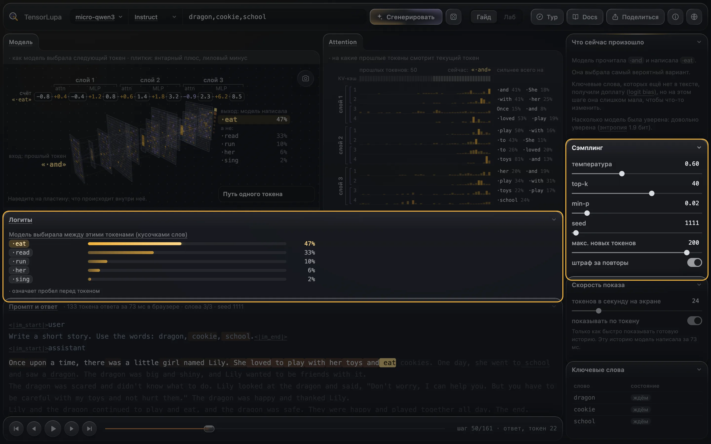

**Одной фразой:** температура (temperature) задаёт, насколько смелый выбор. Низкая почти всегда берёт самый вероятный токен,
высокая даёт неожиданные слова и больше ошибок.

## Что происходит внутри

На каждом шаге модель ставит каждому из 4096 известных ей токенов оценку, логит. Чтобы превратить оценки в шансы,
студия делит каждую оценку на температуру и применяет softmax.

- **Маленькая температура (0,2):** разрывы между оценками растут, и фаворит забирает ещё больше.
- **Большая температура (1,2):** разрывы сглаживаются, шансы выравниваются, и редкие токены получают реальный шанс.

Потом один токен вытягивается случайно, с учётом этих шансов. Температура не меняет то, что модель знает. Она
меняет только то, как взвешен жребий.

## Настоящий шаг

История к этому моменту: *«Once upon a time, there was a little girl named Lily. She loved to play with her toys
and»*. Это одни и те же оценки модели при трёх температурах, с top-k 40 и min-p 0,02, как в студии:

| Температура | eat | read | run | her | sing |
| --- | --- | --- | --- | --- | --- |
| 0,2 | 74% | 26% | 0% | 0% | 0% |
| **0,6** (по умолчанию) | **47%** | 33% | 10% | 6% | 2% |
| 1,2 | 21% | 17% | 9% | 7% | 4% |

При 0,6 модель на самом деле вытянула **eat**, фаворита, и история продолжилась словами «eat cookies». При 0,2
остаются только «eat» и «read»: остальные кандидаты так сильно отстают, что [min-p](../min-p/) их исключает. При 1,2 шансы
выравниваются, а токены за пределами первой пятёрки вместе забирают 41% шансов, и в текст начинают пробираться
странные слова.

## Где это в студии

Ползунок температуры первый в карточке **«Сэмплинг»**, и в Гайде, и в Лабе. Он идёт от 0,05 до 1,5, по умолчанию
0,6. Кандидаты, которые он перекраивает, в панели **«Логиты»**, под строкой «Модель выбирала между этими токенами».

Ползунок сразу пересчитывает историю с тем же seed, поэтому всё, что меняется, меняет именно температура. Учтите:
как только меняется один ранний токен, всё после него становится другой историей.

## Попробуйте

<a class="try-link" href="/ru/studio?w=dragon,cookie,school&seed=1111&s=49&q=8" target="_blank" rel="noopener">Открыть этот шаг в студии</a>

Потом двигайте ползунок температуры и смотрите, как столбики под «Модель выбирала между этими токенами» заостряются и выравниваются.

## В micro-qwen3

Мы выбрали 0,6, измерив по 300 историй на каждой температуре (100 заказов из трёх слов, которых модель не видела,
по 3 seed на каждый), с настройками студии по умолчанию: веса 8 бит, top-k 40, [min-p](../min-p/) 0,02 и включённый
[штраф за повторы](../repetition-penalty/):

| Температура | Заказанные слова на месте | Истории с выдуманным словом | История заканчивается сама | Разнообразие |
| --- | --- | --- | --- | --- |
| 0,5 | 99,7% | 1,0% | 84% | 0,707 |
| **0,6** | **99,8%** | **1,0%** | **85%** | **0,730** |
| 0,7 | 99,6% | 4,0% | 86% | 0,757 |
| 0,8 | 99,8% | 3,7% | 80% | 0,787 |
| 1,0 | 99,9% | 13,7% | 77% | 0,833 |

«Разнообразие» это доля разных фраз из четырёх слов по всем 300 историям. 0,6 это самая высокая температура, при
которой выдуманные слова остаются редкими: на шаг выше, при 0,7, историй с таким словом вчетверо больше, а при 1,0
это каждая седьмая история. Спуск до 0,5 ничего не даёт и делает истории более похожими друг на друга.

Раньше в этом выборе участвовали и повторы: без штрафа за повторы зацикливаются 22% историй при 0,5, 13% при 0,6
и ни одной при 1,0. Со штрафом петель от 0 до 1% при любой температуре, так что выбор теперь держится на выдуманных
словах и разнообразии.

## Немного истории

Название пришло из статистической физики. Softmax с температурой имеет тот же вид, что [распределение Больцмана](https://ru.wikipedia.org/wiki/Распределение_Больцмана), которое описывает, как частицы распределяются по состояниям с разной энергией: при высокой температуре все состояния почти равновероятны, при низкой побеждает состояние с наименьшей энергией. Языковые модели взяли и формулу, и слово.

## Связанные термины

- **Top-k** решает, сколько кандидатов вообще получают шанс; температура потом распределяет шансы между ними.
- **Seed** фиксирует случайный жребий: тот же seed и те же настройки дают ту же историю.
- **Логиты**: сырые оценки, которые температура делит.

## Источники

- [Распределение Больцмана](https://ru.wikipedia.org/wiki/Распределение_Больцмана). Википедия.
