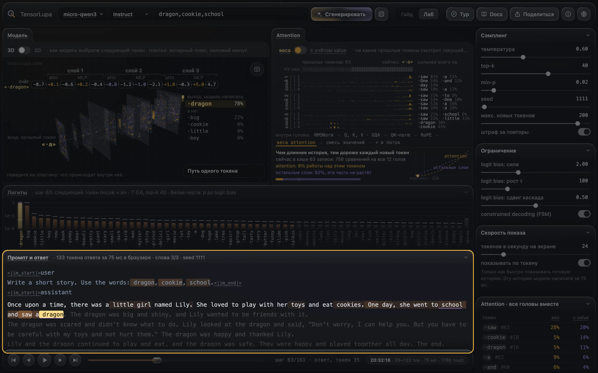

**Одной фразой:** токен (token) это кусочек текста, который модель читает и пишет: целое слово, часть слова или
знак. micro-qwen3 знает 4096 токенов.

## Почему не буквы и не слова

[Языковая модель](../language-model/) работает с фиксированным списком кусочков, своим словарём. С буквами любой
текст получался бы очень длинным. Целых слов понадобились бы сотни тысяч, и новые всё равно не попали бы в список.
Токены посередине: частые слова занимают один кусочек, редкие собираются из кусочков поменьше, и записать можно
любой текст.

Словарь составляется по обучающему тексту ещё до обучения самой модели. Кусочки, которые часто стоят рядом,
склеиваются в один токен, снова и снова, пока список не дорастёт до нужного размера. Этот метод называется
byte pair encoding (BPE).

## Как micro-qwen3 режет текст

Это настоящие разрезы, которые делает токенизатор модели. Каждая пара скобок это один токен. Пробел принадлежит
токену, который идёт после него.

| Текст | Токены |
| --- | --- |
| Once upon a time, a little dragon loved cookies. | `[Once][ upon][ a][ time][,][ a][ little][ dragon][ loved][ cookies][.]` (11) |
| The astronaut found a luxurious spaceship. | `[The][ a][st][ron][aut][ found][ a][ l][u][x][u][ri][ous][ space][sh][ip][.]` (17) |

Первое предложение написано языком детской истории, поэтому почти каждое слово в нём один токен. Во втором слова
редкие для детских историй: «astronaut» занимает четыре кусочка, а «luxurious» шесть. Словарь micro-qwen3
составлен по историям, поэтому на слова из историй он щедр, а на всё остальное скуп.

Поэтому [ключевые слова](../logit-bias/) в студии лучше всего работают с простыми словами: слово из одного токена
можно подтолкнуть за один шаг, а слово из шести кусочков приходится выводить по кусочку.

## Где это в студии

В панели **«Промпт и ответ»** каждый кусочек текста это один токен, а подсвеченный показывает текущий шаг. Плеер
двигается по одному токену, и счётчик шагов внизу считает токены, а не слова.

## Попробуйте

<a class="try-link" href="/ru/studio?w=dragon,cookie,school&seed=1111&s=62&q=8" target="_blank" rel="noopener">Открыть этот шаг в студии</a>

Пройдите историю по шагам и посмотрите, как короткие слова, пробелы и знаки препинания получают каждый свой шаг.

## В micro-qwen3

- В словаре 4096 токенов. Он составлен методом byte pair encoding, с теми же правилами деления на слова и
  пробелы, что у Qwen3.
- Несколько токенов служебные и никогда не выглядят как текст: `<|im_start|>` и `<|im_end|>` размечают части
  чата, а `<|endoftext|>` завершает текст. Их видно в [промпте](../prompt/).
- Большие модели устроены так же, только словари у них гораздо больше: у самой маленькой Qwen3
  ([Qwen3-0.6B-Base](https://huggingface.co/Qwen/Qwen3-0.6B-Base)) около 150 000 токенов.

## Немного истории

[Byte pair encoding](https://en.wikipedia.org/wiki/Byte_pair_encoding) начинался как алгоритм сжатия данных, его описал Филип Гейдж в 1994 году. В 2016 году [Рико Сеннрих с коллегами](https://arxiv.org/abs/1508.07909) приспособили его, чтобы делить редкие слова на кусочки в нейронном переводе. Потом [GPT-2](https://cdn.openai.com/better-language-models/language_models_are_unsupervised_multitask_learners.pdf) заставила его работать с сырыми байтами, так что закодировать можно любой текст. Большинство языковых моделей до сих пор пользуются одним из его вариантов.

## Дальше

[Промпт](../prompt/): что модель читает, прежде чем начать отвечать.

## Источники

- [Byte pair encoding](https://en.wikipedia.org/wiki/Byte_pair_encoding) (Philip Gage, 1994). Wikipedia.
- Rico Sennrich, Barry Haddow, Alexandra Birch (2015). [Neural Machine Translation of Rare Words with Subword Units](https://arxiv.org/abs/1508.07909). ACL 2016.
- Alec Radford et al. (2019). [Language Models are Unsupervised Multitask Learners](https://cdn.openai.com/better-language-models/language_models_are_unsupervised_multitask_learners.pdf). OpenAI.
- [Qwen3-0.6B-Base](https://huggingface.co/Qwen/Qwen3-0.6B-Base). Hugging Face.
