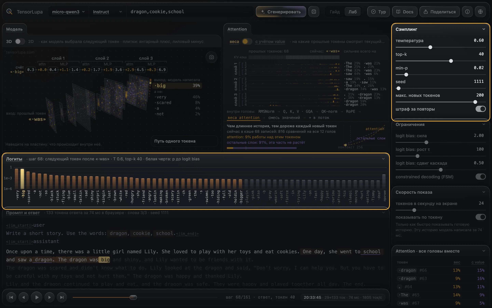

**Одной фразой:** top-k (K лучших) разрешает модели выбирать только среди K самых вероятных токенов, все остальные исключаются.

## Как это работает

На каждом шаге модель даёт каждому из 4096 [токенов](../token/) свой шанс (см. [логиты](../logits/)). Почти все эти
шансы крошечные, но длинный хвост в сумме не равен нулю, и взвешенный жребий всё же может попасть в него и выбрать
странное слово.

Top-k отрезает хвост до жребия:

1. Сортируем токены по шансу.
2. Оставляем K лучших, остальные отбрасываем.
3. Делим 100% между оставшимися K и [сэмплим](../sampling/) из них.

Top-k 1 оставляет только фаворита: это жадное декодирование, совсем без случайности. Большое K почти ничего не
меняет. Top-k работает вместе с [температурой](../temperature/): температура меняет форму шансов, а top-k решает, кто
вообще участвует.

## Настоящий шаг

Демо-история на *«The dragon was»* (seed 1111, температура 0,6). Это шансы по всему словарю, до любого отсечения:

| Top-k | Доля шанса внутри | Исключено |
| --- | --- | --- |
| 1 | 41,6% (только «very») | 58,4% |
| 5 | 89,7% | 10,3% |
| 10 | 93,7% | 6,3% |
| **40** (по умолчанию) | **98,2%** | **1,8%** |
| 64 | 98,9% | 1,1% |

При top-k 40 оставшиеся 40 токенов пересчитываются с 98,2% до 100%, а [min-p](../min-p/) 0,02, который студия
применяет после top-k, отбрасывает и самых слабых из них. Поэтому студия показывает «very» с 45,6%, а не с 41,6%.

Отсечение меняет жребий, а значит и историю. С тем же seed и остальными настройками по умолчанию:

- **top-k 1:** *«…The dragon was very big and had a long tail.»* (всегда фаворит)
- **top-k 5:** *«…The dragon was big and shiny, and Lily wanted to be friends with it. When she got to school…»*
- **top-k 40 и top-k 64:** *«…The dragon was big and shiny, and Lily wanted to be friends with it. The dragon was
  scared and didn't know what to do.»* (оба раза одна и та же история)

Во всей демо-истории токены за пределами первых 40 в среднем держали лишь 0,14% шанса, а за пределами первых 5
около 3,4%. Только 3 из 133 выпавших токенов пришли из-за первых 5.

## Где это в студии

Ползунок **top-k** второй в карточке **«Сэмплинг»**, и в Гайде, и в Лабе. Он идёт от 1 до 64, по умолчанию 40. В Лабе
панель «Логиты» закрашивает серым кандидатов, которые оказались за пределами top-k.

## Попробуйте

<a class="try-link" href="/ru/studio?w=dragon,cookie,school&seed=1111&s=67&q=8" target="_blank" rel="noopener">Открыть этот шаг в студии</a>

Опустите top-k до 1 и верните к 40, и смотрите, как история переключается между «very big and had a long tail» и «big and shiny».

## В micro-qwen3

Мы измерили top-k 10, 20, 40 и 64, по 300 историй на каждый (100 заказов из трёх слов, которых модель не видела,
по 3 seed на каждый), с настройками студии по умолчанию: веса 8 бит, [температура](../temperature/) 0,6,
[min-p](../min-p/) 0,02 и включённый [штраф за повторы](../repetition-penalty/):

| Top-k | Заказанные слова на месте | Истории с выдуманным словом | История заканчивается сама | Разнообразие |
| --- | --- | --- | --- | --- |
| 10 | 99,7% | 3,3% | 82% | 0,731 |
| 20 | 99,9% | 1,0% | 83% | 0,730 |
| **40** | **99,8%** | **1,0%** | **85%** | **0,730** |
| 64 | 99,8% | 1,0% | 84% | 0,729 |

От 20 до 64 он почти ничего не меняет: после [обучения по инструкциям](../instruct/) настоящий выбор на шаге всё
равно идёт среди немногих токенов, от 3 до 5, а хвост, который отрезал бы top-k, уже убирает min-p. При top-k 10
историй с выдуманным словом было больше, 10 против 3 из 300; этого мало, чтобы утверждать, что тесный top-k вредит,
но он явно не помогает. Температура влияет намного сильнее.

Но одного top-k 40 как страховки мало: жребий из хвоста на каждом шаге редок, а на всю историю нет, и именно так
начинаются выдуманные слова вроде «Byican». Без min-p выдуманное слово есть в 2,7% историй вместо 1,0%.

## Немного истории

Top-k сэмплинг для нейросетевого текста популяризировали
[Фан, Льюис и Дофин в 2018 году](https://arxiv.org/abs/1805.04833), которые использовали его, чтобы писать истории.
Через год [Хольцман с коллегами](https://arxiv.org/abs/1904.09751) предложили nucleus (top-p) сэмплинг: он оставляет
не фиксированное число токенов, а наименьший набор, который вместе держит выбранную долю шанса.

## Связанные термины

- [Сэмплинг](../sampling/): жребий, который ограничивает top-k.
- [Температура](../temperature/): меняет форму шансов у оставшихся кандидатов.
- [Seed](../seed/): фиксирует случайные числа жребия.
- [Min-p](../min-p/): отсекает хвост относительно фаворита, после top-k.

## Источники

- Angela Fan, Mike Lewis, Yann Dauphin (2018). [Hierarchical Neural Story Generation](https://arxiv.org/abs/1805.04833).
- Ari Holtzman et al. (2019). [The Curious Case of Neural Text Degeneration](https://arxiv.org/abs/1904.09751).
