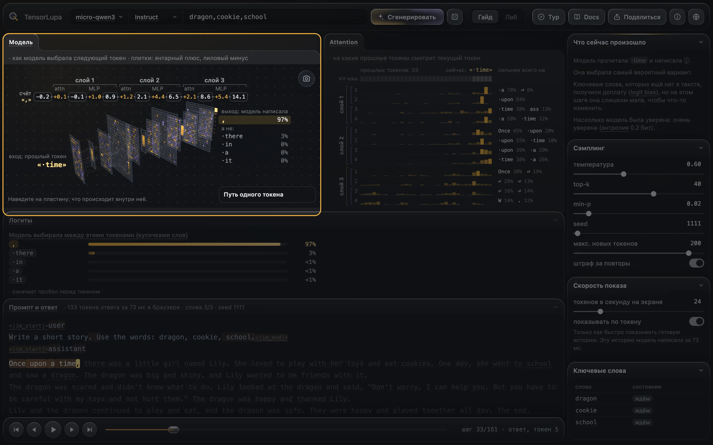

**Одной фразой:** трансформер (transformer) превращает каждый [токен](../token/) в список чисел, пропускает его
через слои [attention](../attention/) и [MLP](../mlp/), а в конце ставит оценку каждому возможному следующему токену.

## Что происходит на одном шаге

На каждом шаге [языковая модель](../language-model/) один раз прогоняет один и тот же конвейер, слева направо:

1. **Эмбеддинг.** Текущий токен превращается в список из 112 чисел. Этот список и есть [остаточный поток](../residual-stream/)
   токена, и всё дальнейшее работает с ним.
2. **Слои.** Поток проходит через три слоя. В каждом слое две части:
   - **[Attention](../attention/)** оглядывается на прежние токены и приносит из них то, что важно.
   - **[MLP](../mlp/)** реагирует на шаблоны в потоке и подталкивает одни следующие слова вверх, другие вниз.

   Ни одна из частей не заменяет поток. Каждая добавляет свой вклад сверху, так что поток хранит всё, что было до
   этого.
3. **Выход.** Итоговый поток сравнивается с каждым токеном словаря. Получается по одной оценке на токен, то есть
   [логиты](../logits/), и по ним вытягивается один токен ([сэмплинг](../sampling/)).

Для каждого токена работают одни и те же слои с одними и теми же весами. От шага к шагу меняется только текст, на
который они смотрят.

## Как складывается догадка, слой за слоем

Поток в середине модели можно прочитать так, будто это её конец. Этот приём называется
[logit lens](../logit-lens/), и он показывает, как формируется предсказание. Вот шаг сразу после
*«Once upon a time»* в демо-истории, с главными кандидатами после каждой части (оценки при температуре 1, до
[top-k](../top-k/) и до [logit bias](../logit-bias/) для ключевых слов):

| Читаем поток после | Главные кандидаты |
| --- | --- |
| эмбеддинга | time 100% |
| слоя 1 | time 16,3%, waited 2,9%, wait 2,8% |
| слоя 2 | **,** 59,1%, **there** 35,4% |
| слоя 3 (выход) | **,** 88,1%, **there** 11,7% |

Сразу после эмбеддинга поток «знает» только слово, которым он является: time. После первого слоя он всё ещё про
это слово, но уже не уверен: у «time» остаётся 16,3%. Второй слой приносит контекст, и появляются два настоящих
кандидата: запятая или «there». Третий слой заостряет выбор. В истории модель написала запятую.

Слои не всегда выстраивают догадку постепенно. После *«Once upon»* поток после слоя 2 указывает на «night»
17,6%, «a» 8,8% и «moment» 6,0%, и только третий слой останавливается на «a» с 99,9%.

## Где это в студии

Панель **«Модель»** рисует весь конвейер в 3D. Токен входит слева как пластина эмбеддинга, проходит пластины трёх
слоёв, а предсказание выходит справа. Строка над моделью хранит счёт написанного токена: для каждого слоя она
читается как «счёт, +attention, счёт, +MLP, счёт». В Лабе можно щёлкнуть любую пластину и увидеть её значения и то,
что модель сказала бы в этой точке.

## Попробуйте

<a class="try-link" href="/ru/studio?w=dragon,cookie,school&seed=1111&s=32&q=8" target="_blank" rel="noopener">Открыть этот шаг в студии</a>

Покрутите модель мышью, потом переключитесь в Лаб и щёлкайте пластины после каждого слоя, чтобы проследить, как
догадка идёт от «time» к запятой.

## В micro-qwen3

micro-qwen3 это маленькая копия архитектуры [Qwen3](https://arxiv.org/abs/2505.09388):

- 3 слоя, поток из 112 чисел на токен, словарь из 4096 токенов, всего 1 056 656 параметров.
- Attention с 4 головами запросов, которые делят 2 головы ключей и значений ([grouped-query attention](https://arxiv.org/abs/2305.13245)), каждая голова работает с 64
  числами.
- MLP с 336 нейронами на слой и активацией [SwiGLU](https://arxiv.org/abs/2002.05202).
- [RMSNorm](https://arxiv.org/abs/1910.07467) перед каждой частью, QK-norm внутри attention и [поворотное кодирование позиции (RoPE)](https://arxiv.org/abs/2104.09864), чтобы модель знала
  порядок токенов. За один раз она читает не больше 256 токенов.

Большие модели используют те же части в том же порядке. У них просто гораздо больше слоёв и гораздо более длинные
потоки.

## Немного истории

Трансформер представили в 2017 году Васвани с коллегами из Google в статье ["Attention Is All You
Need"](https://arxiv.org/abs/1706.03762), для перевода текста. Он отказался от пошаговых рекуррентных сетей, которые использовались раньше, и опирался только на
attention. Почти каждая большая языковая модель с тех пор, включая Qwen3, это трансформер.

## Дальше

[Эмбеддинг и остаточный поток](../residual-stream/): список чисел, в который превращается токен, и как каждый слой
добавляет к нему своё.

## Источники

- Ashish Vaswani et al. (2017). [Attention Is All You Need](https://arxiv.org/abs/1706.03762). arXiv.
- An Yang et al. (2025). [Qwen3 Technical Report](https://arxiv.org/abs/2505.09388). arXiv.
- Joshua Ainslie et al. (2023). [GQA: Training Generalized Multi-Query Transformer Models from Multi-Head Checkpoints](https://arxiv.org/abs/2305.13245). arXiv.
- Noam Shazeer (2020). [GLU Variants Improve Transformer](https://arxiv.org/abs/2002.05202). arXiv.
- Biao Zhang, Rico Sennrich (2019). [Root Mean Square Layer Normalization](https://arxiv.org/abs/1910.07467). arXiv.
- Jianlin Su et al. (2021). [RoFormer: Enhanced Transformer with Rotary Position Embedding](https://arxiv.org/abs/2104.09864). arXiv.
